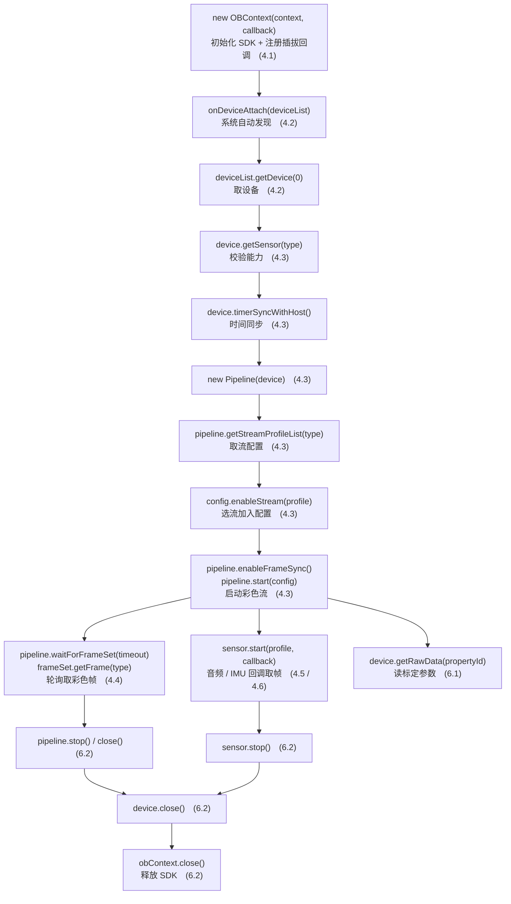
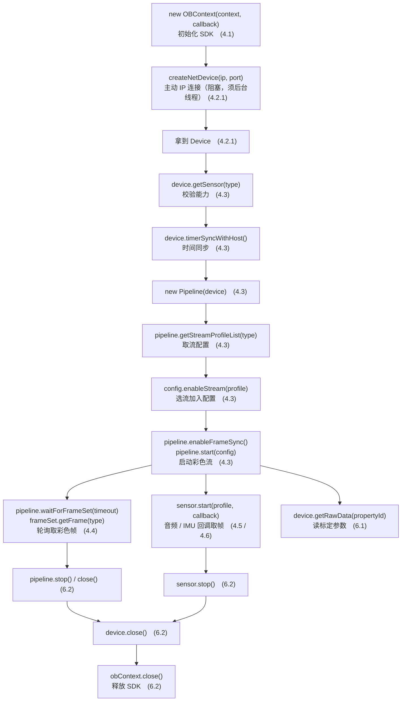
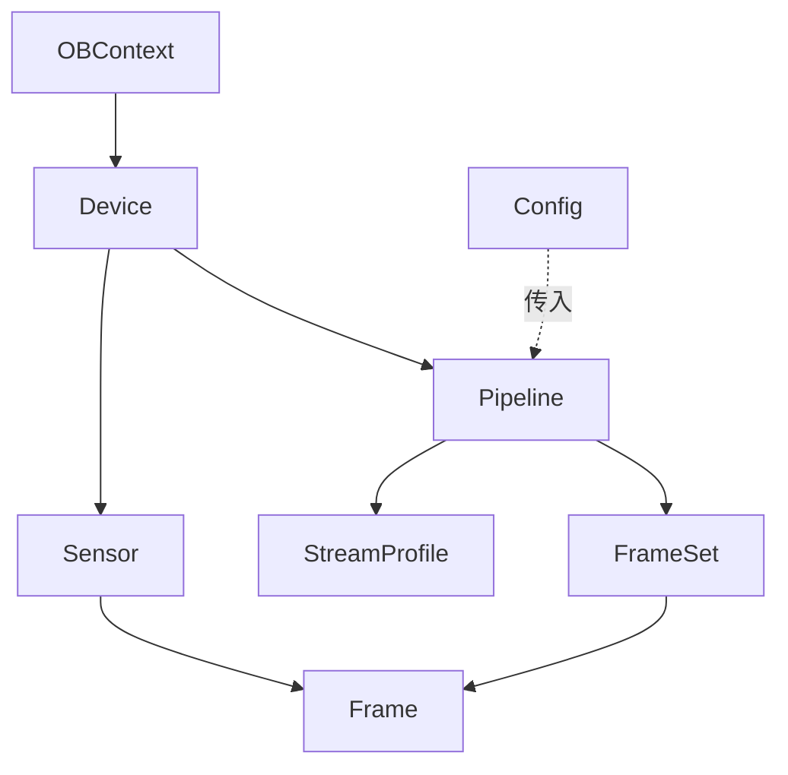
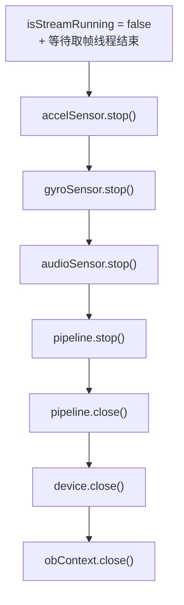

# Ego 双目相机 Android SDK 接入指南（USB / 网络）

> 本文面向将 Ego 接入 Android App 的开发人员。按本文完成后，应用可发现或连接设备，采集**左/右彩色（H264）**、**音频（PCM）**和 **IMU（加速度/陀螺仪）** 数据，并安全处理拔插、断网和页面退出。
>
> **建议首次接入按第 2 章完成一次“最小验证”，确认能稳定拿到左彩色帧后，再按第 4 章逐项加入右彩色、音频、IMU、标定、录制或升级功能。** 不建议一开始同时接入全部能力；这样出现问题时很难区分是连接、权限、开流还是数据处理导致。
>
> **Ego 支持两种接入方式，请先建立统一心智模型：**
>
> | 接入方式 | 如何拿到 `Device` | 特点 |
> |---------|------------------|------|
> | **USB 直连** | 插拔回调里的 `DeviceList.getDevice(i)` | 即插即用、系统自动发现（本文主线，见 4.1 / 4.2） |
> | **IP 网络** | `OBContext.createNetDevice(ip, port)` 直接返回 | 主动以 IP+端口连接（**阻塞**，须后台线程，见 4.2.1） |
>
> ⭐ **关键点：两种方式的主要区别在「设备从哪来」。** 一旦拿到 `Device` 对象，
> 后续的所有流程（开流、取帧、音频、IMU、标定、释放）**共用同一套 API 主干**；
> 但具体 profile 选择可能不同，例如 USB 彩色流通常选 60fps，网络设备通常选 30fps。
> **固件升级是例外：仅支持 USB 直连设备，不支持通过 `createNetDevice` 获取的网络设备。**
> 因此本文以 **USB 为主线**讲解全部共用流程，并在「**4.2.1**」专门说明网络设备在「获取 Device」这一步的差异。
>
> - 本文以 **SDK API 调用主干**为中心；Android 生命周期、UI 更新、运行时权限和并发释放由应用负责。第 2.2、4.2、4.2.1 及第 8 章已明确列出必须处理的边界，不能省略。
> - 代码片段为**教学精简版**，只保留 SDK 调用主干。
> - 完整可运行代码请参考随包示例 `EgoSampleActivity`（USB）与 `EgoSampleNetActivity`（网络），详见文末「8. 完整示例参考」。

---

## 目录

1. [概述与能力清单](#1-概述与能力清单)
2. [快速开始（5 分钟跑通一路预览）](#2-快速开始5-分钟跑通一路预览)
3. [核心概念](#3-核心概念)
4. [视频、音频与 IMU 采集流程](#4-视频音频与-imu-采集流程)
5. [设备端 SD 卡录制与存储设置](#5-设备端-sd-卡录制与存储设置)
6. [标定参数与资源释放](#6-标定参数与资源释放)
7. [API 速查表](#7-api-速查表)
8. [完整示例参考](#8-完整示例参考)
9. [EGO 状态监控](#9-ego-状态监控)
10. [HID 方向键事件](#10-hid-方向键事件)
11. [EGO 固件升级](#11-ego-固件升级)
12. [EGO 固件日志导出](#12-ego-固件日志导出)
13. [EGO 音频播放](#13-ego-音频播放)
14. [蓝牙配对与 Wi-Fi 配置清理](#14-蓝牙配对与-wi-fi-配置清理)
15. [SDK 错误码捕获与处理](#15-sdk-错误码捕获与处理)

---

## 1. 概述与能力清单

### 1.1 先确认你的接入路径

| 你的场景 | 应从哪里开始 | 必须满足的条件 | 暂不支持 / 注意事项 |
|---------|--------------|----------------|--------------------|
| USB 直连 Android 设备 | 2.1 → 2.2 → 4.1 → 4.2 | Android 设备支持 USB Host（OTG）；用户已在系统弹窗中授权 USB 访问 | 设备拔出后，旧 `Device` 句柄立即失效，必须重新从回调获取 |
| IP 网络连接 | 2.1 → 2.2 → 4.1 → 4.2.1 | Android 设备与 Ego 在可达网络；已获知设备 IP；端口固定为 `8090` | `createNetDevice` 会阻塞，严禁在主线程调用；不支持网络升级 |
| 固件升级 | 第 11 章 | **USB 直连**、固件文件与设备型号匹配、升级过程供电稳定 | 不可使用网络 `Device` 升级；升级期间不可拔线或关闭应用 |
| 导出固件日志 | 第 12 章 | 已连接且设备支持该能力；准备 App 可写的独立输出目录 | 同一设备同一时间只能运行一个导出任务 |

### 1.2 接入前检查清单

在写业务代码前，请逐项确认。任一项不满足时，后续“无设备”“开流失败”或“无数据”都可能只是表象。

- 已取得与设备/固件匹配的 SDK AAR，并确认 SDK 要求的 `minSdkVersion` 不高于 App 配置的 `minSdkVersion`。
- USB 场景：Android 设备支持 OTG/USB Host，数据线具备数据传输能力，设备供电充足；首次连接时已允许系统 USB 授权弹窗。
- 网络场景：手机/平板与 Ego 可相互访问，IP 地址正确，端口使用 `8090`；连接与开流均安排在工作线程。
- 已在 Manifest 中声明第 2.2 节所需权限；涉及存储时，使用 App 可写目录并按 Android 版本处理运行时权限/分区存储。
- 已确定 H264 帧的消费方案（硬件/软件解码、预览或落盘）。SDK 输出的是**编码后的 H264 帧**，不是可直接绘制的 RGB 图像。
- 已设计唯一的设备工作线程或串行队列，统一执行开流、停流和释放；不要让 UI、插拔回调和后台任务同时关闭同一个对象。

### 1.3 推荐的实施与验收顺序

| 阶段 | 只做什么 | 完成标准 | 失败时优先检查 |
|------|----------|----------|----------------|
| 1. 工程接入 | 引入 AAR、同步工程、声明权限 | App 编译安装成功，SDK 类可正常导入 | AAR 文件位置、Gradle 依赖、ABI 与 `minSdkVersion` |
| 2. 发现/连接 | USB 插拔回调或网络连接 | 成功取得非空 `Device`，可打印 `DeviceInfo` | USB 授权/OTG；IP、网络可达性、后台线程 |
| 3. 单路视频 | 仅启动左彩色并轮询取帧 | 持续取得非空 `FrameSet` 和左彩色 `Frame` | 设备实际支持的 H264 profile、USB 链路、释放时机 |
| 4. 双目与解码 | 加入右彩色并接入 H264 解码/显示 | 两路画面稳定，分辨率/帧率与所选 profile 一致 | 不要硬编码 profile；每帧和 profile 都要释放 |
| 5. 可选能力 | 逐项加入音频、IMU、标定、录制等 | 每增加一项都能独立验证并可正常停止 | Sensor 与 Pipeline 的分工、回调耗时、线程串行化 |
| 6. 异常场景 | 拔插、断网、页面退出、重复进入 | 不崩溃、不复用旧句柄，能再次连接 | 按 6.2 的顺序停止并做到幂等 |

SDK 支持在一台 Ego 相机上**五类数据流的同时采集**：

| 数据流 | 传感器类型 | 格式 | 取流方式 | 对应 API 入口 |
|--------|-----------|------|---------|--------------|
| 左彩色 | `COLOR_LEFT` | H264（USB 60fps / 网络 30fps） | Pipeline | `Pipeline.waitForFrameSet` |
| 右彩色 | `COLOR_RIGHT` | H264（USB 60fps / 网络 30fps） | Pipeline | `Pipeline.waitForFrameSet` |
| 音频 | `AUDIO` | PCM | Sensor 直连 | `Sensor.start(profile, callback)` |
| 加速度计 | `ACCEL` | float[3] (x,y,z) | Sensor 直连 | `Sensor.start(profile, callback)` |
| 陀螺仪 | `GYRO` | float[3] (x,y,z) | Sensor 直连 | `Sensor.start(profile, callback)` |
| SD 卡固件录制配置 | Color / Depth / IR / IMU 等 | Profile 列表 | Device | `Device.setFwRecordProfileList(...)` |
| 标定参数 | — | YAML | 设备属性 | `Device.getRawData(propertyId)` |

**API 调用流程：**

下图按调用时序展示接入 Ego 设备涉及的核心 API。USB 与网络的完整流程分别绘制，方便对照阅读。

#### 图 A：USB 直连设备接入流程



> USB 主线：`new OBContext → onDeviceAttach → getDevice → new Pipeline → start → 取帧 → stop/close`。
> 彩色走 Pipeline（分支 J），音频/IMU 走 Sensor 直连（K），标定用 getRawData（L）。
> 每个节点括号内为对应的详解章节号。

#### 图 B：IP 网络设备接入流程



> 网络主线：`new OBContext → createNetDevice → 拿到 Device → new Pipeline → start → 取帧 → stop/close`。
> 与 USB 流程的主要差异在「获取 Device」这一步（B2→C2）；拿到 `Device` 后 API 主干一致，
> 但开流时仍需按设备实际支持的 profile 选择参数（例如 USB 60fps、网络 30fps）。
> 彩色走 Pipeline（分支 J），音频/IMU 走 Sensor 直连（K），标定用 getRawData（L）。
> 每个节点括号内为对应的详解章节号。

---

## 2. 快速开始（5 分钟跑通一路预览）

### 2.1 引入 AAR 依赖

SDK 以 Android AAR 形式发布，包内已包含 Java 接口、JNI 层与 Native 动态库。以发布包 `obsensor_v2.0.9_2026071301_release.aar` 为例，三步即可接入：

1. **放入 libs 目录**：将 AAR 拷到你的 App 模块 `app/libs/` 下（没有则新建）。

   ```
   app/
   └── libs/
       └── obsensor_v2.0.9_2026071301_release.aar
   ```

2. **声明依赖**：在 App 模块的 `build.gradle` 的 `dependencies` 块中，用 `fileTree` 直接引用 `libs` 下所有 AAR（推荐，无需关心具体版本号）：

   ```gradle
   dependencies {
       // 自动引入 libs 目录下的全部 .aar（含 obsensor SDK）
       implementation fileTree(dir: "libs", include: ["*.aar"])
   }
   ```

   如需按文件名精确引入，也可改用 `flatDir` 写法（注意 `name` 不含 `.aar` 后缀）：

   ```gradle
   repositories {
       flatDir { dirs 'libs' }
   }
   dependencies {
       implementation(name: 'obsensor_v2.0.9_2026071301_release', ext: 'aar')
   }
   ```

3. **同步工程**：点击 Android Studio 的 **Sync Project with Gradle Files**。同步成功后按需引入 SDK 类与枚举：

   ```java
   import com.orbbec.obsensor.*;
   import com.orbbec.obsensor.types.*;
   import com.orbbec.obsensor.property.DeviceProperty;
   ```

   > `SensorType`、`FrameType`、`DeviceInfo`、`Format` 等在 `com.orbbec.obsensor.types` 子包，
   > `DeviceProperty` 在 `com.orbbec.obsensor.property` 子包；Java 的 `import com.orbbec.obsensor.*;` 不会自动包含子包。

> 外部 App 集成时推荐按上面的 AAR 方式接入。当前源码仓库内的 `OrbbecSdkJavaExamples` 为了便于调试，
> 会优先依赖源码模块 `:obsensor_jni`，并排除 `obsensor_*.aar`；正式随包示例或独立 App 可直接使用 `fileTree(dir: "libs", include: ["*.aar"])` 引入 AAR。

### 2.2 依赖与权限

在 `AndroidManifest.xml` 声明必要权限（USB 相机、存储；网络设备需额外加网络权限）：

```xml
<!-- USB / 网络共用 -->
<uses-permission android:name="android.permission.CAMERA" />
<uses-permission android:name="android.permission.WRITE_EXTERNAL_STORAGE" />

<!-- USB 直连必需 -->
<uses-feature android:name="android.hardware.usb.host" />

<!-- IP 网络设备必需（createNetDevice） -->
<uses-permission android:name="android.permission.INTERNET" />
<uses-permission android:name="android.permission.ACCESS_NETWORK_STATE" />
<uses-permission android:name="android.permission.ACCESS_WIFI_STATE" />
```

> `WRITE_EXTERNAL_STORAGE` 主要用于兼容旧版示例落盘逻辑。若你的目标 Android 版本较新，
> 建议按系统要求使用 App 专属目录、MediaStore 或运行时权限模型管理文件写入。

权限声明不等于已经获得权限。请按下表确定应用是否还需要在运行时向用户申请，或改用无需存储权限的 App 专属目录。

| 能力 | Manifest 声明 | 运行时 / 系统侧还需处理什么 |
|------|---------------|-----------------------------|
| USB 直连 | `android.hardware.usb.host`（feature） | `uses-feature` 只声明硬件能力，不会授权设备访问；SDK 发现未授权设备时会发起 Android USB 授权请求，用户允许后才会进入设备接入回调。 |
| 网络连接 | `INTERNET`、`ACCESS_NETWORK_STATE`、`ACCESS_WIFI_STATE` | 这些是普通权限，通常不弹窗；仍须处理网络不可达、IP 错误和连接超时。 |
| 写采集文件/日志 | 视 Android 版本声明存储权限 | 新版 Android 优先使用 `context.getExternalFilesDir(...)` 等 App 专属目录；不要假设 `WRITE_EXTERNAL_STORAGE` 在所有版本都可写任意路径。 |
| 相机相关能力 | `CAMERA` | 若你的 App 自身也使用 Android Camera API，需按 Android 规则运行时申请；Ego SDK 的 USB 访问仍以 USB 授权为准。 |

### 2.3 最小骨架

一个最小接入只需 4 步：**初始化 → 监听接入 → 开流 → 取帧**。下面是以 **SDK API 调用主干** 组织的最小示例（仅开一路左彩色，不含 Android 生命周期/UI 线程，集成时按需放入你的宿主组件）：

```java
// 1. 初始化 SDK，并注册设备插拔回调
OBContext obContext = new OBContext(context, new DeviceChangedCallback() {
    @Override
    public void onDeviceAttach(DeviceList deviceList) {
        try {
            if (mDevice == null) {
                // 单设备场景直接取第 0 台；接多台时需按 UID / 序列号 / PID 等自行筛选，
                // 例如 deviceList.getDeviceSerialNumber(i)、deviceList.getUid(i)
                mDevice = deviceList.getDevice(0);   // 取第一台设备
                openStream();                          // 此处按你的宿主环境自行调度（如切到工作线程）
            }
        } finally {
            deviceList.close();                      // 用完立即释放列表
        }
    }

    @Override
    public void onDeviceDetach(DeviceList deviceList) {
        deviceList.close();
    }
});

// 2. 开流：创建 Pipeline，开一路左彩色
void openStream() {
    mPipeline = new Pipeline(mDevice);
    Config config = new Config();
    config.enableStream(SensorType.COLOR_LEFT);      // 以默认配置开一路左彩色
    mPipeline.start(config);
    config.close();
}

// 3. 取帧：在独立工作线程中循环轮询
void frameLoop() {
    while (running) {
        try (FrameSet frameSet = mPipeline.waitForFrameSet(100)) {  // 超时返回 null
            if (frameSet == null) {
                continue;
            }
            Frame frame = frameSet.getFrame(FrameType.COLOR_LEFT);
            if (frame != null) {
                // TODO: 解码 / 处理 frame
                frame.close();                   // 每帧用完必须 close
            }
        } catch (Exception e) {
            // 按你的应用自行处理异常 / 日志
        }
    }
}

// 4. 释放（顺序：停 Pipeline → 关设备 → 关上下文；详见 6.2）
void release() {
    if (mPipeline != null) {
        mPipeline.stop();
        mPipeline.close();
    }
    if (mDevice != null) {
        mDevice.close();
    }
    if (obContext != null) {
        obContext.close();
    }
}
```

> ⚠️ 上例是**理解调用顺序**用的最小骨架，仅开一路流、省略了能力校验与并发防护。
> 完整可运行的双目 + 音频 + IMU + 采集落盘实现，请参考文末「8. 完整示例参考」。

### 2.4 最小验证：看到这 4 个结果才进入下一步

首次调通时，请在日志中逐项确认，而不是仅以“不报错”作为成功标准：

1. `onDeviceAttach`（USB）被回调，或 `createNetDevice`（网络）返回非空 `Device`。
2. `device.getInfo()` 可读取到设备信息；网络设备可确认 `getConnectionType()` 为 `Ethernet`。
3. `pipeline.start(config)` 正常返回，且取帧循环持续拿到非空 `FrameSet`。
4. `frameSet.getFrame(FrameType.COLOR_LEFT)` 持续非空，打印的 `format`、宽高和 FPS 与所选 profile 一致。

第 4 项成立只代表 **SDK 已经输出 H264 码流**。要看到画面，应用还必须将 H264 数据交给正确配置的解码器；若帧已持续到达但画面异常，应优先排查解码器输入、关键帧处理和 USB 链路，而非重复初始化 SDK。

---

## 3. 核心概念

### 3.1 对象模型

| 对象 | 作用 | 获取方式 |
|------|------|---------|
| `OBContext` | SDK 全局入口，**一个进程仅一个实例** | `new OBContext(...)` |
| `Device` | 一台物理设备 | 从 `DeviceList.getDevice(i)` 获取（单设备取 0，多设备按 UID/序列号筛选） |
| `Sensor` | 设备上的一个传感器（彩色/音频/IMU 等） | `Device.getSensor(type)` |
| `Pipeline` | 多路视频流的**同步管理器** | `new Pipeline(device)` |
| `Config` | 描述"要开哪些流、什么参数" | `new Config()` |
| `StreamProfile` | 一路流的具体配置（分辨率/帧率/格式） | 从 `StreamProfileList.getProfile(i)` 获取 |
| `Frame` / `FrameSet` | 单帧数据 / 一组同步帧 | 从流回调或 `waitForFrameSet` 获取 |

各对象的归属关系（谁由谁创建/获取）：



> `OBContext` 是根入口；`Device` 从中获取；`Sensor` 与 `Pipeline` 都由 `Device` 派生；
> `Config` 描述要开的流、传给 `Pipeline.start()`；帧数据从 `Pipeline`（FrameSet）或 `Sensor`（Frame 回调）产出。

### 3.2 两种取流模型

- **Pipeline 模型**——用于**需要相互同步**的多路视频流（左/右彩色）。
  Pipeline 内部把同一时刻的多路帧打包成一个 `FrameSet`，你用 `waitForFrameSet` 轮询取出。

- **Sensor 直连模型**——用于**独立、高频**的流（音频、加速度、陀螺仪）。
  直接 `Sensor.start(profile, callback)`，每来一帧回调一次，不进 Pipeline。

> 一台设备上，Pipeline 与 Sensor 直连**可以并存**（范例即如此），
> 但**同一个传感器**不能既被 Pipeline 使用又被 Sensor 直连使用。

---

## 4. 视频、音频与 IMU 采集流程

> 以下各小节按调用时序排列，逐段讲解 SDK API 的调用方式（代码片段已剥离宿主层逻辑，只保留 SDK 调用主干）。

### 4.1 初始化 SDK

创建全局唯一的 `OBContext`，并注册设备插拔回调。

```java
void initSDK() {
    try {
        // (1) 设置日志等级（静态方法，全局生效）
        OBContext.setLoggerSeverity(LogSeverity.DEBUG);

        // (2) 准备设备插拔回调
        DeviceChangedCallback deviceChangedCallback = new DeviceChangedCallback() {
            @Override
            public void onDeviceAttach(DeviceList deviceList) { /* 见 4.2 */ }
            @Override
            public void onDeviceDetach(DeviceList deviceList) { /* 见 4.2 */ }
        };

        // (3) 创建 SDK 上下文。若存在 XML 配置文件则用带 configPath 的重载，否则用普通重载。
        //     context 为 Android Context（Application/Activity 等均可传入）
        String configFilePath = ...;   // 可能返回 null
        if (configFilePath != null && !configFilePath.isEmpty()) {
            obContext = new OBContext(context, configFilePath, deviceChangedCallback);
        } else {
            obContext = new OBContext(context, deviceChangedCallback);
        }

        // (4) 可选：指定 UVC 后端类型。该接口底层主要用于 Linux 平台；
        //     Android Java 接入通常无需设置，只有在底层明确要求切换 UVC 后端时再调用。
        //     网络设备（createNetDevice，走 TCP）不需要、也不会使用该设置。
        // obContext.setUvcBackendType(UvcBackendType.OB_UVC_BACKEND_TYPE_LIBUVC);
    } catch (OBException e) {
        // 按你的应用自行处理异常 / 日志
    }
}
```

| API | 说明 |
|-----|------|
| `static void setLoggerSeverity(LogSeverity)` | 设置全局日志等级 |
| `static void setLoggerToFile(LogSeverity, String directory)` | 设置日志等级并将 SDK 日志写入指定目录 |
| `OBContext(Context, DeviceChangedCallback)` | 创建 SDK 上下文，注册插拔回调 |
| `OBContext(Context, String configPath, DeviceChangedCallback)` | 同上，额外指定 XML 配置文件 |
| `void setUvcBackendType(UvcBackendType)` | 可选：指定 UVC 后端类型；底层主要用于 Linux 平台，Android Java 接入通常无需设置，网络设备无需关注 |

> 💡 `OBContext` 全进程仅一个实例，请勿重复创建。

#### 自定义 SDK 日志输出目录

如需将 SDK 的文件日志保存到客户指定的目录，请在创建 `OBContext` **之前**调用
`OBContext.setLoggerToFile`。该配置为静态全局配置；第二个参数传入的是**目录**，不是日志文件完整路径。

Android 10 及以上建议使用应用专属外部存储目录，无需申请额外存储权限： 

```java
import java.io.File;

import com.orbbec.obsensor.LogSeverity;
import com.orbbec.obsensor.OBContext;

void initSDK() {
    // 最终路径：/Android/data/<package-name>/files/orbbec_logs
    File appExternalDir = getExternalFilesDir(null);
    if (appExternalDir == null) {
        throw new IllegalStateException("App external storage is unavailable");
    }
    File logDirectory = new File(appExternalDir, "orbbec_logs");
    if (!logDirectory.exists() && !logDirectory.mkdirs()) {
        throw new IllegalStateException("Cannot create SDK log directory: "
                + logDirectory.getAbsolutePath());
    }

    // 必须在 new OBContext(...) 前调用；DEBUG 可按需改为 INFO / WARN / ERROR。
    OBContext.setLoggerToFile(LogSeverity.DEBUG, logDirectory.getAbsolutePath());

    OBContext obContext = new OBContext(this, deviceChangedCallback);
}
```

若同时希望 Logcat 也有输出，可额外调用
`OBContext.setLoggerToConsole(LogSeverity.DEBUG)`。调用 `setLoggerSeverity` 只会调整已配置输出的全局等级，
不会替代 `setLoggerToFile` 启用文件日志。

### 4.2 监听设备插拔

回调运行在 SDK 自己的线程。下面是处理插拔回调的 SDK 调用主干（UI 提示、线程切换、销毁协同等宿主层逻辑由你自行处理）：

```java
DeviceChangedCallback deviceChangedCallback = new DeviceChangedCallback() {
    @Override
    public void onDeviceAttach(DeviceList deviceList) {
        try {
            if (mDevice == null) {
                mDevice = deviceList.getDevice(0);   // 取第一台设备
                // 能力校验：不支持左/右彩色则放弃
                if (mDevice.getSensor(SensorType.COLOR_LEFT) == null) {
                    // 提示用户：设备不支持左彩色（按你的应用自行处理）
                    releaseDevice();
                    return;
                }
                if (mDevice.getSensor(SensorType.COLOR_RIGHT) == null) {
                    // 提示用户：设备不支持右彩色
                    releaseDevice();
                    return;
                }
                openStream();   // 开流（见 4.3，注意切到合适的工作线程）
            }
        } catch (Exception e) {
            // 按你的应用自行处理异常 / 日志
        } finally {
            deviceList.close();   // 无论成功与否都要释放列表
        }
    }

    @Override
    public void onDeviceDetach(DeviceList deviceList) {
        try {
            if (mDevice != null) {
                // 比对 UID，确认拔掉的正是当前设备再清理
                for (int i = 0; i < deviceList.getDeviceCount(); i++) {
                    String uid = deviceList.getUid(i);
                    DeviceInfo deviceInfo = mDevice.getInfo();
                    if (deviceInfo != null && uid.equals(deviceInfo.getUid())) {
                        closeStream();
                        releaseDevice();
                    }
                }
            }
        } catch (Exception e) {
            // 按你的应用自行处理异常 / 日志
        } finally {
            deviceList.close();
        }
    }
};
```

| API | 说明 |
|-----|------|
| `DeviceList.getDevice(int)` | 按索引取设备（handle 为 0 返回 null） |
| `DeviceList.getDeviceCount()` | 设备数量 |
| `DeviceList.getUid(int)` | 设备唯一标识，用于识别是哪一台被拔出 |
| `DeviceList.close()` | **回调里的 DeviceList 用完必须 close** |
| `Device.getSensor(SensorType)` | 校验设备是否支持某传感器（不支持返回 null） |
| `Device.getInfo()` | 获取设备信息（含 UID、连接类型等） |

> ⚠️ 回调运行在 **SDK 自己的线程**，如需更新 UI/切线程请自行调度；同时要注意释放顺序与幂等，
> 避免与其他线程并发释放设备导致 native 双关闭崩溃（详见 6.2）。

#### 获取设备信息（DeviceInfo）

拿到 `Device` 后，可用 `device.getInfo()` 获取一个 `DeviceInfo` 对象，从中读取设备的名称、序列号、固件版本、连接类型等元信息——常用于界面展示、日志记录、多设备识别、固件校验。

```java
DeviceInfo info = mDevice.getInfo();
if (info != null) {
    String name     = info.getName();              // 产品名，如 "Ego"
    String sn       = info.getSerialNumber();      // 序列号（多设备识别常用）
    String uid      = info.getUid();               // 唯一标识
    int    pid      = info.getPid();               // 产品号
    int    vid      = info.getVid();               // 厂商号
    String connType = info.getConnectionType();    // 连接类型：USB2.0 / USB3.0 / Ethernet
    String fwVer    = info.getFirmwareVersion();   // 固件版本
    String hwVer    = info.getHardwareVersion();   // 硬件版本
    String minSdk   = info.getSupportedMinSdkVersion(); // 设备要求的最低 SDK 版本
    String asic     = info.getAsicName();          // 芯片型号
    String ip       = info.getIpAddress();         // IP（仅网络设备有效，否则 "0.0.0.0"）

    Log.i(TAG, "device: " + info.toString());      // 也可直接打印全部字段
}
```

| API | 说明 |
|-----|------|
| `DeviceInfo Device.getInfo()` | 获取设备信息对象 |
| `String getName()` | 产品名 |
| `String getSerialNumber()` | 序列号 |
| `String getUid()` | 唯一标识 UID |
| `int getPid()` / `int getVid()` | 产品号 / 厂商号 |
| `String getConnectionType()` | 连接类型（USB2.0/USB3.0/Ethernet） |
| `String getFirmwareVersion()` | 固件版本 |
| `String getHardwareVersion()` | 硬件版本 |
| `String getSupportedMinSdkVersion()` | 设备要求的最低 SDK 版本 |
| `String getAsicName()` | 芯片型号 |
| `String getIpAddress()` | IP 地址（仅网络设备有效，否则 `"0.0.0.0"`） |
| `DeviceType getDeviceType()` | 设备类型枚举 |


---

> 📌 **上面 4.2 讲的是 USB 设备的获取方式**：系统插拔 → 回调自动发现 → 从 `DeviceList` 取设备。
> **如果你的设备走的是 IP 网络**，则不需要等待插拔回调，而是由应用主动连接——见下节 4.2.1。
> 两者拿到 `Device` 之后进入同一套 API 主干，都直接进入「4.3 打开设备与数据流」。

### 4.2.1 通过 IP 打开网络设备（与 USB 的差异）

网络设备与 USB 设备的**主要差异在「怎么拿到 `Device`」这一步**，其余流程复用同一套 API 主干。先用一张表把差异钉死：

| 对比项 | USB 设备（4.2） | 网络设备（本节 4.2.1） |
|--------|----------------|------------------------|
| 触发方式 | 系统插拔，回调**自动**发现 | 应用**主动**调用 `createNetDevice(ip, port)` |
| 设备来源 | `DeviceList.getDevice(i)` | `OBContext.createNetDevice(...)` 直接返回 |
| 是否需要等待 | 是（等 `onDeviceAttach` 回调） | 否（立即连接，但**阻塞**，须放后台线程） |
| 线程要求 | 回调在 SDK 线程，开流切工作线程 | **连接调用本身即阻塞，必须后台线程执行** |
| 拿到 `Device` 之后 | 走同一套 API 主干（4.3 及之后） | 走同一套 API 主干（4.3 及之后） |

> ⚠️ `createNetDevice` 是**阻塞式 TCP 连接**，必须在后台线程执行，否则会阻塞 Android 主线程触发 ANR。
> 连接成功拿到 `Device` 后，**后续 4.3 开流、4.4 取帧、4.5 音频、4.6 IMU、6.1 标定、6.2 释放全部复用同一套 API 主干**——
> 本节只讲「怎么拿到 Device」这一步，其余请回看对应章节。
> **第 11 章的固件升级不属于该共用范围：网络设备不支持升级，必须使用 USB 直连设备。**
>
> 📌 **参数说明**：
> - `address`：Ego 网络设备的 **IP 地址**（设备配网后在路由器分配列表或 Ego 配套工具中查到；也可通过 `EgoNetDeviceFoundActivity` 走 BLE 发现获取）。
> - `port`：**固定端口 `8090`**（SDK 当前仅支持 8090，勿传其它值）。

```java
// 网络设备入口：替代 USB 场景下"等回调 + DeviceList.getDevice()"这一步
// address = Ego 网络设备 IP；port 固定 8090
void openNetDevice(String address, int port) {
    if (obContext == null) {
        return;                                // SDK 未初始化
    }
    new Thread(() -> {                         // 必须后台线程，避免阻塞主线程 ANR
        try {
            closeStream();                     // 先停掉旧设备（如有）
            releaseDevice();
            // 阻塞式连接：以 IP + 端口主动创建网络设备，失败返回 null
            Device device = obContext.createNetDevice(address, port);
            if (device == null) {
                // 按你的应用自行处理：网络设备连接失败
                return;
            }
            mDevice = device;
            openStream();                      // 复用 4.3 的开流逻辑
        } catch (Exception e) {
            // 按你的应用自行处理异常 / 日志
        }
    }, "NetDeviceConnect").start();
}
```

| API | 说明 |
|-----|------|
| `Device OBContext.createNetDevice(String address, int port)` | 以 IP + 端口主动创建网络设备；`address` 为 Ego 网络设备 IP，`port` 固定 `8090`；**阻塞调用，须后台线程执行**，失败返回 `null` |

> 💡 连接成功后可用 `device.getInfo().getConnectionType()` 确认连接类型为 `Ethernet`，
> 用 `getIpAddress()` 读回实际 IP（见 4.2「获取设备信息」）。完整实现见 `EgoSampleNetActivity.java`。

### 4.3 打开设备与数据流

这是最核心的一步：左、右两路彩色都列出，并保留必要的容错分支。下面的代码为 **SDK 调用主干**（UI/解码/线程调度等宿主层逻辑已抽掉，只保留 API 调用）：

```java
void openStream() {
    // 幂等保护：已在推流或设备为空时直接返回
    if (isStreamRunning || mDevice == null) {
        return;
    }

    try {
        // (1) 打印 USB 链路类型。若协商成 USB2.0，相机固件可能限制 H264 码率导致花屏
        try {
            DeviceInfo info = mDevice.getInfo();
            if (info != null) {
                // 按你的应用自行处理日志
            }
        } catch (Exception e) {
            // 忽略
        }

        // (2) 同步设备时间戳与主机（整个连接期只需一次）
        try {
            if (mDevice != null && !timeSyncWithHost) {
                mDevice.timerSyncWithHost();
                timeSyncWithHost = true;
            }
        } catch (Exception e) {
            // 忽略
        }

        // (3) 创建 Pipeline
        if (mPipeline == null) {
            mPipeline = new Pipeline(mDevice);
        }

        // (4) 准备 Config。H264 为帧间编码，丢一帧会花屏到下个 IDR，
        //     故关闭帧聚合，让左右两路每帧独立输出
        Config config = new Config();
        config.setFrameAggregateOutputMode(
                FrameAggregateOutputMode.OB_FRAME_AGGREGATE_OUTPUT_DISABLE);

        // (5) 遍历左彩色 profile 列表，选出 H264 配置。
        //     注意：USB 设备支持 60fps，网络设备通常仅 30fps（见 EgoSampleNetActivity），
        //     下面条件按 USB 60fps 筛选；走网络时请改为 vp.getFps() == 30
        StreamProfileList leftProfiles = mPipeline.getStreamProfileList(SensorType.COLOR_LEFT);
        if (leftProfiles != null) {
            int leftCount = leftProfiles.getCount();
            boolean leftFound = false;
            for (int i = 0; i < leftCount; i++) {
                StreamProfile p = leftProfiles.getProfile(i);
                VideoStreamProfile vp = p.as(StreamType.COLOR_LEFT);
                // USB 60fps；网络设备改为 == 30（见 4.2.1）
                if (p.getFormat() == Format.H264 && vp.getFps() == 60) {
                    leftColorW = vp.getWidth();
                    leftColorH = vp.getHeight();
                    config.enableStream(p);   // 选中并加入 config
                    p.close();
                    leftFound = true;
                    break;
                }
                p.close();                    // 未选中的 profile 也要 close
            }
            if (!leftFound) {
                // 按你的应用自行处理：左彩色无 H264 配置
            }
            leftProfiles.close();
        }

        // (6) 右彩色：逻辑与左彩色完全一致
        StreamProfileList rightProfiles = mPipeline.getStreamProfileList(SensorType.COLOR_RIGHT);
        if (rightProfiles != null) {
            int rightCount = rightProfiles.getCount();
            boolean rightFound = false;
            for (int i = 0; i < rightCount; i++) {
                StreamProfile p = rightProfiles.getProfile(i);
                VideoStreamProfile vp = p.as(StreamType.COLOR_RIGHT);
                // USB 60fps；网络设备改为 == 30（见 4.2.1）
                if (p.getFormat() == Format.H264 && vp.getFps() == 60) {
                    rightColorW = vp.getWidth();
                    rightColorH = vp.getHeight();
                    config.enableStream(p);
                    p.close();
                    rightFound = true;
                    break;
                }
                p.close();
            }
            if (!rightFound) {
                // 按你的应用自行处理：右彩色无 H264 配置
            }
            rightProfiles.close();
        }

        // (7) 开启帧同步并启动 Pipeline
        mPipeline.enableFrameSync();
        mPipeline.start(config);
        config.close();                       // start 后 config 即可释放
        isStreamRunning = true;

        // (8) 启动取帧线程（详见 4.4）
        startFrameLoop();
    } catch (Exception e) {
        // 按你的应用自行处理异常 / 日志
        return;
    }

    // (9) 音频、IMU 属于可选流，失败不影响彩色（详见 4.5 / 4.6）
    startAudioSensor();
    startImuSensor(SensorType.ACCEL, FrameType.ACCEL, "accel");
    startImuSensor(SensorType.GYRO,  FrameType.GYRO,  "gyro");

    // (10) 后台预取标定，避免采集时卡流（详见 6.1）
    prefetchCalibAsync();
}
```

> 📌 上面为 **SDK 调用主干**，省略了渲染、解码线程池、花屏优化等宿主层逻辑；
> 完整实现（含解码线程池、花屏优化）请参考文末「8. 完整示例参考」。

| API | 说明 |
|-----|------|
| `Device.getInfo()` | 获取设备信息，`getConnectionType()` 可查 USB2.0/3.0 |
| `Device.timerSyncWithHost()` | 设备计时器与主机同步（保证时间戳可用） |
| `new Pipeline(Device)` | 基于设备创建 Pipeline |
| `Config.setFrameAggregateOutputMode(FrameAggregateOutputMode)` | 帧聚合模式；H264 建议 `OB_FRAME_AGGREGATE_OUTPUT_DISABLE` |
| `Pipeline.getStreamProfileList(SensorType)` | 获取某传感器支持的所有流配置 |
| `StreamProfileList.getCount()` / `getProfile(int)` | 遍历流配置 |
| `StreamProfile.as(StreamType)` | 转成具体子类型（如 `VideoStreamProfile`） |
| `StreamProfile.getFormat()` | 流格式（如 `Format.H264`） |
| `VideoStreamProfile.getWidth() / getHeight() / getFps()` | 分辨率与帧率 |
| `Config.enableStream(StreamProfile)` | 将选中的流加入配置 |
| `Pipeline.enableFrameSync()` | 开启多路帧同步 |
| `Pipeline.start(Config)` | 按配置启动数据流 |

#### 彩色相机参数控制（自动曝光 / 曝光 / 增益）

彩色相机的自动曝光、曝光和增益不是通过流配置设置的，而是走**设备属性（`DeviceProperty`）**读写接口。自动曝光还可通过最大曝光时间限制其可使用的曝光上限。

| 属性 | 枚举 | 类型 | 含义 |
|------|------|------|------|
| 自动曝光使能 | `OB_PROP_COLOR_AUTO_EXPOSURE_BOOL` | boolean | 开/关彩色相机自动曝光（AE） |
| 自动曝光最大曝光时间 | `OB_PROP_COLOR_AE_MAX_EXPOSURE_INT` | int | 限制彩色自动曝光（AE）可使用的最大曝光时间 |
| 曝光值 | `OB_PROP_COLOR_EXPOSURE_INT` | int | 手动曝光时间（AE 关闭时才可写） |
| 增益值 | `OB_PROP_COLOR_GAIN_INT` | int | 手动增益（AE 关闭时才可写） |

读写规则：
- **自动曝光是布尔属性**，用 `getPropertyValueB / setPropertyValueB`。
- **自动曝光最大曝光时间、曝光和增益是整型属性**，用 `getPropertyValueI / setPropertyValueI`。
- 自动曝光最大曝光时间用于限制 AE，不会直接设置当前的手动曝光值；设备是否支持及其单位、范围由设备和固件决定。
- 开着自动曝光（AE=on）时，曝光/增益由相机自动调节，**手动写入通常无效**；要手动设置须**先关闭 AE**。
- 曝光/增益的可写范围因设备而异，用 `getMinRangeI / getMaxRangeI / getStepI` 查询后再写，避免越界。

```java
// (1) 读取自动曝光状态
boolean aeOn = mDevice.getPropertyValueB(DeviceProperty.OB_PROP_COLOR_AUTO_EXPOSURE_BOOL);

// (2) 关闭自动曝光（准备手动设置曝光/增益）
mDevice.setPropertyValueB(DeviceProperty.OB_PROP_COLOR_AUTO_EXPOSURE_BOOL, false);

// (3) 读取当前曝光、增益
int exposure = mDevice.getPropertyValueI(DeviceProperty.OB_PROP_COLOR_EXPOSURE_INT);
int gain     = mDevice.getPropertyValueI(DeviceProperty.OB_PROP_COLOR_GAIN_INT);

// (4) 先查可写范围，再手动设置（避免越界）
int expMin = mDevice.getMinRangeI(DeviceProperty.OB_PROP_COLOR_EXPOSURE_INT);
int expMax = mDevice.getMaxRangeI(DeviceProperty.OB_PROP_COLOR_EXPOSURE_INT);
int target = Math.max(expMin, Math.min(expMax, 1000));   // 夹到合法区间
mDevice.setPropertyValueI(DeviceProperty.OB_PROP_COLOR_EXPOSURE_INT, target);
mDevice.setPropertyValueI(DeviceProperty.OB_PROP_COLOR_GAIN_INT, 50);

// (5) 限制自动曝光可使用的最大曝光时间（设备支持时）
DeviceProperty aeMaxExposure = DeviceProperty.OB_PROP_COLOR_AE_MAX_EXPOSURE_INT;
if (mDevice.isPropertySupported(aeMaxExposure, PermissionType.OB_PERMISSION_READ_WRITE)) {
    int aeMax = mDevice.getMaxRangeI(aeMaxExposure);
    mDevice.setPropertyValueI(aeMaxExposure, aeMax);
}

```

> 💡 稳妥做法：操作前先用 `isPropertySupported(property, PermissionType.OB_PERMISSION_READ_WRITE)`
> 判断设备是否支持该属性的读写，不支持时属性读写会抛 `OBException`。

| API | 说明 |
|-----|------|
| `boolean getPropertyValueB(DeviceProperty)` | 读布尔属性（如 AE 使能） |
| `void setPropertyValueB(DeviceProperty, boolean)` | 写布尔属性 |
| `int getPropertyValueI(DeviceProperty)` | 读整型属性（曝光、增益） |
| `void setPropertyValueI(DeviceProperty, int)` | 写整型属性 |
| `int getMinRangeI(DeviceProperty)` / `getMaxRangeI(DeviceProperty)` / `getStepI(DeviceProperty)` | 查整型属性的最小/最大/步进 |
| `boolean isPropertySupported(DeviceProperty, PermissionType)` | 查属性是否支持指定读写权限 |

#### 彩色编码码率控制

Ego 的彩色视频码率通过设备属性控制。码率值及动态码率开关是两个独立属性：

| 属性 | 枚举 | 类型 | 含义 |
|------|------|------|------|
| 彩色码率 | `OB_PROP_COLOR_BITRATE_INT` | int | 设置或读取彩色相机编码码率 |
| 动态码率使能 | `OB_PROP_COLOR_DYNAMIC_BITRATE_ENABLE_BOOL` | boolean | 开启或关闭彩色相机动态码率 |

设备和固件版本可能支持不同的码率范围，因此不要在应用中固定假设范围或单位。设置前先检查权限并读取范围：

```java
void configureColorBitrate(Device device, int targetBitrate, boolean dynamicEnabled) {
    DeviceProperty dynamicProperty =
            DeviceProperty.OB_PROP_COLOR_DYNAMIC_BITRATE_ENABLE_BOOL;
    DeviceProperty bitrateProperty =
            DeviceProperty.OB_PROP_COLOR_BITRATE_INT;

    if (!device.isPropertySupported(
            dynamicProperty, PermissionType.OB_PERMISSION_READ_WRITE)) {
        throw new UnsupportedOperationException("Dynamic color bitrate is not supported");
    }
    if (!device.isPropertySupported(
            bitrateProperty, PermissionType.OB_PERMISSION_READ_WRITE)) {
        throw new UnsupportedOperationException("Color bitrate is not supported");
    }

    int min = device.getMinRangeI(bitrateProperty);
    int max = device.getMaxRangeI(bitrateProperty);
    int step = device.getStepI(bitrateProperty);
    if (targetBitrate < min || targetBitrate > max
            || (step > 0 && (targetBitrate - min) % step != 0)) {
        throw new IllegalArgumentException(
                "bitrate must be in [" + min + ", " + max + "] with step " + step);
    }

    device.setPropertyValueB(dynamicProperty, dynamicEnabled);
    device.setPropertyValueI(bitrateProperty, targetBitrate);

    // 可选：回读确认当前配置
    boolean dynamicReadback = device.getPropertyValueB(dynamicProperty);
    int bitrateReadback = device.getPropertyValueI(bitrateProperty);
}
```

> 固定码率场景通常先关闭动态码率，再设置目标码率；若启用动态码率，固件会根据设备策略动态调整实际码率。
> 不支持属性的设备会抛出 `OBException`，因此必须先调用 `isPropertySupported()`。

### 4.4 取彩色帧（Pipeline 轮询）

取帧跑在独立工作线程里，循环用 `waitForFrameSet` 轮询，从帧集中分别取出左、右彩色帧。

```java
void startFrameLoop() {
    new Thread(() -> {
        while (isStreamRunning) {
            // try-with-resources 保证 FrameSet 一定被 close
            try (FrameSet frameSet = mPipeline.waitForFrameSet(100)) {   // 超时 100ms 返回 null
                if (frameSet == null) {
                    continue;
                }
                Frame leftFrame = null;
                Frame rightFrame = null;
                try {
                    leftFrame  = frameSet.getFrame(FrameType.COLOR_LEFT);
                    rightFrame = frameSet.getFrame(FrameType.COLOR_RIGHT);
                    if (leftFrame != null) {
                        handleColorFrame(leftFrame);
                        leftFrame.close();
                        leftFrame = null;
                    }
                    if (rightFrame != null) {
                        handleColorFrame(rightFrame);
                        rightFrame.close();
                        rightFrame = null;
                    }
                } finally {
                    // 异常路径下的兜底释放，避免帧泄漏
                    if (leftFrame != null)  leftFrame.close();
                    if (rightFrame != null) rightFrame.close();
                }
            } catch (Exception e) {
                // 按你的应用自行处理异常 / 日志
            }
        }
    }).start();
}

/** 处理一帧彩色数据：读取序号、时间戳与字节，拷贝后交给解码/录制线程。 */
void handleColorFrame(Frame frame) {
    long idx  = frame.getIndex();                 // 帧序号：相邻帧应连续，跳变即丢帧
    long tsUs;
    try {
        tsUs = frame.getTimeStampUs().longValue();// 设备时间戳（BigInteger → long）
    } catch (Exception e) {
        tsUs = System.currentTimeMillis() * 1000L;// 取不到时回退到墙上时钟（us）
    }

    int size = frame.getDataSize();               // 帧字节数
    byte[] buf = new byte[size];
    frame.getData(buf);                           // 将帧数据拷入数组

    // TODO: 把 buf 交给独立的解码线程 / 录制线程（切勿在本循环里做耗时操作）
}
```

> 📌 范例中为了零 GC 使用了缓冲池（`FrameBuffer` + 队列），这里简化成 `new byte[size]` 便于理解；
> 完整实现请参考文末「8. 完整示例参考」。

| API | 说明 |
|-----|------|
| `Pipeline.waitForFrameSet(long timeoutMs)` | 轮询取一组同步帧，超时返回 null |
| `FrameSet.getFrame(FrameType)` | 从帧集中取指定类型的帧 |
| `Frame.getIndex()` | 帧序号，相邻帧应连续，跳变即丢帧 |
| `Frame.getTimeStampUs()` | 设备时间戳（us），**返回 `BigInteger`，需 `.longValue()`** |
| `Frame.getDataSize()` | 帧字节数 |
| `Frame.getData(byte[])` | 将帧数据拷入数组，返回实际拷贝字节数（失败 -1） |
| `Frame.close()` / `FrameSet.close()` | **每帧、每帧集用完必须释放**（try-with-resources 最省心） |

> ⚠️ 取帧循环**不能阻塞**（如在循环里做重活/等磁盘）。阻塞会让 SDK 内部队列溢出丢帧，
> H264 随即花屏。范例的做法是循环里只拷贝，解码/录制交给独立线程。

### 4.5 音频流（Sensor 直连）

音频不进 Pipeline，直接用 `Sensor.start(profile, callback)` 注册回调接收 PCM。

```java
void startAudioSensor() {
    try {
        // (1) 取音频传感器，设备不支持时返回 null
        Sensor audioSensor = mDevice.getSensor(SensorType.AUDIO);
        if (audioSensor == null) {
            // 按你的应用自行处理：设备不支持音频
            return;
        }

        // (2) 取第一个音频配置，并读出真实编码参数（用于写 WAV 头）
        StreamProfile audioProfile = null;
        StreamProfileList profileList = audioSensor.getStreamProfileList();
        if (profileList != null) {
            if (profileList.getCount() > 0) {
                audioProfile = profileList.getProfile(0);
                AudioStreamProfile ap = audioProfile.as(StreamType.AUDIO);
                int wavSampleRate = ap.getSampleRate();     // 采样率 Hz
                int wavChannels   = ap.getChannelCount();   // 声道数
                int wavBits       = ap.getBitsPerSample();  // 位深 bits
            }
            profileList.close();
        }
        if (audioProfile == null) {
            // 按你的应用自行处理：音频无可用配置
            return;
        }

        // (3) 启动音频流，注册帧回调
        audioSensor.start(audioProfile, frame -> {
            if (frame == null) {
                return;
            }
            int dataSize = frame.getDataSize();
            if (dataSize > 0) {
                byte[] pcm = new byte[dataSize];
                int copied = frame.getData(pcm);         // 取 PCM；注意用实际拷贝字节数
                if (copied > 0) {
                    // TODO: 写 WAV（用 copied 而非 dataSize，避免写入残留脏数据）
                }
            }
            frame.close();                               // 回调里的帧同样要 close
        });
        audioProfile.close();
        mAudioSensor = audioSensor;                      // 保存引用，停流时用（见 6.2）
    } catch (Exception e) {
        // 按你的应用自行处理异常 / 日志
    }
}
```

| API | 说明 |
|-----|------|
| `Device.getSensor(SensorType.AUDIO)` | 获取音频传感器 |
| `Sensor.getStreamProfileList()` | 该传感器支持的流配置（无参重载） |
| `AudioStreamProfile.getSampleRate() / getChannelCount() / getBitsPerSample()` | 音频编码参数（写 WAV 头必需） |
| `Sensor.start(StreamProfile, FrameCallback)` | 启动流并注册回调（**只有这一个两参重载**） |
| `Sensor.stop()` | 停止该传感器 |

> 💡 WAV 头一定要用 profile 里读到的**真实**采样率/声道/位深，用错会导致播放变调变速；
> 写入长度用 `getData()` 返回的实际字节数，而非 `getDataSize()`，否则可能写入残留脏数据产生噪声。

### 4.6 IMU 流（加速度 / 陀螺仪）

加速度、陀螺仪结构一致，仅传感器类型、帧类型不同，用一个泛化方法处理两者。

```java
private void startImuSensor(SensorType sensorType, FrameType frameType, String csvType) {
    try {
        // (1) 取传感器
        Sensor sensor = mDevice.getSensor(sensorType);
        if (sensor == null) {
            return;
        }

        // (2) 遍历 profile，选 1kHz 采样率 + 指定量程；未命中则回退到第 0 个
        StreamProfile profile = null;
        StreamProfileList profileList = sensor.getStreamProfileList();
        if (profileList != null) {
            int count = profileList.getCount();
            for (int i = 0; i < count; i++) {
                StreamProfile p = profileList.getProfile(i);
                if (sensorType == SensorType.ACCEL) {
                    AccelStreamProfile ap = p.as(StreamType.ACCEL);
                    if (ap.getSampleRate() == IMUSampleRate.ODR_1_KHZ
                            && ap.getFullScaleRange() == AccelFullScaleRange.FS_24g) {
                        profile = p;
                        break;
                    }
                } else if (sensorType == SensorType.GYRO) {
                    GyroStreamProfile gp = p.as(StreamType.GYRO);
                    if (gp.getSampleRate() == IMUSampleRate.ODR_1_KHZ
                            && gp.getFullScaleRange() == GyroFullScaleRange.FS_2000dps) {
                        profile = p;
                        break;
                    }
                }
                p.close();                          // 未选中的要 close
            }
            if (profile == null && count > 0) {
                profile = profileList.getProfile(0);// 回退：取第一个
            }
            profileList.close();
        }
        if (profile == null) {
            return;
        }

        // (3) 启动 IMU 流，注册帧回调
        sensor.start(profile, frame -> {
            if (frame == null) {
                return;
            }
            Frame typed = frame.as(frameType);      // 转成 AccelFrame / GyroFrame
            try {
                float[] v;                          // {x, y, z}
                if (sensorType == SensorType.ACCEL) {
                    v = ((AccelFrame) typed).getAccelData();
                } else {
                    v = ((GyroFrame) typed).getGyroData();
                }
                long ts = typed.getTimeStampUs().longValue();
                // TODO: 记录 IMU 数据 (ts, v[0], v[1], v[2], csvType)
            } finally {
                typed.close();
            }
        });
        profile.close();

        // (4) 保存引用，停流时用
        if (sensorType == SensorType.ACCEL) mAccelSensor = sensor;
        else                                mGyroSensor  = sensor;
    } catch (Exception e) {
        Log.w(TAG, "startImuSensor " + sensorType + " failed: " + e.getMessage());
    }
}
```

| API | 说明 |
|-----|------|
| `AccelStreamProfile.getSampleRate()` | 采样率，返回枚举 `IMUSampleRate`（**非数值**） |
| `AccelStreamProfile.getFullScaleRange()` | 量程，返回 `AccelFullScaleRange` |
| `GyroStreamProfile.getSampleRate() / getFullScaleRange()` | 陀螺仪对应项（量程为 `GyroFullScaleRange`） |
| `Frame.as(FrameType.ACCEL)` | 转成 `AccelFrame`（陀螺仪用 `FrameType.GYRO` 转 `GyroFrame`） |
| `AccelFrame.getAccelData()` | 加速度 `float[3]` {x,y,z} |
| `GyroFrame.getGyroData()` | 角速度 `float[3]` {x,y,z} |

## 5. 设备端 SD 卡录制与存储设置

> 本章配置的是**设备端**的录制行为：设备根据设置写入 TF 卡或主机。它与 App 侧通过回调自行保存音视频不同，也不依赖 IMU 功能；可单独接入和验收。
>
> 调用前请确认已取得有效 `Device`，设备支持对应属性，且录制到 SD 卡时已插入可用 TF 卡。所有设备调用应在应用的设备工作线程中串行执行，避免与开流、升级或释放并发。

### 5.1 配置 SD 卡固件录制参数

Ego 支持配置设备端 SD 卡录制所使用的数据流 Profile，以及录制文件的切片时长。配置流程是：从设备支持列表选择 Profile → 转成固件录制 Profile → 写入设备 → 设置文件切片时间。

下面为精简示例，使用索引 0；实际应用应先检查传感器、Profile 列表及数量，并替换为用户选中的 Profile。

```java
void configureSdCardRecording(Device device) {
    Sensor leftSensor = device.getSensor(SensorType.COLOR_LEFT);
    Sensor rightSensor = device.getSensor(SensorType.COLOR_RIGHT);
    Sensor accelSensor = device.getSensor(SensorType.ACCEL);
    Sensor gyroSensor = device.getSensor(SensorType.GYRO);

    try (StreamProfileList leftProfiles = leftSensor.getStreamProfileList();
         StreamProfileList rightProfiles = rightSensor.getStreamProfileList();
         StreamProfileList accelProfiles = accelSensor.getStreamProfileList();
         StreamProfileList gyroProfiles = gyroSensor.getStreamProfileList();
         VideoStreamProfile left = leftProfiles.getProfile(0).as(StreamType.COLOR_LEFT);
         VideoStreamProfile right = rightProfiles.getProfile(0).as(StreamType.COLOR_RIGHT);
         AccelStreamProfile accel = accelProfiles.getProfile(0).as(StreamType.ACCEL);
         GyroStreamProfile gyro = gyroProfiles.getProfile(0).as(StreamType.GYRO)) {

        device.setFwRecordProfileList(
                FwRecordStreamProfile.from(left),
                FwRecordStreamProfile.from(right),
                FwRecordStreamProfile.from(accel),
                FwRecordStreamProfile.from(gyro));
    }

    DeviceProperty splitDuration =
            DeviceProperty.OB_PROP_FW_RECORDING_FILE_SPLIT_DURATION_MIN_INT;
    if (!device.isPropertySupported(
            splitDuration, PermissionType.OB_PERMISSION_READ_WRITE)) {
        throw new UnsupportedOperationException("Recording file split is not supported");
    }

    // 文件切片时长单位为分钟；设置前校验设备实际支持的范围。
    int durationMinutes = 10;
    int min = device.getMinRangeI(splitDuration);
    int max = device.getMaxRangeI(splitDuration);
    if (durationMinutes < min || durationMinutes > max) {
        throw new IllegalArgumentException(
                "split duration must be in [" + min + ", " + max + "] minutes");
    }
    device.setPropertyValueI(splitDuration, durationMinutes);
}
```

`FwRecordStreamProfile.from(VideoStreamProfile)` 同时支持 Color、Depth、IR、左右 Color、左右 IR、Raw Phase 和 Confidence。以后增加 Depth 或 IR 录制时仍使用同一个转换方法：

```java
device.setFwRecordProfileList(
        FwRecordStreamProfile.from(left),
        FwRecordStreamProfile.from(right),
        FwRecordStreamProfile.from(depth),
        FwRecordStreamProfile.from(ir),
        FwRecordStreamProfile.from(accel),
        FwRecordStreamProfile.from(gyro));
```

回读结果以类型化对象返回，通过 `getSensorType()` 确定具体数据流：

```java
List<FwRecordStreamProfile> readbackProfiles = device.getFwRecordProfileList();
for (FwRecordStreamProfile profile : readbackProfiles) {
    if (profile instanceof FwRecordVideoStreamProfile) {
        FwRecordVideoStreamProfile video = (FwRecordVideoStreamProfile) profile;
        Log.i(TAG, video.getSensorType() + ": "
                + video.getWidth() + "x" + video.getHeight()
                + "@" + video.getFps() + ", format=" + video.getFormat());
    }
    else if (profile instanceof FwRecordAccelStreamProfile) {
        FwRecordAccelStreamProfile accel = (FwRecordAccelStreamProfile) profile;
        Log.i(TAG, "ACCEL: range=" + accel.getFullScaleRange()
                + ", rate=" + accel.getSampleRate());
    }
    else if (profile instanceof FwRecordGyroStreamProfile) {
        FwRecordGyroStreamProfile gyro = (FwRecordGyroStreamProfile) profile;
        Log.i(TAG, "GYRO: range=" + gyro.getFullScaleRange()
                + ", rate=" + gyro.getSampleRate());
    }
}

int durationReadback = device.getPropertyValueI(
        DeviceProperty.OB_PROP_FW_RECORDING_FILE_SPLIT_DURATION_MIN_INT);
```

> `getFwRecordProfileList()` 返回的是设备端录制配置描述，不是用于开流的 `StreamProfile`，因此不需要调用 `close()`。
> 不支持固件端录制配置的设备会由底层 SDK 抛出 `OBException`。

| API | 说明 |
|-----|------|
| `FwRecordStreamProfile.from(VideoStreamProfile)` | 将 Color、Depth、IR 等视频 Profile 转成固件录制配置 |
| `FwRecordStreamProfile.from(AccelStreamProfile)` | 将加速度计 Profile 转成固件录制配置 |
| `FwRecordStreamProfile.from(GyroStreamProfile)` | 将陀螺仪 Profile 转成固件录制配置 |
| `Device.setFwRecordProfileList(...)` | 设置设备端录制 Profile 列表 |
| `Device.getFwRecordProfileList()` | 回读设备端录制 Profile 列表 |
| `OB_PROP_FW_RECORDING_FILE_SPLIT_DURATION_MIN_INT` | 录制文件切片时间，单位为分钟 |

### 5.2 录制封装格式与 MCAP Topic

SDK 新增以下三个设备属性能力。调用前应通过 `isPropertySupported` 检查实际设备/固件是否支持相应读写权限；所有调用仍应放在设备工作线程串行执行。

| 功能 | 属性 / 类型 | Java 接口 | 说明 |
|------|-------------|-----------|------|
| 录制封装格式 | `OB_PROP_FW_RECORDING_FORMAT_INT` | `getFwRecordingFormat()` / `setFwRecordingFormat(FwRecordingFormat)` | 使用 `FwRecordingFormat.MCAP` 或 `FwRecordingFormat.MP4` 设置录制容器格式。 |
| MCAP Topic 列表 | `OB_RAW_DATA_FW_RECORDING_MCAP_TOPIC_LIST` | `getFwRecordingMcapTopicList()` / `setFwRecordingMcapTopicList(...)` | 为固件录制流设置 `OBFwRecordingMcapTopicType → Topic` 映射。 |

#### 5.2.1 录制封装格式

```java
DeviceProperty formatProperty = DeviceProperty.OB_PROP_FW_RECORDING_FORMAT_INT;
if (device.isPropertySupported(formatProperty, PermissionType.OB_PERMISSION_READ)) {
    FwRecordingFormat currentFormat = device.getFwRecordingFormat();
    Log.i(TAG, "FW recording format=" + currentFormat);
}
if (device.isPropertySupported(formatProperty, PermissionType.OB_PERMISSION_WRITE)) {
    device.setFwRecordingFormat(FwRecordingFormat.MCAP); // 或 FwRecordingFormat.MP4
}
```

`FwRecordingFormat` 当前取值为 `MCAP(0)` 与 `MP4(1)`。示例页选择 MP4 时仅在 UI 禁用 Topic 编辑与下发；SDK/JNI 不额外增加“必须为 MCAP”的前置限制。

#### 5.2.2 MCAP Topic 列表

`FwRecordingMcapTopic` 由 `OBFwRecordingMcapTopicType` 和 UTF-8 Topic 组成。Topic 不能为空，最大为 127 个 UTF-8 字节；同一列表中不能重复设置同一种类型。

`OBFwRecordingMcapTopicType` 可取：`COLOR`、`COLOR_LEFT`、`COLOR_RIGHT`、`COLOR_SIDE_LEFT`、`COLOR_SIDE_RIGHT`、`ACCEL`、`GYRO`、`AUDIO`。按设备实际支持的类型配置即可。

```java
import com.orbbec.obsensor.types.FwRecordingMcapTopic;
import com.orbbec.obsensor.types.OBFwRecordingMcapTopicType;
```

```java
DeviceProperty topicProperty = DeviceProperty.OB_RAW_DATA_FW_RECORDING_MCAP_TOPIC_LIST;
if (device.isPropertySupported(topicProperty, PermissionType.OB_PERMISSION_READ)) {
    List<FwRecordingMcapTopic> topics = device.getFwRecordingMcapTopicList();
    for (FwRecordingMcapTopic item : topics) {
        Log.i(TAG, item.getTopicType() + " -> " + item.getTopic());
    }
}

if (device.isPropertySupported(topicProperty, PermissionType.OB_PERMISSION_WRITE)) {
    device.setFwRecordingMcapTopicList(
            new FwRecordingMcapTopic(OBFwRecordingMcapTopicType.COLOR_LEFT, "/orbbec/color/left"),
            new FwRecordingMcapTopic(OBFwRecordingMcapTopicType.COLOR_RIGHT, "/orbbec/color/right"),
            new FwRecordingMcapTopic(OBFwRecordingMcapTopicType.ACCEL, "/orbbec/imu/accel"),
            new FwRecordingMcapTopic(OBFwRecordingMcapTopicType.GYRO, "/orbbec/imu/gyro"));
}
```

设备支持的传感器因型号而异。应用应仅为 `device.hasSensor(...)` 返回 `true` 的流提供 Topic，例如单目 `COLOR`、双目 `COLOR_LEFT/COLOR_RIGHT`、四目侧向 `COLOR_SIDE_LEFT/COLOR_SIDE_RIGHT`、`ACCEL`、`GYRO`、`AUDIO`。

### 5.3 录制目标

`OB_PROP_RECORDING_DESTINATION_INT` 用于设置设备录制的目标位置，值类型为
`RecordingDestination`，支持读写。

| 取值 | 含义 |
|------|------|
| `OB_RECORDING_DESTINATION_SD_CARD`（0） | 录制到设备 SD 卡 |
| `OB_RECORDING_DESTINATION_HOST`（1） | 录制到主机 |

```java
import com.orbbec.obsensor.Device;
import com.orbbec.obsensor.property.DeviceProperty;
import com.orbbec.obsensor.types.PermissionType;
import com.orbbec.obsensor.types.RecordingDestination;

DeviceProperty property = DeviceProperty.OB_PROP_RECORDING_DESTINATION_INT;
if (device.isPropertySupported(property, PermissionType.OB_PERMISSION_READ)) {
    int value = device.getPropertyValueI(property);
    RecordingDestination destination = RecordingDestination.get(value);
    // destination 为 null 表示设备返回了当前 SDK 未定义的取值。
}
if (device.isPropertySupported(property, PermissionType.OB_PERMISSION_WRITE)) {
    device.setPropertyValueI(property,
            RecordingDestination.OB_RECORDING_DESTINATION_SD_CARD.value());
}
```

### 5.4 设备语音提示语言

`OB_PROP_DEVICE_VOICE_PROMPT_LANGUAGE_INT` 用于设置设备端语音提示语言，值类型为
`DeviceVoicePromptLanguage`，支持读写。

| 取值 | 含义 |
|------|------|
| `OB_DEVICE_VOICE_PROMPT_LANGUAGE_CHINESE`（0） | 中文语音提示 |
| `OB_DEVICE_VOICE_PROMPT_LANGUAGE_ENGLISH`（1） | 英文语音提示 |

```java
import com.orbbec.obsensor.Device;
import com.orbbec.obsensor.property.DeviceProperty;
import com.orbbec.obsensor.types.DeviceVoicePromptLanguage;
import com.orbbec.obsensor.types.PermissionType;

DeviceProperty property = DeviceProperty.OB_PROP_DEVICE_VOICE_PROMPT_LANGUAGE_INT;
if (device.isPropertySupported(property, PermissionType.OB_PERMISSION_READ)) {
    int value = device.getPropertyValueI(property);
    DeviceVoicePromptLanguage language = DeviceVoicePromptLanguage.get(value);
    // language 为 null 表示设备返回了当前 SDK 未定义的取值。
}
if (device.isPropertySupported(property, PermissionType.OB_PERMISSION_WRITE)) {
    device.setPropertyValueI(property,
            DeviceVoicePromptLanguage.OB_DEVICE_VOICE_PROMPT_LANGUAGE_ENGLISH.value());
}
```

### 5.5 读取 TF 卡容量

使用 `Device.getTFCardCapacity()` 可读取 TF 卡状态、总容量和剩余容量。该方法封装了只读结构体属性
`OB_STRUCT_GET_TF_CARD_CAPACITY`，返回 `TFCardCapacity`：`tfCardStatus` 为 `0` 表示未插入、为 `1` 表示已插入；
容量单位均为 GB。

在设备连接成功后可先读取一次，并在用户点击“刷新容量”时再次读取。该调用会与其他设备访问串行执行，且不应放在 UI 线程。
部分设备在未插入 TF 卡时会直接抛出异常，而不是返回 `tfCardStatus = 0`，因此应将异常视为“未插入/不可读取”并提示用户：

```java
/** 在设备工作线程执行；返回值可用于更新 UI。 */
String readTfCardCapacity(Device device) {
    try {
        TFCardCapacity capacity = device.getTFCardCapacity();
        if (!capacity.isInserted()) {
            return "TF 卡状态：未插入";
        }
        return String.format(java.util.Locale.getDefault(),
                "TF 卡状态：已插入\\n总容量：%.2f GB\\n剩余容量：%.2f GB",
                capacity.getTotalCapacity(), capacity.getRemainCapacity());
    } catch (Exception e) {
        // 部分设备未插卡时，OB_STRUCT_GET_TF_CARD_CAPACITY 会直接读取失败。
        return "TF 卡状态：未插入或容量无法读取";
    }
}
```

| API / 字段 | 说明 |
|-----------|------|
| `Device.getTFCardCapacity()` | 读取 `OB_STRUCT_GET_TF_CARD_CAPACITY`；属性不支持或读取失败时抛出异常 |
| `TFCardCapacity.isInserted()` | 是否已插入 TF 卡 |
| `TFCardCapacity.getTfCardStatus()` | 原始状态值：`0` 未插入，`1` 已插入 |
| `TFCardCapacity.getTotalCapacity()` | 总容量，单位 GB |
| `TFCardCapacity.getRemainCapacity()` | 剩余容量，单位 GB |

### 5.6 自定义目录 SD 卡录制与启停

固件端 SD 卡录制目录通过 `Device.setFwRecordingDirectory()` 设置。该目录是 **设备 SD 卡内的 UTF-8 Linux 风格路径**，不是 Android 手机本地文件路径。

目录必须使用 `/` 作为分隔符，例如 `raw/session_001`；不支持 `C:\recordings\session_001`、`raw\session_001` 等 Windows 风格路径。允许传入前导或尾部 `/`，设备读回时会移除。目录只能在固件录制停止时修改。

调用前先检查属性权限。SDK 会校验空路径、空路径段、`.`、`..`、控制字符、非法 UTF-8、超过 480 UTF-8 字节的路径和超过 255 UTF-8 字节的单个路径段，并以 `OBException` 返回失败原因。

```java
import android.util.Log;

import com.orbbec.obsensor.Device;
import com.orbbec.obsensor.property.DeviceProperty;
import com.orbbec.obsensor.types.PermissionType;
import com.orbbec.obsensor.types.RecordingAction;
import com.orbbec.obsensor.types.RecordingDestination;

private static void requireWritable(Device device, DeviceProperty property) {
    if (!device.isPropertySupported(property, PermissionType.OB_PERMISSION_WRITE)) {
        throw new UnsupportedOperationException(property + " is not writable on this device");
    }
}

// 1. 设置设备 SD 卡内的录制目录；请勿传入 Android 本地路径。
requireWritable(device, DeviceProperty.OB_STRUCT_FW_RECORDING_DIRECTORY);
device.setFwRecordingDirectory("raw/session_001");

// 可选：读回设备规范化后的目录。
if (device.isPropertySupported(DeviceProperty.OB_STRUCT_FW_RECORDING_DIRECTORY,
        PermissionType.OB_PERMISSION_READ)) {
    Log.i(TAG, "Recording directory: " + device.getFwRecordingDirectory());
}

// 2. 开始录制前必须切换到 SD 卡目标；否则 START 可能只播放设备语音提示。
requireWritable(device, DeviceProperty.OB_PROP_RECORDING_DESTINATION_INT);
requireWritable(device, DeviceProperty.OB_PROP_RECORDING_ACTION_INT);
device.setPropertyValueI(DeviceProperty.OB_PROP_RECORDING_DESTINATION_INT,
        RecordingDestination.OB_RECORDING_DESTINATION_SD_CARD.value());
device.executeRecordingAction(RecordingAction.OB_RECORDING_ACTION_START);

// 3. 停止时再次确保目标为 SD 卡，再发送 STOP 动作。
device.setPropertyValueI(DeviceProperty.OB_PROP_RECORDING_DESTINATION_INT,
        RecordingDestination.OB_RECORDING_DESTINATION_SD_CARD.value());
device.executeRecordingAction(RecordingAction.OB_RECORDING_ACTION_STOP);
```

示例应用提供了完整页面：`OrbbecSdkJavaExamples > Ego-FW-Recording-Directory`。页面可读取和设置目录，并提供开始、停止固件 SD 卡录制按钮。详细示例见 [EGO 自定义目录 SD 卡录制示例](EgoSdCardRecordingDirectoryExample.md)。

## 6. 标定参数与资源释放

### 6.1 导出标定参数

**基本用法**——一次读取，写入 YAML 文件：

```java
/** 读取一个原始数据属性，失败返回 null。 */
byte[] readRawData(Device device, int propertyId, String label) {
    try {
        byte[] data = device.getRawData(propertyId);
        if (data == null || data.length == 0) {
            // 按你的应用自行处理：空数据
            return null;
        }
        return data;
    } catch (OBException e) {
        // 按你的应用自行处理异常 / 日志
        return null;
    }
}

// 读取两类标定并落盘
byte[] alignCalib = readRawData(mDevice,
        DeviceProperty.OB_RAW_DATA_ALIGN_CALIB_YAML.value(), "Align calibration");
byte[] imuCalib   = readRawData(mDevice,
        DeviceProperty.OB_RAW_DATA_IMU_CALIB_YAML.value(),   "IMU calibration");
// 各自 new FileOutputStream(...).write(data) 写入 *.yaml
```

**推荐用法（范例已优化）**——开流后后台预取并缓存，采集时直接用缓存：

```java
private volatile byte[] mAlignCalibData;   // 缓存：连接期内标定不变，只读一次
private volatile byte[] mImuCalibData;
private final Object mCalibLock = new Object();  // 串行化，避免并发读设备

/** 开流后调用：后台线程预取两类标定并缓存。 */
private void prefetchCalibAsync() {
    final Device device = mDevice;
    if (device == null) {
        return;
    }
    new Thread(() -> {
        synchronized (mCalibLock) {
            if (mAlignCalibData == null) {
                mAlignCalibData = readRawData(device,
                        DeviceProperty.OB_RAW_DATA_ALIGN_CALIB_YAML.value(), "Align calibration");
            }
            if (mImuCalibData == null) {
                mImuCalibData = readRawData(device,
                        DeviceProperty.OB_RAW_DATA_IMU_CALIB_YAML.value(), "IMU calibration");
            }
        }
    }, "CalibPrefetch").start();
}
```

| API | 说明 |
|-----|------|
| `Device.getRawData(int propertyId)` | 读取设备原始数据（如标定 YAML），返回完整字节数组；失败抛运行时 `OBException` |
| `DeviceProperty.OB_RAW_DATA_ALIGN_CALIB_YAML.value()` | 对齐标定属性 ID |
| `DeviceProperty.OB_RAW_DATA_IMU_CALIB_YAML.value()` | IMU 标定属性 ID |

### 6.2 停止与释放

**释放顺序很重要：先停子流（IMU → 音频），再停 Pipeline，最后关设备、关上下文。**



**停止数据流**：

```java
void stopStreamOnly() {
    // (1) 先置标志位，取帧线程据此退出循环，再等待它结束
    isStreamRunning = false;
    if (frameThread != null) {
        try {
            frameThread.join(300);
        } catch (InterruptedException e) {
            // 按你的应用自行处理
        }
        frameThread = null;
    }

    // (2) 停 IMU（加速度、陀螺仪）——必须先于 Pipeline
    if (mAccelSensor != null) {
        try { mAccelSensor.stop(); } catch (Exception e) { /* 忽略 */ }
        mAccelSensor = null;
    }
    if (mGyroSensor != null) {
        try { mGyroSensor.stop(); } catch (Exception e) { /* 忽略 */ }
        mGyroSensor = null;
    }

    // (3) 停音频
    if (mAudioSensor != null) {
        try { mAudioSensor.stop(); } catch (Exception e) { /* 忽略 */ }
        mAudioSensor = null;
    }

    // (4) 最后停 Pipeline（彩色流）
    if (mPipeline != null) {
        try { mPipeline.stop(); } catch (Exception e) { /* 忽略 */ }
    }
}
```

**释放 Pipeline**：

```java
void closeStream() {
    stopStreamOnly();
    if (mPipeline != null) {
        try { mPipeline.close(); } catch (Exception ignore) {}
        mPipeline = null;
    }
}
```

**释放设备**——建议用 `synchronized` + 置空保证幂等，避免多线程并发释放导致 native 双关闭崩溃：

```java
void releaseDevice() {
    if (mDevice != null) {
        try {
            mDevice.close();
        } catch (Exception e) {
            // 按你的应用自行处理异常 / 日志
        }
        mDevice = null;          // 置空 → 再次调用即为 no-op（幂等）
        mAlignCalibData = null;  // 顺带清标定缓存，重连后重新预取
        mImuCalibData = null;
    }
}
```

> 💡 释放的最终顺序：`closeStream()` → `releaseDevice()` → `obContext.close()`，
> 与宿主组件的生命周期（如 `onDestroy` / 服务停止）绑定，由你的应用自行安排。

| API | 说明 |
|-----|------|
| `Sensor.stop()` | 停止传感器（IMU、音频） |
| `Pipeline.stop()` | 停止 Pipeline 视频流 |
| `Pipeline.close()` | 释放 Pipeline |
| `Device.close()` | 释放设备（建议 `synchronized` + 置空防止**双关闭**崩溃） |
| `OBContext.close()` | 释放 SDK 上下文 |

---

## 7. API 速查表

### OBContext（SDK 入口）

| 方法签名 | 说明 |
|---------|------|
| `OBContext(Context, DeviceChangedCallback)` | 创建上下文并注册插拔回调 |
| `OBContext(Context, String configPath, DeviceChangedCallback)` | 同上，指定 XML 配置 |
| `Device createNetDevice(String address, int port)` | 主动连接网络设备（**阻塞，须后台线程**；与 USB 的 `DeviceList.getDevice` 互斥二选一，见 4.2.1） |
| `static void setLoggerSeverity(LogSeverity)` | 设置全局日志等级 |
| `static void setLoggerToFile(LogSeverity, String directory)` | 设置日志等级并将 SDK 日志写入指定目录；应在创建 `OBContext` 前调用 |
| `static String getCoreVersionName()` | 获取 SDK 内核版本名 |
| `void setUvcBackendType(UvcBackendType)` | 可选：设置 UVC 后端类型；底层主要用于 Linux 平台，Android Java 接入通常无需设置，网络设备（`createNetDevice`）无需关注 |
| `void close()` | 释放上下文 |

### DeviceList（设备列表，插拔回调中获取）

| 方法签名 | 说明 |
|---------|------|
| `int getDeviceCount()` | 列表中的设备数量 |
| `Device getDevice(int index)` | 按索引取设备（单设备取 0；越界返回 null） |
| `String getUid(int index)` | 设备唯一标识 UID（多设备筛选用） |
| `String getDeviceSerialNumber(int index)` | 设备序列号（多设备筛选用） |
| `int getPid(int index)` / `int getVid(int index)` | 产品号 / 厂商号（多设备筛选用） |
| `String getConnectionType(int index)` | 连接类型（USB2.0/USB3.0/Ethernet 等） |
| `Device getDeviceBySerialNumber(String sn)` | 按序列号直接取设备 |
| `Device getDeviceByUid(String uid)` | 按 UID 直接取设备 |
| `void close()` | **回调里的 DeviceList 用完必须 close** |

> 💡 **单设备**直接 `getDevice(0)` 即可；**多设备**时按 `getDeviceSerialNumber(i)` / `getUid(i)` /
> `getPid(i)` 等信息判断，选出目标设备再 `getDevice(i)`。

### Device（设备）

| 方法签名 | 说明 |
|---------|------|
| `Sensor getSensor(SensorType)` | 获取传感器（不支持返回 null） |
| `DeviceInfo getInfo()` | 获取设备信息 |
| `void timerSyncWithHost()` | 设备计时器同步主机 |
| `byte[] getRawData(int propertyId)` | 读原始数据（标定等） |
| `List<FwRecordStreamProfile> getFwRecordProfileList()` | 回读设备端 SD 卡录制 Profile 列表 |
| `void setFwRecordProfileList(FwRecordStreamProfile...)` | 设置设备端 SD 卡录制 Profile |
| `void setFwRecordProfileList(List<? extends FwRecordStreamProfile>)` | 以列表形式设置设备端 SD 卡录制 Profile |
| `TFCardCapacity getTFCardCapacity()` | 读取 TF 卡插入状态、总容量和剩余容量 |
| `boolean isPropertySupported(DeviceProperty, PermissionType)` | 查属性是否支持指定读写权限 |
| `boolean getPropertyValueB(DeviceProperty)` / `void setPropertyValueB(DeviceProperty, boolean)` | 读/写布尔属性（如彩色 AE 使能） |
| `int getPropertyValueI(DeviceProperty)` / `void setPropertyValueI(DeviceProperty, int)` | 读/写整型属性（如彩色曝光、增益） |
| `float getPropertyValueF(DeviceProperty)` / `void setPropertyValueF(DeviceProperty, float)` | 读/写浮点属性 |
| `int getMinRangeI(DeviceProperty)` / `getMaxRangeI(DeviceProperty)` / `getStepI(DeviceProperty)` | 查整型属性的最小/最大/步进 |
| `void close()` | 释放设备 |

**Ego 常用设备属性（`DeviceProperty`）**

| 枚举 | 类型 | 含义 | 读写 API |
|------|------|------|---------|
| `OB_PROP_COLOR_AUTO_EXPOSURE_BOOL` | boolean | 彩色自动曝光（AE）使能 | `getPropertyValueB` / `setPropertyValueB` |
| `OB_PROP_COLOR_AE_MAX_EXPOSURE_INT` | int | 彩色自动曝光（AE）允许的最大曝光时间 | `getPropertyValueI` / `setPropertyValueI` |
| `OB_PROP_COLOR_EXPOSURE_INT` | int | 彩色曝光值（AE 关闭时可写） | `getPropertyValueI` / `setPropertyValueI` |
| `OB_PROP_COLOR_GAIN_INT` | int | 彩色增益值（AE 关闭时可写） | `getPropertyValueI` / `setPropertyValueI` |
| `OB_PROP_COLOR_BITRATE_INT` | int | 彩色编码码率 | `getPropertyValueI` / `setPropertyValueI` |
| `OB_PROP_COLOR_DYNAMIC_BITRATE_ENABLE_BOOL` | boolean | 彩色动态码率使能 | `getPropertyValueB` / `setPropertyValueB` |
| `OB_PROP_VIDEO_GOP_INT` | int | 视频 GOP（通用整型设备属性） | `getPropertyValueI` / `setPropertyValueI` |
| `OB_PROP_FW_RECORDING_FILE_SPLIT_DURATION_MIN_INT` | int | SD 卡录制文件切片时长（分钟） | `getPropertyValueI` / `setPropertyValueI` |
| `OB_PROP_RECORDING_DESTINATION_INT` | int（`RecordingDestination`） | 录制目标：设备 SD 卡（0）或主机（1） | `getPropertyValueI` / `setPropertyValueI` |
| `OB_PROP_DEVICE_VOICE_PROMPT_LANGUAGE_INT` | int（`DeviceVoicePromptLanguage`） | 设备语音提示语言：中文（0）或英文（1） | `getPropertyValueI` / `setPropertyValueI` |
| `OB_PROP_DEVICE_AUDIO_OUTPUT_VOLUME_INT` | int | 扬声器播放音量（dB，范围取决于设备/固件） | `getMinRangeI` / `getMaxRangeI` / `setAudioPlaybackVolume` |
| `OB_STRUCT_GET_TF_CARD_CAPACITY` | `TFCardCapacity` | TF 卡状态、总容量、剩余容量 | `getTFCardCapacity` |

**Video GOP（通用整型属性）**

GOP 与固件录制配置无关，不提供专用 `get/set GOP` 接口。应通过通用整型属性接口读取设备支持范围与步长后再写入：

```java
DeviceProperty gopProperty = DeviceProperty.OB_PROP_VIDEO_GOP_INT;
if (device.isPropertySupported(gopProperty, PermissionType.OB_PERMISSION_READ)
        && device.isPropertySupported(gopProperty, PermissionType.OB_PERMISSION_WRITE)) {
    int current = device.getPropertyValueI(gopProperty);
    int min = device.getMinRangeI(gopProperty);
    int max = device.getMaxRangeI(gopProperty);
    int step = device.getStepI(gopProperty);
    int target = 30;
    if (step > 0 && target >= min && target <= max && (target - min) % step == 0) {
        device.setPropertyValueI(gopProperty, target);
    }
    Log.i(TAG, "Video GOP=" + current + ", range=" + min + "-" + max + ", step=" + step);
}
```

### DeviceInfo（设备信息，`Device.getInfo()` 获取）

| 方法签名 | 说明 |
|---------|------|
| `String getName()` | 产品名 |
| `String getSerialNumber()` | 序列号 |
| `String getUid()` | 唯一标识 UID |
| `int getPid()` / `int getVid()` | 产品号 / 厂商号 |
| `String getConnectionType()` | 连接类型（USB2.0/USB3.0/Ethernet） |
| `String getFirmwareVersion()` | 固件版本 |
| `String getHardwareVersion()` | 硬件版本 |
| `String getSupportedMinSdkVersion()` | 设备要求的最低 SDK 版本 |
| `String getAsicName()` | 芯片型号 |
| `String getIpAddress()` | IP（仅网络设备有效，否则 `"0.0.0.0"`） |
| `DeviceType getDeviceType()` | 设备类型枚举 |
| `String toString()` | 一次性打印全部字段 |

### Pipeline（视频流管理器）

| 方法签名 | 说明 |
|---------|------|
| `Pipeline(Device)` | 创建 Pipeline |
| `StreamProfileList getStreamProfileList(SensorType)` | 取某传感器的流配置列表 |
| `void enableFrameSync()` | 开启帧同步 |
| `void start(Config)` | 启动数据流 |
| `void start(Config, FrameSetCallback)` | 启动并注册帧集回调 |
| `FrameSet waitForFrameSet(long timeoutMs)` | 轮询取帧集（超时 null） |
| `void stop()` | 停止 |
| `void close()` | 释放 |

### Sensor（传感器直连）

| 方法签名 | 说明 |
|---------|------|
| `StreamProfileList getStreamProfileList()` | 取流配置列表 |
| `void start(StreamProfile, FrameCallback)` | 启动流并注册回调 |
| `void stop()` | 停止 |

### Config（流配置）

| 方法签名 | 说明 |
|---------|------|
| `Config()` | 创建配置 |
| `void enableStream(StreamProfile)` | 开启指定配置的流 |
| `void enableStream(SensorType)` | 以默认配置开某传感器的流 |
| `void setFrameAggregateOutputMode(FrameAggregateOutputMode)` | 设置帧聚合模式 |
| `void close()` | 释放 |

### StreamProfile / 子类

| 方法签名 | 说明 |
|---------|------|
| `<T> T as(StreamType)` | 转具体子类型 |
| `Format getFormat()` | 流格式 |
| `StreamType getType()` | 流类型 |
| `int VideoStreamProfile.getWidth/getHeight/getFps()` | 视频分辨率/帧率 |
| `int AudioStreamProfile.getSampleRate/getChannelCount/getBitsPerSample()` | 音频参数 |
| `IMUSampleRate AccelStreamProfile.getSampleRate()` | 加速度采样率（枚举） |
| `AccelFullScaleRange AccelStreamProfile.getFullScaleRange()` | 加速度量程 |
| `IMUSampleRate GyroStreamProfile.getSampleRate()` | 陀螺仪采样率（枚举） |
| `GyroFullScaleRange GyroStreamProfile.getFullScaleRange()` | 陀螺仪量程 |

### FwRecordStreamProfile / 子类

| 方法签名 | 说明 |
|---------|------|
| `FwRecordStreamProfile.from(VideoStreamProfile)` | 创建视频固件录制配置，支持 Color、Depth、IR 等视频流 |
| `FwRecordStreamProfile.from(AccelStreamProfile)` | 创建加速度计固件录制配置 |
| `FwRecordStreamProfile.from(GyroStreamProfile)` | 创建陀螺仪固件录制配置 |
| `SensorType FwRecordStreamProfile.getSensorType()` | 获取录制配置所属的数据流类型 |
| `FwRecordVideoStreamProfile.getWidth/getHeight/getFps/getFormat()` | 获取视频录制参数 |
| `FwRecordAccelStreamProfile.getFullScaleRange/getSampleRate()` | 获取加速度计录制参数 |
| `FwRecordGyroStreamProfile.getFullScaleRange/getSampleRate()` | 获取陀螺仪录制参数 |

### StreamProfileList

| 方法签名 | 说明 |
|---------|------|
| `int getCount()` | 配置数量 |
| `StreamProfile getProfile(int index)` | 按索引取配置 |
| `void close()` | 释放 |

### Frame / FrameSet

| 方法签名 | 说明 |
|---------|------|
| `<T> T Frame.as(FrameType)` | 转具体帧类型；用于 `ACCEL` / `GYRO` / `COLOR` / `DEPTH` 等基础类型，不用于 `COLOR_LEFT` / `COLOR_RIGHT` |
| `int Frame.getDataSize()` | 帧字节数 |
| `int Frame.getData(byte[])` | 拷贝帧数据（失败 -1） |
| `BigInteger Frame.getTimeStampUs()` | 设备时间戳 us（需 `.longValue()`） |
| `long Frame.getIndex()` | 帧序号 |
| `Format Frame.getFormat()` | 帧格式 |
| `void Frame.close()` | 释放帧 |
| `<T> T FrameSet.getFrame(FrameType)` | 从帧集取指定帧；左右彩色请用 `FrameType.COLOR_LEFT` / `FrameType.COLOR_RIGHT` 从 `FrameSet` 取 |
| `float[] AccelFrame.getAccelData()` | 加速度 {x,y,z} |
| `float[] GyroFrame.getGyroData()` | 角速度 {x,y,z} |

### 回调接口

| 接口方法 | 说明 |
|---------|------|
| `FrameCallback.onFrame(Frame)` | 单帧到达回调 |
| `DeviceChangedCallback.onDeviceAttach(DeviceList)` | 设备接入 |
| `DeviceChangedCallback.onDeviceDetach(DeviceList)` | 设备移除 |

### 关键枚举

| 枚举 | 常用常量 |
|------|---------|
| `SensorType` | `COLOR_LEFT` `COLOR_RIGHT` `AUDIO` `ACCEL` `GYRO` |
| `FrameType` | `COLOR_LEFT` `COLOR_RIGHT` `ACCEL` `GYRO` |
| `StreamType` | `COLOR_LEFT` `COLOR_RIGHT` `AUDIO` `ACCEL` `GYRO` |
| `Format` | `H264`（Ego 彩色流格式） |
| `FrameAggregateOutputMode` | `OB_FRAME_AGGREGATE_OUTPUT_DISABLE`（H264 推荐） |

---

## 8. 完整示例参考

本文档为 SDK API 的**主干讲解**，省略了 Android 生命周期管理（如 `Activity` 的创建/销毁）、
UI 线程切换、并发释放防护、解码线程池、落盘等宿主层逻辑。集成到你的应用
（`Activity` / `Service` / `Application` 均可）时，请自行管理这些宿主层逻辑。

完整的、可直接运行的工程实现（含双目 + 音频 + IMU 同时采集、解码、落盘，
以及设备的生命周期与并发安全处理），请参考随包示例：

- `examples/OrbbecSdkJavaExamples/app/src/main/java/com/orbbec/orbbecsdkexamples/activity/EgoSampleActivity.java`　（**USB 主线**完整实现）
- `examples/OrbbecSdkJavaExamples/app/src/main/java/com/orbbec/orbbecsdkexamples/activity/EgoSampleNetActivity.java`　（**IP 网络设备**完整实现，含 `createNetDevice` 连接）
- `examples/OrbbecSdkJavaExamples/app/src/main/java/com/orbbec/orbbecsdkexamples/activity/EgoFirmwareUpdateActivity.java`　（EgoBoot 固件升级完整实现）
- [EGO 状态、录制结果与设备端录制说明](EgoStateMonitorExample.md)　（状态/结果回调、错误标志、分片查询与业务处理示例）
- `OrbbecSdkJavaExamples` 的 `DirectionKeyCallbackActivity`　（HID 方向键回调、设备插拔与 UI 展示示例）
- [EGO 固件升级使用说明](EgoFirmwareUpdateExample.md)　（BIN 校验、恢复模式、重新授权与升级流程）

两个示例覆盖了本文第 2–4 章的所有 API 调用路径：USB 与网络设备的主要差异在「获取 Device」一步（对照 4.2 与 4.2.1），
拿到 `Device` 后的开流、取帧、音频、IMU、标定、释放逻辑复用同一套 API 主干；具体 profile 参数请以设备实际支持列表为准。

---

## 9. EGO 状态监控

本章说明 EGO 状态监控的最短接入路径。状态监控用于驱动上位机业务，必须在已获取有效 `Device` 后调用。

### 9.1 注册与清除状态回调

`Device.setEgoStateCallback` 注册 EGO HID 状态回调；`Device.clearEgoStateCallback` 停止回调并释放 SDK 创建的分发线程。
同一 `Device` 再次注册会替换原有回调；传入 `null` 等同于清除回调。

| 接口 | 说明 |
|------|------|
| `setEgoStateCallback(EgoStateCallback)` | 使用默认 `SDK_WORKER` 线程注册回调。 |
| `setEgoStateCallback(EgoStateCallback, EgoStateCallbackThread)` | 指定回调分发线程。 |
| `clearEgoStateCallback()` | 停止状态回调并释放分发线程。 |

`EgoStateCallbackThread` 的取值如下：

| 取值 | 适用场景 |
|------|----------|
| `SDK_WORKER` | 推荐用于设备控制、数据流启停、录制处理等非 UI 业务。 |
| `MAIN` | 仅用于轻量界面更新；不要在主线程中执行耗时操作。 |

客户回调不会直接运行在底层 HID 接收线程中。

```java
import com.orbbec.obsensor.Device;
import com.orbbec.obsensor.types.EgoStateCallbackThread;

device.setEgoStateCallback(this::handleEgoState,
        EgoStateCallbackThread.SDK_WORKER);

// Activity / Service 销毁或不再需要状态通知时调用。
device.clearEgoStateCallback();
```

> `Device.close()` 也会自动清除状态回调。USB 设备重新插拔后，必须对新获取的 `Device` 重新注册回调。

### 9.2 EgoStateReport 状态报告字段

每次回调携带一个不可变的 `EgoStateReport`。协议版本、序列号、标志位及剩余空间均使用 `long` 保存，以保留原生无符号值。

| 接口 | 返回值 | 说明 |
|------|--------|------|
| `getProtocolVersion()` | `long` | 设备状态协议版本。 |
| `getSequence()` | `long` | 状态报告序列号，可用于识别丢失或乱序报告。 |
| `getWorkState()` | `EgoWorkState` | 类型化工作状态；未知原始值映射为 `UNKNOWN`。 |
| `getRawWorkState()` | `int` | 设备上报的原始工作状态值。 |
| `getStateFlags()` | `long` | 原始状态标志位掩码。 |
| `getErrorFlags()` | `long` | 原始错误标志位掩码。 |
| `getStorageFreeBytes()` | `long` | 设备上报的剩余存储空间，单位为字节。 |
| `getRecordingDurationMs()` | `long` | 最近一次设备端录制时长，单位为毫秒。 |
| `isRecordingDurationValid()` | `boolean` | 录制时长是否有效；不能以时长是否为 0 代替此判断。 |
| `hasStateFlag(EgoStateFlag)` | `boolean` | 判断一个状态标志是否置位。 |
| `hasErrorFlag(EgoErrorFlag)` | `boolean` | 判断一个错误标志是否置位。 |

### 9.3 EgoWorkState 工作状态

`EgoStateReport.getWorkState()` 返回以下状态。`UNKNOWN` 表示 SDK 不识别设备上报的原始值，应记录
`getRawWorkState()` 以便排查，而不要按某个已知状态处理。

| 枚举 | 值 | 含义 |
|------|----|------|
| `UNKNOWN` | -1 | 未知工作状态。 |
| `BOOTING` | 0 | 设备正在启动。 |
| `SELF_TESTING` | 1 | 设备正在自检。 |
| `READY` | 2 | 设备就绪。 |
| `RECORD_COUNTDOWN` | 3 | 录制倒计时。 |
| `RECORDING` | 4 | 正在录制。 |
| `STOPPING_RECORD` | 5 | 正在停止录制。 |
| `SAVING` | 6 | 正在保存录制文件。 |
| `FW_UPGRADING` | 7 | 正在进行固件升级。 |
| `SHUTTING_DOWN` | 8 | 正在关机。 |
| `FAULT` | 9 | 设备故障。 |
| `RECORD_SAVED` | 10 | 设备端录制文件已保存成功。 |

### 9.4 EgoStateFlag 状态标志

状态标志可同时置位，应通过 `hasStateFlag` 分别判断，不要将 `getStateFlags()` 与单一数值直接比较。

| 枚举 | 位值 | 含义 |
|------|------|------|
| `EXTERNAL_POWER` | `1 << 0` | 正在使用外部供电。 |
| `AUDIO_MUTED` | `1 << 1` | 音频已静音。 |
| `STORAGE_PRESENT` | `1 << 2` | 存储介质已插入。 |
| `WIFI_CONFIG_MODE` | `1 << 3` | Wi-Fi 配网模式。 |
| `WIFI_CONNECTED` | `1 << 4` | Wi-Fi 已连接。 |
| `BLE_CONNECTED` | `1 << 5` | 蓝牙已连接。 |
| `HOST_CONNECTED` | `1 << 6` | 已连接主机。 |

### 9.5 EgoErrorFlag 错误标志

错误标志同样可同时置位。应用应优先处理安全、存储和录制中断类错误，并将原始 `getErrorFlags()` 记录到日志。

| 枚举 | 位值 | 含义 |
|------|------|------|
| `UNKNOWN` | `1 << 0` | 未知错误。 |
| `INTERNAL` | `1 << 1` | 内部错误。 |
| `SELF_TEST` | `1 << 2` | 自检失败。 |
| `CAMERA` | `1 << 3` | 相机错误。 |
| `IMU` | `1 << 4` | IMU 错误。 |
| `SYNC` | `1 << 5` | 同步错误。 |
| `MIC` | `1 << 6` | 麦克风错误。 |
| `STORAGE_NOT_FOUND` | `1 << 7` | 未找到存储介质。 |
| `STORAGE_READ_ONLY` | `1 << 8` | 存储介质只读。 |
| `STORAGE_LOW_SPACE` | `1 << 9` | 存储空间不足。 |
| `STORAGE_FULL` | `1 << 10` | 存储空间已满。 |
| `STORAGE_WRITE` | `1 << 11` | 存储写入错误。 |
| `FILE_SAVE` | `1 << 12` | 文件保存错误。 |
| `POWER` | `1 << 13` | 电源错误。 |
| `OVER_TEMP_PROTECTION` | `1 << 14` | 过温保护已触发。 |
| `WIFI_CONFIG` | `1 << 15` | Wi-Fi 配网错误。 |
| `WIFI_DISCONNECTED` | `1 << 16` | Wi-Fi 连接中断。 |
| `BLE_DISCONNECTED` | `1 << 17` | 蓝牙连接中断。 |
| `FW_UPGRADE` | `1 << 18` | 固件升级错误。 |
| `RECORD_ABORTED` | `1 << 19` | 录制已中止。 |

### 9.6 状态处理示例

```java
import android.util.Log;

import com.orbbec.obsensor.types.EgoErrorFlag;
import com.orbbec.obsensor.types.EgoStateFlag;
import com.orbbec.obsensor.types.EgoStateReport;
import com.orbbec.obsensor.types.EgoWorkState;

private void handleEgoState(EgoStateReport state) {
    switch (state.getWorkState()) {
        case RECORDING:
            // 设备正在录制：更新录制状态。
            break;
        case SAVING:
            // 等待保存完成后再允许开始下一次录制。
            break;
        case RECORD_SAVED:
            // 设备端录制文件已保存成功。
            if (state.isRecordingDurationValid()) {
                Log.i("EgoState", "Recording duration="
                        + state.getRecordingDurationMs() + " ms");
            }
            break;
        case FAULT:
            // 设备故障：停止高负载业务并提示用户。
            break;
        case UNKNOWN:
            Log.w("EgoState", "Unknown EGO work state=" + state.getRawWorkState());
            break;
        default:
            break;
    }

    if (!state.hasStateFlag(EgoStateFlag.STORAGE_PRESENT)) {
        // 未检测到存储介质：禁用设备端录制入口。
    }
    if (state.hasErrorFlag(EgoErrorFlag.STORAGE_LOW_SPACE)
            || state.hasErrorFlag(EgoErrorFlag.STORAGE_FULL)) {
        // 空间不足或已满：停止录制并提示用户清理空间。
    }
    if (state.hasErrorFlag(EgoErrorFlag.OVER_TEMP_PROTECTION)) {
        // 已触发过温保护：停止高负载业务。
    }
    if (state.hasErrorFlag(EgoErrorFlag.RECORD_ABORTED)) {
        // 录制中止：结束当前录制会话并提示失败原因。
    }
}
```

### 9.7 录制结果回调与最近分片查询

状态回调用于观察录制过程；当业务需要获得某次录制最终写入的目录和分片名时，应优先使用
`EgoRecordingResultCallback`。`getFwRecordingPartList()` 是读取“最近一次”结果的主动辅助查询，
不应作为回调的回退、验证或轮询接口。

| 能力 | API | 返回内容 | 适用时机 |
| --- | --- | --- | --- |
| 本次录制结果 | `setEgoRecordingResultCallback(...)` | `EgoStateReport` 快照、目录、最终分片名及各自有效标志 | 在发送 START 前注册；业务主路径。 |
| 最近分片补查 | `getFwRecordingPartList()` | 当前设备保存的最近一次分片目录名 | 用户主动刷新、诊断或补查。 |
| 指定目录的录制会话查询 | `getRecordingSessionResult(String)` | 文件是否存在、录制时长（秒）和会话状态 | 按设置录制时使用的目录查询其当前或最终状态。 |

```java
import android.util.Log;

import com.orbbec.obsensor.types.EgoRecordingResult;
import com.orbbec.obsensor.types.EgoRecordingResultCallbackThread;

// 在发送设备端录制 START 前注册，避免遗漏快速出现的保存终态。
device.setEgoRecordingResultCallback(this::handleRecordingResult,
        EgoRecordingResultCallbackThread.SDK_WORKER);

private void handleRecordingResult(EgoRecordingResult result) {
    // 先根据状态和错误标志判断录制是否成功或中止。
    Log.i("EgoRecording", "state=" + result.getState().getWorkState()
            + ", sequence=" + result.getState().getSequence());

    if (result.isDirectoryValid()) {
        Log.i("EgoRecording", "directory=" + result.getRecordingDirectory());
    }
    if (result.isPartListValid()) {
        for (String partName : result.getPartNames()) {
            Log.i("EgoRecording", "part=" + partName);
        }
    }
}

// 页面销毁、设备断开或不再需要结果通知时调用。
device.clearEgoRecordingResultCallback();
```

SDK 在收到“录制时长有效”且状态为 `SAVING`、`RECORD_SAVED`、`FAULT`，或带有
`RECORD_ABORTED` 错误标志的状态报告时，为该序列号创建一次结果任务。为填充目录和分片列表，
SDK 会内部读取 `OB_STRUCT_FW_RECORDING_DIRECTORY` 与
`OB_RAW_DATA_FW_RECORDING_PART_LIST`。网络设备上，这会形成两次 TCP 控制读取；因此 X 键或软件
STOP 触发保存终态后紧跟这些请求属于正常行为。

目录或分片读取失败时，回调仍会提供状态快照，但 `isDirectoryValid()` 或
`isPartListValid()` 为 `false`。这不表示录制本身一定失败；必须结合工作状态、错误标志和有效标志处理。

主动补查必须在应用工作线程执行，并且只在业务确有需要时调用：

```java
import android.util.Log;

import java.util.List;

List<String> partNames = device.getFwRecordingPartList();
for (String partName : partNames) {
    Log.i("EgoRecording", "latest part=" + partName);
}
```

`getRecordingSessionResult(String recordingTaskDirectory)` 按创建录制会话时使用的设备端目录查询结果。
目录必须与录制时设置的目录完全一致；建议在设置成功后保存设备回读的规范化目录，并在应用工作线程中调用。
返回的 `RecordingSessionResult` 提供 `isFileExists()`、`getRecordingDuration()`（秒）、
`getRecordingStatus()` 和 `getRawRecordingStatus()`。状态包括 `NOT_STARTED`、`RECORDING`、`STOPPED`、
`ABNORMAL`、`NOT_FOUND`。

| `RecordingSessionStatus` | raw 值 | 含义 |
| --- | ---: | --- |
| `NOT_STARTED` | 0 | 会话已创建但尚未开始录制。 |
| `RECORDING` | 1 | 正在录制、停止处理中或正在保存最终文件。 |
| `STOPPED` | 2 | 录制已正常完成。 |
| `ABNORMAL` | 3 | 录制被中断或异常终止。 |
| `NOT_FOUND` | 4 | 未找到该录制目录对应的会话。 |

#### 返回字段与判定方式

| `RecordingSessionResult` 方法 | 类型/单位 | 客户端处理建议 |
| --- | --- | --- |
| `isFileExists()` | `boolean` | 查询时设备端是否存在对应录制文件。它只表示文件当前是否存在，不能单独用于判断录制是否正常完成。 |
| `getRecordingDuration()` | `long`，秒 | 设备端会话的录制时长。与 `EgoStateReport.getRecordingDurationMs()` 的毫秒单位不同。状态未开始、未找到或时长尚不可用时，不能只凭时长为 `0` 判断结果。 |
| `getRecordingStatus()` | `RecordingSessionStatus` | 业务判断应优先使用此类型化状态。`STOPPED` 表示正常完成，`ABNORMAL` 表示异常终止，`NOT_FOUND` 表示路径没有对应会话。 |
| `getRawRecordingStatus()` | `int` | 与上表的 raw 值一一对应；用于日志、协议联调或跨版本诊断。 |

建议同时记录 `fileExists`、录制时长和会话状态。例如，`STOPPED` 才表示会话正常完成；
`fileExists` 仅辅助判断文件在查询时是否存在。`RECORDING` 同时覆盖录制、停止处理和最终文件保存过程，
因此收到该状态时不应假定文件已可供业务读取。

#### 支持范围、参数和异常

当前核心 SDK 仅在 Wrist / Wrist 网络设备且固件版本大于 `10102` 时注册该能力；其他设备或固件会抛出
`OBException`（不支持操作）。

- `recordingTaskDirectory` 必须使用**创建该录制会话时设置的设备端目录**；它不是 Android 本地文件路径。
  设置目录成功后，建议保存设备回读的规范化目录，再将同一个值用于查询。
- 目录不能为空、必须是有效 UTF-8，编码后最长 `480` 字节，单个路径段最长 `255` 字节；不允许空路径段、
  `.` / `..` 路径段、反斜杠 `\`、控制字符或内嵌空字符。
- Java 侧传入 `null`、空字符串或内嵌 `\0` 会抛出 `IllegalArgumentException`；其他路径格式错误、设备不支持、
  通信失败或设备断开会抛出 `OBException`。可通过 `OBException.getStatus()` 和 `getStatusCode()` 记录 SDK 错误。
- 该接口是一次同步设备查询，不注册回调，也不等待下一次录制结束。请在应用工作线程调用；持续获知录制完成事件
  仍应使用 `setEgoRecordingResultCallback(...)`。

```java
import android.util.Log;

import com.orbbec.obsensor.OBException;
import com.orbbec.obsensor.types.RecordingSessionResult;
import com.orbbec.obsensor.types.RecordingSessionStatus;

// recordingDirectory 使用设置固件录制目录时的最终值。
try {
    RecordingSessionResult result =
            device.getRecordingSessionResult(recordingDirectory);
    Log.i("EgoRecording", "fileExists=" + result.isFileExists()
            + ", duration=" + result.getRecordingDuration() + " s"
            + ", status=" + result.getRecordingStatus()
            + ", rawStatus=" + result.getRawRecordingStatus());

    if (result.getRecordingStatus() == RecordingSessionStatus.STOPPED) {
        // 会话正常完成；如 fileExists 为 true，可继续执行文件相关业务。
    } else if (result.getRecordingStatus() == RecordingSessionStatus.ABNORMAL) {
        // 录制异常终止；结合状态回调中的错误标志进行排查。
    }
} catch (IllegalArgumentException e) {
    // 目录参数非法。
} catch (OBException e) {
    // 不支持、通信失败或设备断开等 SDK 错误。
}
```

### 9.8 主动读取当前 EGO 状态

`getEgoState()` 直接向设备读取一次当前 `EgoStateReport`，适用于页面打开后的初始展示、用户主动刷新或诊断。
它不会注册状态回调，也不能替代 `setEgoStateCallback(...)` 对录制过程的持续监听；应在应用工作线程调用。
设备不支持 EGO 状态服务或查询失败时会抛出 `OBException`。

```java
import android.util.Log;

import com.orbbec.obsensor.types.EgoStateReport;

EgoStateReport state = device.getEgoState();
Log.i("EgoState", "workState=" + state.getWorkState()
        + ", sequence=" + state.getSequence()
        + ", storageFree=" + state.getStorageFreeBytes());
```

## 10. HID 方向键事件

方向键事件与 EGO 状态监控是两套独立的 HID 功能：前者上报用户按键操作，后者上报设备工作状态、标志和错误信息。两者可以按需分别注册，也可以同时使用，互不替代。

### 10.1 注册与清除方向键回调

支持通过 HID 上报按键事件的设备可使用 `Device.setDirectionKeyCallback` 接收方向键、音量键、电源键及 Wi-Fi 手柄事件。每个 `Device` 同时只能注册一个方向键回调；再次注册会替换旧回调，传入 `null` 等同于清除。

| API | 说明 |
| --- | --- |
| `setDirectionKeyCallback(DirectionKeyCallback)` | 使用默认 `SDK_WORKER` 线程分发事件。 |
| `setDirectionKeyCallback(DirectionKeyCallback, DirectionKeyCallbackThread)` | 指定事件分发线程。 |
| `clearDirectionKeyCallback()` | 停止事件分发并释放回调资源。 |

`DirectionKeyCallbackThread.MAIN` 适用于轻量 UI 更新；复杂或耗时处理应选择 `SDK_WORKER`，或在收到事件后自行转交业务线程。客户回调不会直接运行在底层 HID 接收线程中。

```java
import android.util.Log;

import com.orbbec.obsensor.types.DirectionKeyCallbackThread;
import com.orbbec.obsensor.types.DirectionKeyEvent;

device.setDirectionKeyCallback(this::handleDirectionKey,
        DirectionKeyCallbackThread.MAIN);

private void handleDirectionKey(DirectionKeyEvent event) {
    // 例如：LEFT / RIGHT + SHORT_PRESS
    Log.i("DirectionKey", "key=" + event.getKey()
            + ", status=" + event.getStatus());
}

// 在页面销毁、设备断开前，或不再需要监听时调用。
device.clearDirectionKeyCallback();
```

`DirectionKeyEvent` 是不可变对象，提供以下字段：

| 方法 | 说明 |
| --- | --- |
| `getKey()` | `DirectionKey` 枚举值，如 `LEFT`、`RIGHT`、`POWER`、`VOLUME_UP`。 |
| `getStatus()` | `DirectionKeyStatus` 枚举值：`NONE`、`SHORT_PRESS`、`LONG_PRESS` 或 `DOUBLE_PRESS`。 |
| `getRawKey()` / `getRawStatus()` | 原始 native 整数值；未知固件值会在枚举方法中显示为 `UNKNOWN`，但原值仍可用于日志和兼容处理。 |

> `Device.close()` 会自动清除方向键回调。USB 设备重新插拔后，必须从新的 `DeviceList` 获取新的 `Device` 并重新注册。完整页面示例见 `OrbbecSdkJavaExamples` 的 `DirectionKeyCallbackActivity`：它在设备连接后注册回调，并将键值、按键状态、原始值及回调线程显示在界面中。

### 10.2 事件模型与支持的按键

一次回调表示设备已经解析完成的一次按键事件，而不是底层 HID 报告的原始字节。应用通常只需根据 `getKey()` 和 `getStatus()` 执行业务动作。

| `DirectionKey` | raw 值 | 含义 |
| --- | ---: | --- |
| `NONE` | 0 | 无有效按键。通常应忽略。 |
| `MIDDLE` | 1 | 中键 / 确认键。 |
| `LEFT` / `RIGHT` | 2 / 3 | 左、右方向键。 |
| `TOP` / `BOTTOM` | 4 / 5 | 上、下方向键。 |
| `POWER` | 6 | 电源键。 |
| `VOLUME_UP` / `VOLUME_DOWN` | 7 / 8 | 音量加、减键。 |
| `WIFI_HANDLE_START` / `WIFI_HANDLE_RESET` | 20 / 21 | Wi-Fi 手柄的开始、复位事件。 |
| `UNKNOWN` | 其他值 | 当前 Java SDK 未识别的固件扩展值；使用 `getRawKey()` 记录或兼容处理。 |

并非每个设备都会实现全部按键，也并非每个具备 HID 接口的设备都会报告方向键事件。调用注册接口时如设备不支持该服务，SDK 会抛出异常；应用应捕获异常并将方向键功能视为不可用，而不是中断其他取流或设备控制逻辑。

### 10.3 按键动作类型

`DirectionKeyStatus` 描述一次按键动作的类型，并不表示物理按键当前是否处于按下状态。

| `DirectionKeyStatus` | raw 值 | 建议处理方式 |
| --- | ---: | --- |
| `NONE` | 0 | 无有效动作，忽略。 |
| `SHORT_PRESS` | 1 | 执行单次操作，例如切换选项或确认。 |
| `LONG_PRESS` | 2 | 执行需要明确意图的操作，例如打开设置或开始/停止录制。 |
| `DOUBLE_PRESS` | 3 | 执行快捷操作；不要将它再拆成两次短按。 |
| `UNKNOWN` | 其他值 | 记录 `getRawStatus()`，不要猜测其语义。 |

推荐使用“键值 + 动作类型”的组合判断，而不是只判断键值。例如，`LEFT + SHORT_PRESS` 可用于切换上一项，`POWER + LONG_PRESS` 可用于请求退出；对于可能影响设备工作状态的操作，仍应由应用层做二次确认和状态校验。

```java
import com.orbbec.obsensor.types.DirectionKey;
import com.orbbec.obsensor.types.DirectionKeyStatus;

private void handleDirectionKey(DirectionKeyEvent event) {
    if (event.getStatus() == DirectionKeyStatus.SHORT_PRESS) {
        if (event.getKey() == DirectionKey.LEFT) {
            selectPreviousItem();
        } else if (event.getKey() == DirectionKey.RIGHT) {
            selectNextItem();
        }
    } else if (event.getKey() == DirectionKey.POWER
            && event.getStatus() == DirectionKeyStatus.LONG_PRESS) {
        requestExitConfirmation();
    }
}
```

### 10.4 线程与性能

| 分发线程 | 适用场景 | 注意事项 |
| --- | --- | --- |
| `MAIN` | 更新 `View`、显示提示、轻量状态切换。 | 不要执行网络、磁盘 I/O、长时间计算或同步等待。 |
| `SDK_WORKER` | 轻量设备控制和非 UI 业务分发。 | 不要阻塞；耗时工作继续提交到应用自己的线程池。 |

按键事件可能在短时间内连续到达。回调中应只做快速判断和投递；对录制、切换模式、网络操作等耗时任务使用串行执行器，并在任务执行前再次检查设备仍已连接。若业务不允许重复触发，应在应用层做去重或防抖，例如仅接受两次相同操作之间间隔大于 300 ms 的事件。

### 10.5 注册时机、重连与释放

1. 在 `DeviceChangedCallback.onDeviceAttach` 中取得有效 `Device` 后注册；不要把旧设备实例跨重插复用。
2. 在 `onDeviceDetach`、页面停止监听或业务切换时调用 `clearDirectionKeyCallback()`；该操作可重复调用。
3. 在 Activity/Service 销毁时释放 `Device`。`Device.close()` 会兜底清理回调，但显式清除能使页面状态更清晰。
4. 同一 `Device` 的新注册会替换旧注册。因此一个页面应作为该设备方向键事件的唯一协调者，再把事件分发给自己的业务组件。

下面是 USB 插拔回调中的最小注册模式：

```java
public void onDeviceAttach(DeviceList list) {
    try {
        Device device = list.getDevice(0);
        device.setDirectionKeyCallback(this::handleDirectionKey,
                DirectionKeyCallbackThread.SDK_WORKER);
        currentDevice = device;
    } catch (Exception e) {
        Log.w("DirectionKey", "Direction-key feature is unavailable", e);
    } finally {
        list.close();
    }
}

public void onDeviceDetach(DeviceList list) {
    try {
        if (currentDevice != null) {
            currentDevice.clearDirectionKeyCallback();
            currentDevice.close();
            currentDevice = null;
        }
    } finally {
        list.close();
    }
}
```

实际应用还应根据 UID 匹配断开的设备，避免在存在多个设备时误释放当前设备；完整的匹配与 UI 展示逻辑请参考 `DirectionKeyCallbackActivity`。

## 11. EGO 固件升级

本章说明将正常 EGO 切换至 EgoBoot 后执行固件升级的完整流程。
**固件升级仅支持 USB 直连模式，不支持 IP 网络模式，也不能对 `OBContext.createNetDevice()` 返回的 `Device` 调用升级接口。**
升级必须从已授权的 USB EGO `Device` 开始。

### 11.1 升级前置条件与设备阶段

固件升级不能直接在正常 EGO 上调用 `upgrade`。必须先校验 BIN，再使 USB 直连的正常 EGO 重启至恢复模式，等待
EgoBoot 作为**新 USB 设备**枚举并完成授权，最后对新获取的 EgoBoot `Device` 调用升级接口。

| 阶段 | USB 标识 | 可执行操作 |
| --- | --- | --- |
| 正常 EGO | `2BC5:1201` 或 `2BC5:1203` | 校验 BIN、请求进入恢复模式。 |
| EgoBoot ROM | `1B20:0300` | 等待系统 USB 授权；可作为升级入口，SDK 会处理 ROM 到 U-Boot 的切换。 |
| EgoBoot U-Boot | `1B20:0301` | 使用新获取的 `Device` 调用 `upgrade`。 |

> 不要复用正常 EGO 的 `Device` 实例调用升级接口。设备进入恢复模式后该实例已失效，必须等待
> `onDeviceAttach` 回调中得到新授权的 EgoBoot `Device`。

升级、BIN 校验和大文件读取都可能耗时，必须在后台线程执行；回调更新界面时再切换到主线程。

### 11.2 BIN 校验接口

`EgoFirmwareBinValidator` 仅用于判断所选 BIN 是否可升级：`isValid()` 为 `true` 才允许进入恢复模式和调用
`Device.upgrade`；为 `false` 则显示 `getErrorMessage()`，并禁止升级。EgoBoot 在实际写入前仍会执行最终校验。

```java
import com.orbbec.obsensor.EgoFirmwareBinValidator;
import com.orbbec.obsensor.types.EgoFirmwareBinValidationResult;

EgoFirmwareBinValidationResult result =
        EgoFirmwareBinValidator.validate(firmwarePath);
if (!result.isValid()) {
    showError(result.getErrorMessage());
    return;
}
// 校验通过：允许请求恢复模式，随后等待 EgoBoot 并开始升级。
```

### 11.3 进入恢复模式接口

在正常 EGO 上向 `OB_PROP_BOOT_INTO_RECOVERY_MODE_BOOL` 写入 `true`，设备会立即断开并重启。
该断开可能使调用返回 USB/JNI 异常；只要前置校验已通过，这属于预期的设备切换过程，不应立即判定升级失败。

```java
import com.orbbec.obsensor.property.DeviceProperty;
import com.orbbec.obsensor.types.PermissionType;

DeviceProperty property = DeviceProperty.OB_PROP_BOOT_INTO_RECOVERY_MODE_BOOL;
if (!normalEgo.isPropertySupported(property, PermissionType.OB_PERMISSION_WRITE)) {
    throw new UnsupportedOperationException("Recovery-mode reboot is not supported");
}
try {
    normalEgo.setPropertyValueB(property, true);
} catch (Exception expectedDisconnect) {
    // 先释放 normalEgo，再等待 EgoBoot 的 onDeviceAttach 回调。
}
```

### 11.4 获取 EgoBoot Device

进入恢复模式后，Android 会将 EgoBoot 视为新的 USB 设备，必须在系统授权弹窗中允许应用访问。
在 `DeviceChangedCallback.onDeviceAttach(DeviceList)` 中检查 VID/PID 并从新的 `DeviceList` 获取设备；
无论是否匹配都必须关闭 `DeviceList`。

```java
public void onDeviceAttach(DeviceList list) {
    try {
        for (int i = 0; i < list.getDeviceCount(); i++) {
            int vid = list.getVid(i);
            int pid = list.getPid(i);
            if (vid == 0x1B20 && (pid == 0x0300 || pid == 0x0301)) {
                Device egoBoot = list.getDevice(i);
                // 保存 egoBoot；在后台线程调用其 upgrade 接口。
                return;
            }
        }
    } finally {
        list.close();
    }
}
```

### 11.5 Device.upgrade 升级接口

`Device` 提供两个升级重载；两者均只能对新获取的 EgoBoot `Device` 调用。

| 接口 | 使用方式 |
|------|----------|
| `upgrade(String fileName, UpgradeCallback callback)` | 推荐方式，传入应用可读取的固件文件绝对路径。 |
| `upgrade(ByteBuffer buffer, UpgradeCallback callback)` | 传入固件内容；`ByteBuffer.capacity()` 必须等于有效固件数据长度。 |

```java
import android.util.Log;

import com.orbbec.obsensor.UpgradeCallback;

// 在后台线程中执行；不要阻塞 UI 线程。
egoBoot.upgrade(firmwarePath, (state, percent, message) -> {
    Log.i("EgoUpgrade", "state=" + state + ", percent=" + percent + ", " + message);
    runOnUiThread(() -> updateUpgradeUi(percent, message));
});
```

### 11.6 UpgradeCallback 升级状态回调

`UpgradeCallback.onCallback(short state, short percent, String msg)` 在升级过程中报告状态、进度和说明。
`percent` 为当前阶段的百分比（0–100）；`state` 小于 0 表示错误，应终止等待并恢复页面到可重试状态。

| 状态常量 | 值 | 含义 |
|----------|----|------|
| `STAT_VERIFY_IMAGE` | 0 | 正在校验固件镜像。 |
| `STAT_START` | 1 | 开始升级。 |
| `STAT_IN_PROGRESS` | 2 | 正在写入固件。 |
| `STAT_DONE` | 3 | 升级完成。 |
| `STAT_FILE_TRANSFER` | 4 | 正在传输固件文件。 |
| `STAT_VERIFY_SUCCESS` | 5 | 固件镜像校验成功。 |
| `STAT_DONE_WITH_DUPLICATES` | 6 | 升级完成，重复文件被忽略。 |
| `ERR_VERIFY` | -1 | 镜像校验失败。 |
| `ERR_PROGRAM` | -2 | 写入程序错误。 |
| `ERR_ERASE` | -3 | 擦除失败。 |
| `ERR_FLASH_TYPE` | -4 | Flash 类型错误。 |
| `ERR_IMG_SIZE` | -5 | 固件镜像大小错误。 |
| `ERR_OTHER` | -6 | 其他错误。 |
| `ERR_DDR` | -7 | DDR 错误。 |
| `ERR_TIMEOUT` | -8 | 升级超时。 |
| `ERR_MISMATCH` | -9 | 固件不匹配。 |
| `ERR_UNSUPPORT_DEV` | -10 | 不支持该设备。 |
| `ERR_INVALID_COUNT` | -11 | 固件或预设数量无效。 |

状态处理建议：`STAT_DONE` 和 `STAT_DONE_WITH_DUPLICATES` 都应视为完成；任何 `ERR_*` 都应显示
`msg`、记录日志并允许用户重新选择/校验 BIN 后重试。

### 11.7 升级完成、断开与重试

升级期间保持 USB 连接、供电和应用进程稳定。升级过程中 EgoBoot 可能从 ROM 重新枚举到 U-Boot；
该过程不应关闭正在执行 `upgrade` 的 `Device`。升级返回且收到完成状态后，释放 EgoBoot `Device`、清除已选
BIN 与校验结果，并回到“仅可选择 BIN”的初始页面状态。若任意阶段发生断开或 `ERR_*`，释放失效设备并等待
正常 EGO 或 EgoBoot 再次枚举后再继续，不要复用旧句柄。

### 11.8 推荐交付物

- USB 和网络预览及 IMU 状态展示：`EgoSampleActivity`、`EgoSampleNetActivity`。
- 状态、录制结果和分片查询的完整字段说明：[EgoStateMonitorExample.md](EgoStateMonitorExample.md)。
- 固件升级的完整页面流程与常见问题：[EgoFirmwareUpdateExample.md](EgoFirmwareUpdateExample.md)。

## 12. EGO 固件日志导出

`Device.exportFirmwareLogs(File outputDirectory, FirmwareLogExportCallback callback)` 用于异步导出
EGO 设备的固件日志。导出文件会直接写入传入的 `outputDirectory`；不会再自动创建
`ego_fw_logs_<UUID>` 形式的子目录。

建议应用在 `firmware_logs` 根目录下按时间创建子目录后传入，以避免多次导出时同名文件被覆盖：

```text
Android/data/<package-name>/files/firmware_logs/
└── 20260728_194812_345/
    └── <firmware log files>
```

### 12.1 启动接口：`Device.exportFirmwareLogs`

**方法签名**：`FirmwareLogExportTask exportFirmwareLogs(File outputDirectory, FirmwareLogExportCallback callback)`。

| 项目 | 说明 |
| --- | --- |
| 调用前提 | `Device` 已初始化、未关闭，且为支持固件日志导出的 EGO 设备。 |
| `outputDirectory` | 日志最终写入目录，不是父目录。目录不存在时 SDK 调用 `mkdirs()` 创建；必须是可写目录。SDK 不会自动增加 UUID 或时间戳子目录。 |
| `callback` | 不可为 `null`；用于接收进度和终态通知。 |
| 返回值 | 正常启动后返回本次任务的 `FirmwareLogExportTask`，用于查询状态或取消。 |
| 并发限制 | 每个 `Device` 同时仅允许一个未结束的导出任务；再次调用会失败。 |
| 线程行为 | 接口启动 Native 导出；文件数据由 SDK 工作线程接收并写入。对应用暴露的三个回调统一切换到 Android 主线程。 |

应用应自行决定输出目录命名策略。推荐传入按时间创建的独立目录，例如
`.../firmware_logs/20260728_194812_345`；这样多次导出不会因同名固件日志文件相互覆盖。

调用前的参数或目录问题会在调用时直接抛出异常，而不是通过回调报告：

| 条件 | 结果 |
| --- | --- |
| `outputDirectory == null` 或 `callback == null` | 抛出 `IllegalArgumentException`。 |
| `Device` 未初始化或已关闭 | 抛出 SDK 初始化/设备句柄异常。 |
| 目录无法创建、不是目录或没有写权限 | 抛出 `FirmwareLogExportException`，原因 `INVALID_OUTPUT_DIRECTORY`。 |
| 已有导出任务尚未结束 | 抛出 `FirmwareLogExportException`，原因 `ALREADY_RUNNING`。 |
| 底层 SDK 无法启动导出（例如设备不支持） | JNI 将底层错误作为启动调用异常抛出；应用应记录异常信息并停止等待回调。 |

### 12.2 回调接口：`FirmwareLogExportCallback`

`FirmwareLogExportCallback` 定义三个回调：

| 回调 | 触发时机 | 参数与使用方式 |
| --- | --- | --- |
| `onProgress(FirmwareLogExportProgress progress)` | 一个日志文件完整接收、写入并关闭后。不是每个数据包都会触发。 | `getCurrentFileName()` 为刚完成的文件名；`getCompletedFileCount()`、`getTotalFileCount()` 为已完成/总数；`getPercent()` 按整数计算 `completed × 100 / total`，总数未知或为 0 时返回 0。 |
| `onSuccess(FirmwareLogExportResult result)` | 所有日志文件导出完成且底层导出已停止后，仅触发一次。 | `getOutputDirectory()` 是传入的最终目录；`getExportedFiles()` 是本次成功完成的文件列表，列表为只读快照。 |
| `onFailure(FirmwareLogExportException exception)` | 导出已启动但未完成时发生失败、取消或设备关闭后，仅触发一次。 | 使用 `getReason()` 区分原因，使用 `getMessage()` 获取底层或文件系统错误详情。部分已写完的文件可能仍保留在输出目录中，应用不得将其当作一次完整导出结果。 |

回调内可以直接更新 `View`，但不要执行长时间磁盘、网络或同步等待操作；这会阻塞主线程。若需复制、压缩或上传日志，应将工作投递到应用自己的后台线程。

### 12.3 任务控制：`FirmwareLogExportTask`

| 方法 | 说明 |
| --- | --- |
| `cancel()` | 请求停止当前任务。该方法是异步请求；返回不代表导出已经停止，仍须等待终态回调。重复调用安全。 |
| `isDone()` | 返回任务是否已经收到成功或失败终态回调。`false` 表示仍在导出或正在停止。 |
| `isCancelled()` | 仅当任务以 `CANCELLED` 原因结束时返回 `true`；设备关闭、写入失败等其他失败均返回 `false`。 |

页面退出、用户取消、设备即将替换时，应对未完成任务调用 `cancel()`；随后等待 `onFailure()` 的 `CANCELLED` 终态。
调用 `Device.close()` 会主动终止进行中的导出，终态原因是 `DEVICE_CLOSED`。

### 12.4 失败原因与文件处理

`FirmwareLogExportException.Reason` 的含义如下：

| 原因 | 含义与建议 |
| --- | --- |
| `UNSUPPORTED` | 设备或底层 SDK 不支持该能力；停止导出流程并确认设备/固件版本。 |
| `ALREADY_RUNNING` | 同一设备已有导出任务；等待该任务终态后再重试。 |
| `INVALID_OUTPUT_DIRECTORY` | 传入路径无效、无法创建、不是目录或不可写；更换为应用可写的目录。 |
| `OUTPUT_CREATE_FAILED` | 输出目录创建失败；检查父目录、剩余空间和写权限。 |
| `FILE_OPEN_FAILED` | 某个固件日志文件无法创建或打开；检查目录权限、文件名冲突和存储状态。 |
| `FILE_WRITE_FAILED` | 写入、刷新或关闭日志文件失败；检查可用空间、挂载状态和文件系统错误。 |
| `SDK_ERROR` | 底层返回了无效文件名、无效数据包状态或其他 SDK 错误；保留 `getMessage()` 供定位。 |
| `CANCELLED` | 应用调用了 `FirmwareLogExportTask.cancel()`；属于预期终态。 |
| `DEVICE_CLOSED` | 设备断开或应用调用了 `Device.close()`；重新获取新的 `Device` 后才可再次导出。 |

底层只接受无路径分隔符的文件名，写入时会在 `outputDirectory` 下创建文件。导出失败、取消或设备关闭时，
SDK 会关闭已打开的文件，但不会删除已经落盘的部分文件或输出目录。应用若需要清理，应在收到终态后依据自身保留策略处理。

如需可运行的页面级参考，可查阅 [EgoFirmwareLogExportExample.md](EgoFirmwareLogExportExample.md)。

---

## 13. EGO 音频播放

本章说明在 Android 上通过 SDK 将 WAV 文件播放到 EGO 设备扬声器，以及设置播放音量和停止播放的方法。

> **USB 直连与 Wi-Fi 网络设备使用统一接口。** 获取到 `Device` 后，均调用本章的 `playAudioFile`、`stopAudioPlayback` 和 `setAudioPlaybackVolume`。

### 13.1 前置条件与限制

- 已获取有效的 USB 或 Wi-Fi 网络 `Device`；网络设备的 `createNetDevice` 必须在工作线程执行。
- 音频文件必须是本机可访问的**绝对路径**，并使用 PCM WAV：16 kHz、单声道、16-bit little-endian、未压缩（format tag 1）。
- `playAudioFile` 为阻塞调用；不得在 Android 主线程调用。
- `stopAudioPlayback` 可由另一线程调用，以中断正在执行的 `playAudioFile`。
- 音量单位为 dB，支持范围随设备和固件而变化；不支持或数值无效时，SDK 抛出 `OBException`。

### 13.2 接口

| API | 说明 |
| --- | --- |
| `Device.setAudioPlaybackVolume(int volume)` | 设置扬声器播放音量，单位 dB。 |
| `Device.playAudioFile(String filePath)` | 阻塞播放 WAV；播放完成或被停止后返回。 |
| `Device.stopAudioPlayback()` | 停止当前播放；应与播放调用位于不同线程。 |
| `DeviceProperty.OB_PROP_DEVICE_AUDIO_OUTPUT_VOLUME_INT` | 音量属性（305），可用于先通过 `isPropertySupported` 判断读写支持。 |

### 13.3 调用示例

以下示例假定已获取 `device`。播放任务放在工作线程；停止操作可以由按钮或页面退出逻辑触发。

```java
import com.orbbec.obsensor.Device;
import com.orbbec.obsensor.OBException;
import com.orbbec.obsensor.property.DeviceProperty;
import com.orbbec.obsensor.types.PermissionType;

import java.io.File;

private Thread audioPlaybackThread;

private void playEgoAudio(Device device, File wavFile) {
    if (!device.isPropertySupported(
            DeviceProperty.OB_PROP_DEVICE_AUDIO_OUTPUT_VOLUME_INT,
            PermissionType.OB_PERMISSION_WRITE)) {
        // 按产品逻辑隐藏音量控件；播放能力仍由 playAudioFile 的调用结果决定。
    } else {
        // 示例值为 dB；请按设备实际支持范围选择。
        device.setAudioPlaybackVolume(-12);
    }

    String absolutePath = wavFile.getAbsolutePath();
    audioPlaybackThread = new Thread(() -> {
        try {
            device.playAudioFile(absolutePath); // 阻塞至完成或 stop
        } catch (OBException e) {
            // 记录错误并更新业务状态。
        }
    }, "EgoAudioPlayback");
    audioPlaybackThread.start();
}

private void stopEgoAudio(Device device) {
    try {
        device.stopAudioPlayback();
    } catch (OBException e) {
        // 未在播放、设备断开或设备不支持时，按业务需要处理。
    }
}
```

页面退出、设备断开或释放设备前应先调用 `stopAudioPlayback()`，再等待播放线程退出；`Device.close()` 也会尝试停止正在进行的音频播放，但显式停止有助于业务状态同步。

## 14. 蓝牙配对与 Wi-Fi 配置清理

本章说明读取和清除 Ego 设备保存的蓝牙配对记录。该能力独立于视频、音频流；应在已获取有效 `Device` 后，于设备工作线程串行调用。

### 14.1 接口

| API | 说明 |
|-----|------|
| `Device.getBluetoothPairingInfo()` | 读取配对状态、配对时间和蓝牙名称列表。 |
| `Device.clearBluetoothPairing()` | 清除设备保存的全部蓝牙配对记录。 |
| `Device.clearWifiConfig()` | 清除设备保存的 Wi-Fi 配置信息。 |
| `BluetoothPairingInfo.getPairingState()` | 返回配对状态：未配对（0）、有效（1）或无效（2）。 |
| `BluetoothPairingInfo.getPairingTimeS()` | 返回设备报告的配对时间，单位秒。 |
| `BluetoothPairingInfo.getPairedDeviceNames()` | 返回蓝牙名称列表，顺序与设备固件返回顺序一致。 |

### 14.2 读取配对信息

```java
import com.orbbec.obsensor.Device;
import com.orbbec.obsensor.types.BluetoothPairingInfo;

import java.util.List;

BluetoothPairingInfo pairingInfo = device.getBluetoothPairingInfo();
int pairingState = pairingInfo.getPairingState();
long pairingTimeS = pairingInfo.getPairingTimeS();
List<String> bluetoothNames = pairingInfo.getPairedDeviceNames();
```

名称列表中的第一个记录为主 Ego 设备名称；其余记录为设备返回的从设备名称。对于从设备，第一个记录为已配对的主 Ego 设备，第二个记录为该从设备自身。

### 14.3 清除配对记录

`clearBluetoothPairing()` 会清除设备内全部配对记录。该操作会影响后续蓝牙连接，应由应用在用户确认后调用；调用完成后重新读取 `getBluetoothPairingInfo()` 确认结果。

```java
// 在用户确认后、设备工作线程中执行。
device.clearBluetoothPairing();
BluetoothPairingInfo clearedInfo = device.getBluetoothPairingInfo();
```

不支持该能力的设备或固件会抛出 `OBException`；应用应捕获异常并隐藏或禁用配对管理入口。

## 15. SDK 错误码捕获与处理

SDK 调用失败时会抛出 `OBException`。若异常来自底层 SDK 的 `ob_error`，可通过
`hasSdkStatus()` 判断状态是否有效，再通过 `getStatus()` 获取类型化的 `OBStatus`，或通过
`getStatusCode()` 获取原始数值。不要只显示 `getMessage()`；应针对客户可恢复的状态给出明确操作建议，
同时记录状态名、数值和原始消息以便定位。**当 `hasSdkStatus()` 为 `true` 时，UI 只显示业务提示、状态名和
状态码，不显示底层 `getMessage()`；原始消息仅写入日志。**

以下以**使能设备端 SD 卡录制**为例。调用必须放在工作线程；示例假设 `device` 已打开且在本次操作期间
不会被其他线程关闭。

```java
import android.util.Log;

import com.orbbec.obsensor.Device;
import com.orbbec.obsensor.OBException;
import com.orbbec.obsensor.OBStatus;
import com.orbbec.obsensor.property.DeviceProperty;
import com.orbbec.obsensor.types.PermissionType;
import com.orbbec.obsensor.types.RecordingAction;
import com.orbbec.obsensor.types.RecordingDestination;
import com.orbbec.obsensor.types.TFCardCapacity;

private static final String TAG = "EgoRecording";

private void enableDeviceSdCardRecording(Device device) {
    try {
        requireWritable(device, DeviceProperty.OB_PROP_RECORDING_DESTINATION_INT);
        requireWritable(device, DeviceProperty.OB_PROP_RECORDING_ACTION_INT);

        // 新设备可先读取 SD 卡状态，未插卡时无需再向设备发送 START。
        DeviceProperty capacityProperty = DeviceProperty.OB_STRUCT_GET_TF_CARD_CAPACITY;
        if (device.isPropertySupported(capacityProperty, PermissionType.OB_PERMISSION_READ)) {
            TFCardCapacity capacity = device.getTFCardCapacity();
            if (!capacity.isInserted()) {
                showRecordingError("未检测到 SD 卡，请插入 SD 卡后重试");
                return;
            }
        }

        // 必须先选 SD 卡目的地；否则录制动作可能控制的是其他设备功能。
        device.setPropertyValueI(DeviceProperty.OB_PROP_RECORDING_DESTINATION_INT,
                RecordingDestination.OB_RECORDING_DESTINATION_SD_CARD.value());
        device.executeRecordingAction(RecordingAction.OB_RECORDING_ACTION_START);
        showRecordingResult("已请求启动设备端 SD 卡录制");
    } catch (OBException e) {
        handleRecordingSdkError(e);
    } catch (Exception e) {
        // 例如参数错误、设备已经关闭，或应用自身的线程/生命周期错误。
        Log.e(TAG, "Enable recording failed", e);
        showRecordingError("启动录制失败：" + e.getMessage());
    }
}

private void requireWritable(Device device, DeviceProperty property) {
    if (!device.isPropertySupported(property, PermissionType.OB_PERMISSION_WRITE)) {
        throw new UnsupportedOperationException(property + " does not support write");
    }
}

private void handleRecordingSdkError(OBException exception) {
    if (!exception.hasSdkStatus()) {
        Log.e(TAG, "SDK wrapper error", exception);
        showRecordingError("启动录制失败：" + exception.getMessage());
        return;
    }

    OBStatus status = exception.getStatus();
    String message;
    switch (status) {
        case OB_ERROR_DEVICE_SD_CARD_NOT_DETECTED:
            message = "未检测到 SD 卡，请插入 SD 卡后重试";
            break;
        case OB_ERROR_RESOURCE_BUSY:
            message = "设备繁忙，请停止当前录制或等待设备完成操作后重试";
            break;
        case OB_ERROR_DEVICE_DISCONNECTED:
            message = "设备已断开，请重新连接后重试";
            break;
        case OB_ERROR_DEVICE_UNAVAILABLE:
            message = "设备当前不可用，请重新连接后重试";
            break;
        case OB_ERROR_WAIT_TIMEOUT:
            message = "设备响应超时，请稍后重试";
            break;
        case OB_ERROR_UNSUPPORTED_OPERATION:
            message = "当前设备或固件不支持设备端录制";
            break;
        default:
            message = "设备端录制操作失败";
            break;
    }

    Log.e(TAG, "Enable recording failed, status=" + status
            + ", code=" + exception.getStatusCode(), exception);
    showRecordingError(message + " [" + status + ", code="
            + exception.getStatusCode() + "]");
}
```

其中 `showRecordingResult(...)` 与 `showRecordingError(...)` 是应用自己的 UI 方法；若当前代码在后台线程执行，
应通过 `runOnUiThread(...)` 或其他 UI 调度机制更新界面。

### 15.1 状态处理原则

| 场景 | 推荐处理 |
|------|----------|
| `OB_ERROR_DEVICE_SD_CARD_NOT_DETECTED`（1008） | 明确提示插入 SD 卡，不要重试发送 START。 |
| `OB_ERROR_RESOURCE_BUSY`（116） | 提示当前录制或其他设备操作尚未完成；不要并发重复发送录制命令。 |
| `OB_ERROR_DEVICE_DISCONNECTED`（112） | 立即丢弃旧 `Device`，等待重新枚举并使用新实例。 |
| `OB_ERROR_DEVICE_UNAVAILABLE`（113）或 `OB_ERROR_WAIT_TIMEOUT`（105） | 可在确认设备仍连接后由用户重试；不要在 UI 线程循环重试。 |
| `OB_ERROR_UNSUPPORTED_OPERATION`（107） | 视为设备/固件能力差异，隐藏或禁用对应功能。 |
| `hasSdkStatus() == false` | 此类异常来自 Java/JNI 包装层，而非 SDK `ob_error`；保留原始消息并按应用生命周期逻辑处理。 |

`OBStatus` 可能随 SDK 演进增加新值。`getStatus()` 对未知值会返回 `OB_STATUS_UNRECOGNIZED`，因此业务代码必须保留
`default` 分支，并始终记录 `getStatusCode()`。这可让旧版 App 在配合新版 SDK 时仍能安全显示通用错误，而不会因枚举值变化崩溃。
