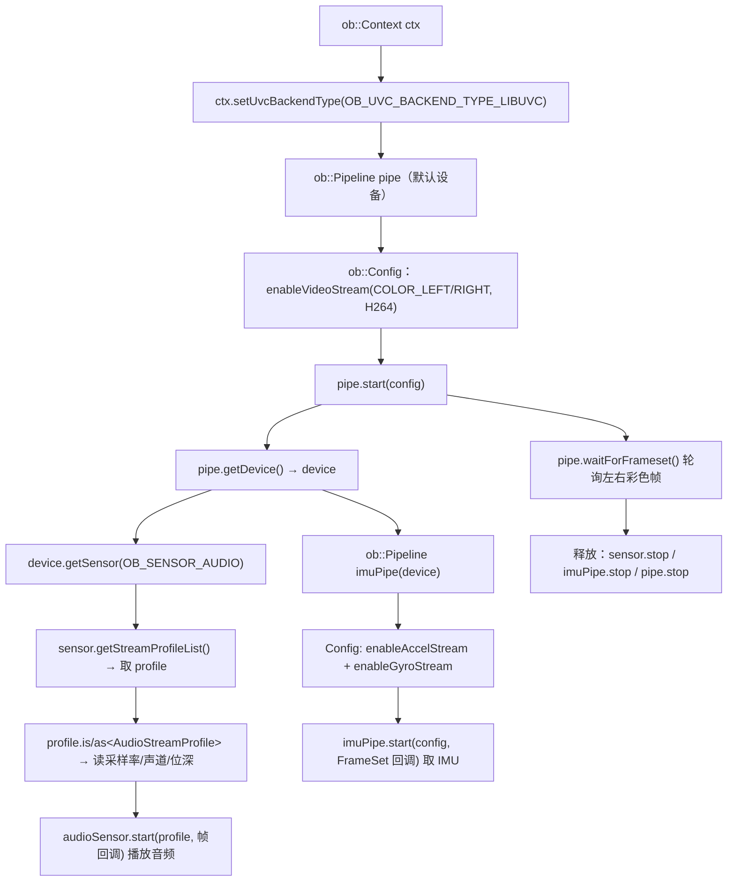
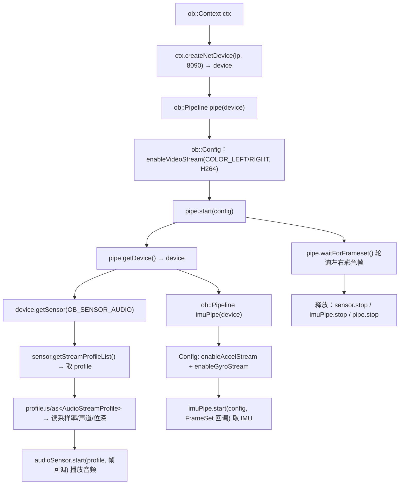

# Ego 设备 C++ 接入指南

> 本文以官方示例 `openorbbecsdk/examples/6.ego/ego_sample.cpp` 为主线，讲解如何用 **Orbbec SDK 的 C++ API**（`#include <libobsensor/ObSensor.hpp>`，命名空间 `ob`）在 **Ego / EgoPro / Wrist** 上采集与控制：
>
> - **彩色（COLOR 或 COLOR_LEFT/RIGHT，示例默认 H264）** —— 走 `Pipeline`，支持 `waitForFrameset` 轮询或 `FrameSetCallback` 回调
> - **音频（PCM）** —— 走 `Sensor` 直连回调
> - **IMU（加速度 / 陀螺仪）** —— 走第二条 `Pipeline`（FrameSet 回调）
> - **设备信息 / 标定 YAML** —— 走 `Device` 的查询 / 原始数据接口（示例之外的常用补充接口）
> - **Ego 扩展能力（DataAcquisitionDevice）** —— 设备端音频播放、录制目录、固件日志导出、状态/电池/按键回调
>
> 所有签名均取自 SDK 头文件 `openorbbecsdk/include/libobsensor/hpp/`，行为说明同时以当前 SDK 实现为准。本文已按当前仓库 `examples/6.ego` 与 `DataAcquisitionDevice.hpp` 新增能力同步更新。
>
> 本文**不覆盖**深度、通用录制 / 回放、固件升级等接口；如业务需要，请查阅 SDK 完整头文件与对应专题文档。

---

## 目录

1. [文档概览与阅读指引](#ch1)
2. [快速开始：最小可运行示例](#ch2)
3. [两种连接模式（USB / 网络）](#ch3)
4. [初始化 Context 与 UVC 后端](#ch4)
5. [Pipeline 与彩色流](#ch5)
6. [音频流（Sensor 直连）](#ch6)
7. [IMU 流（加速度 / 陀螺仪）](#ch7)
8. [彩色相机曝光控制](#ch8)
9. [获取设备信息（DeviceInfo）](#ch9)
10. [读取标定 YAML（对齐 / IMU）](#ch10)
11. [停止与释放](#ch11)
12. [异常处理](#ch12)
13. [API 速查表](#ch13)
14. [完整示例参考](#ch14)
15. [DataAcquisitionDevice 与 fromDevice 语义](#ch15)
16. [设备端音频播放与音量控制](#ch16)
17. [固件录制目录与结果回调](#ch17)
18. [固件日志导出与设备状态回调](#ch18)
19. [蓝牙配对与 Wi-Fi 配网信息管理](#ch19)
20. [SD 卡文件服务](#ch20)

---

<a id="ch1"></a>

## 1. 文档概览与阅读指引

### 1.1 两种连接方式

Ego 支持 **USB** 与**网络（以太网）** 两种接入。二者使用相同的 C++ API 组织流程，但设备创建方式、传输通道及固件实际上报的流配置可能不同：

- **USB**：需先指定 UVC 后端（`setUvcBackendType(OB_UVC_BACKEND_TYPE_LIBUVC)`），再用默认设备构造 `Pipeline`；
- **网络**：用 `createNetDevice(ip, 8090)` 先拿到 `Device`，再以其构造 `Pipeline`。

拿到 `Pipeline` 之后，彩色 / 音频 / IMU 的调用流程基本一致；流格式、分辨率和属性支持情况仍应以当前设备查询结果为准。

### 1.2 章节导航

| 章节 | 内容 | 是否示例主线 |
|------|------|--------------|
| 2 | 快速开始：最小可运行示例 | 入门 |
| 3 | 两种连接模式（USB / 网络）流程对比 | 入门 |
| 4 | 初始化 Context 与 UVC 后端 | ✅ |
| 5 | Pipeline 与彩色流 | ✅ |
| 6 | 音频流（Sensor 直连） | ✅ |
| 7 | IMU 流（加速度 / 陀螺仪） | ✅ |
| 8 | 彩色相机曝光控制 | 补充 |
| 9 | 获取设备信息（DeviceInfo） | 补充 |
| 10 | 读取标定 YAML（对齐 / IMU） | 补充 |
| 11 | 停止与释放 | ✅ |
| 12 | 异常处理 | ✅ |
| 13 | API 速查表 | 参考 |
| 14 | 完整示例参考 | 参考 |
| 15 | DataAcquisitionDevice 与 fromDevice 语义 | 新增 |
| 16 | 设备端音频播放与音量控制 | 新增 |
| 17 | 固件录制目录与结果回调 | 新增 |
| 18 | 固件日志导出与设备状态回调 | 新增 |
| 19 | 蓝牙配对与 Wi-Fi 配网信息管理 | 新增 |
| 20 | SD 卡文件服务（网络设备，固件 ≥ 1.1.8） | 新增 |

> 标 ✅ 的章节覆盖 `ego_sample.cpp` 的全部调用路径；标「补充」的章节为示例之外、实际集成常用的接口。

### 1.3 约定

```cpp
#include <libobsensor/ObSensor.hpp>   // 唯一需要包含的主头文件
using namespace ob;                    // 或显式写 ob:: 前缀
```

- C++ 封装类和异常位于 `ob` 命名空间；`OBFormat`、`OBFloat3D` 等 C API 类型与枚举位于全局命名空间；
- SDK 内部通过 RAII（`std::shared_ptr`）管理资源，对象析构时自动释放，**无需手动 `delete` 底层句柄**；
- 示例中的 `device` 来源有二：USB 来自 `pipe.getDevice()`（启动 `Pipeline` 之后），网络来自 `ctx.createNetDevice(ip, 8090)` 的返回。

---

<a id="ch2"></a>

## 2. 快速开始：最小可运行示例

下面两段是最精简的「跑通彩色流」示例，复制即可看到左右彩色帧。建议先照此跑通，再回看第 4–7 章了解每个接口的完整用法。

### 2.1 USB 最小示例

```cpp
#include <libobsensor/ObSensor.hpp>
using namespace ob;

int main() {
    Context ctx;
    ctx.setUvcBackendType(OB_UVC_BACKEND_TYPE_LIBUVC);   // 仅 USB 需要

    Pipeline pipe;                                       // 绑定第一台设备
    auto config = std::make_shared<Config>();
    config->enableVideoStream(OB_STREAM_COLOR_LEFT,  OB_WIDTH_ANY, OB_HEIGHT_ANY, OB_FPS_ANY, OB_FORMAT_H264);
    config->enableVideoStream(OB_STREAM_COLOR_RIGHT, OB_WIDTH_ANY, OB_HEIGHT_ANY, OB_FPS_ANY, OB_FORMAT_H264);
    pipe.start(config);

    for (int i = 0; i < 100; ++i) {                      // 取 100 组帧即退出
        auto frameSet = pipe.waitForFrameset();          // 阻塞等待一组同步帧
        if (frameSet) {
            // frameSet 内已含左 + 右彩色帧，可在此渲染 / 保存
        }
    }

    pipe.stop();                                         // 停止并释放
    return 0;
}
```

### 2.2 网络最小示例

把设备创建方式换成 `createNetDevice`；后续 API 流程与 USB 基本相同：

```cpp
Context ctx;
auto device = ctx.createNetDevice("192.168.1.10", 8090);  // 仅 IPv4；Ego 固件默认控制端口为 8090
Pipeline pipe(device);                                   // 用指定设备构造

auto config = std::make_shared<Config>();
config->enableVideoStream(OB_STREAM_COLOR_LEFT,  OB_WIDTH_ANY, OB_HEIGHT_ANY, OB_FPS_ANY, OB_FORMAT_H264);
config->enableVideoStream(OB_STREAM_COLOR_RIGHT, OB_WIDTH_ANY, OB_HEIGHT_ANY, OB_FPS_ANY, OB_FORMAT_H264);
pipe.start(config);

// 后续取帧、停止方式与 USB 相同
```

### 2.3 编译 / 链接提示

- 头文件：将 SDK 的 `include/` 加入编译包含路径；
- 链接：链接 Orbbec SDK 动态 / 静态库（具体库名与路径随平台 / 构建系统而异，参见 SDK 发行包 `README` 与 `CMake` 示例）；
- 示例工程可直接参考 `openorbbecsdk/examples/6.ego/` 下的 `CMakeLists.txt`。

---

<a id="ch3"></a>

## 3. 两种连接模式（USB / 网络）

下面是两种方式的**核心流程**总览（只保留 SDK 调用主干）。

### 3.1 USB 设备核心流程



### 3.2 网络设备核心流程



### 3.3 差异对比

| 步骤 | USB | 网络 |
|------|-----|------|
| 创建 Context | `ob::Context ctx;` | `ob::Context ctx;` |
| 指定后端 | `ctx.setUvcBackendType(OB_UVC_BACKEND_TYPE_LIBUVC)` **必须** | 不需要 |
| 获取 Device | `Pipeline` 默认绑定 | `ctx.createNetDevice(ip, 8090)` **必须** |
| 构造 Pipeline | `ob::Pipeline pipe;` | `ob::Pipeline pipe(device);` |
| 后续 API 流程 | 基本一致；Profile 以设备查询为准 | 基本一致；Profile 以设备查询为准 |

---

<a id="ch4"></a>

## 4. 初始化 Context 与 UVC 后端

`Context` 是 SDK 入口。**`setUvcBackendType` 仅 USB 设备需要**——USB 必须在创建设备前指定 UVC 后端（Ego 用 `OB_UVC_BACKEND_TYPE_LIBUVC`）；**网络设备无需设置**（走 `createNetDevice`，不涉及 UVC 后端）。

```cpp
ob::Context ctx;
// 仅 USB 设备需要；网络设备不必调用
ctx.setUvcBackendType(OB_UVC_BACKEND_TYPE_LIBUVC);
```

| API | 说明 |
|-----|------|
| `ob::Context::Context(const char *configPath = "")` | 构造上下文；`configPath` 为空用默认配置 |
| `void ob::Context::setUvcBackendType(OBUvcBackendType type) const` | 设置 UVC 后端类型；**仅 USB 设备需要**，须在创建设备前调用；Ego 用 `OB_UVC_BACKEND_TYPE_LIBUVC`；网络设备无需设置 |
| `std::shared_ptr<ob::Device> ob::Context::createNetDevice(const char *address, uint16_t port, OBDeviceAccessMode accessMode = OB_DEVICE_DEFAULT_ACCESS) const` | 按 IP 创建网络设备；`address` 仅 IPv4（如 `"192.168.1.10"`），Ego 固件默认控制端口为 `8090`；网络设备无需 `setUvcBackendType` |

---

<a id="ch5"></a>

## 5. Pipeline 与彩色流

`Pipeline` 是高层接口，负责多路视频流的同步（`FrameSet`），既支持阻塞轮询取帧，也支持回调取帧。无参构造会默认打开系统连接的第一台设备。当前 `ego_sample.cpp` 默认使用 `OB_FORMAT_H264`，并按设备能力自动在 `OB_STREAM_COLOR` 与 `OB_STREAM_COLOR_LEFT/RIGHT` 之间选择。

### 5.1 创建 Pipeline 与配置

```cpp
ob::Pipeline pipe;   // 默认设备（USB）；网络用 ob::Pipeline pipe(device);

std::shared_ptr<ob::Config> config = std::make_shared<ob::Config>();
// 当前官方 Ego sample 使用 H264；宽高帧率传 *_ANY 表示由 SDK 匹配
config->enableVideoStream(OB_STREAM_COLOR_LEFT,  OB_WIDTH_ANY, OB_HEIGHT_ANY, OB_FPS_ANY, OB_FORMAT_H264);
config->enableVideoStream(OB_STREAM_COLOR_RIGHT, OB_WIDTH_ANY, OB_HEIGHT_ANY, OB_FPS_ANY, OB_FORMAT_H264);

pipe.start(config);
```

| API | 说明 |
|-----|------|
| `ob::Pipeline::Pipeline()` | 创建 Pipeline 并默认绑定第一台设备 |
| `ob::Pipeline::Pipeline(std::shared_ptr<Device> device)` | 用指定设备创建（网络设备或示例的 IMU 管道即用此重载） |
| `ob::Config::Config()` | 构造空配置 |
| `void ob::Config::enableVideoStream(OBStreamType streamType, uint32_t width = OB_WIDTH_ANY, uint32_t height = OB_HEIGHT_ANY, uint32_t fps = OB_FPS_ANY, OBFormat format = OB_FORMAT_ANY) const` | 启用某路视频流；传 `OB_*_ANY` 即使用默认参数 |
| `void ob::Pipeline::start(std::shared_ptr<Config> config = nullptr) const` | 按配置启动流（无回调，配合 `waitForFrameset` 轮询） |

> 用到的流类型与格式常量：`OB_STREAM_COLOR`、`OB_STREAM_COLOR_LEFT`、`OB_STREAM_COLOR_RIGHT`、`OB_FORMAT_H264`，以及通配符 `OB_WIDTH_ANY`、`OB_HEIGHT_ANY`、`OB_FPS_ANY`。这里与当前 `ego_sample.cpp` 一致。

### 5.2 轮询取彩色帧

```cpp
while (/* 渲染窗口运行 */) {
    auto frameSet = pipe.waitForFrameset();   // 默认超时 1000ms，无帧返回 nullptr
    if (frameSet == nullptr) {
        continue;
    }
    // frameSet 内已含左 + 右彩色帧，交给渲染器显示
}
```

| API | 说明 |
|-----|------|
| `std::shared_ptr<ob::FrameSet> ob::Pipeline::waitForFrameset(uint32_t timeoutMs = 1000) const` | 阻塞等待一组同步帧；超时返回 `nullptr` |
| `std::shared_ptr<ob::Device> ob::Pipeline::getDevice() const` | 获取当前 Pipeline 绑定的设备对象 |

### 5.3 回调方式取彩色帧

不希望业务线程阻塞在 `waitForFrameset()` 时，可使用带 `FrameSetCallback` 的 `Pipeline::start` 重载。每当一组同步帧到达，SDK 会调用注册的回调：

```cpp
ob::Pipeline pipe;   // 网络设备使用 ob::Pipeline pipe(device)
auto config = std::make_shared<ob::Config>();
config->enableVideoStream(OB_STREAM_COLOR_LEFT,
                          OB_WIDTH_ANY, OB_HEIGHT_ANY, OB_FPS_ANY, OB_FORMAT_H264);
config->enableVideoStream(OB_STREAM_COLOR_RIGHT,
                          OB_WIDTH_ANY, OB_HEIGHT_ANY, OB_FPS_ANY, OB_FORMAT_H264);

pipe.start(config, [](std::shared_ptr<ob::FrameSet> frameSet) {
    if (!frameSet) {
        return;
    }

    auto leftFrame  = frameSet->getFrame(OB_FRAME_COLOR_LEFT);
    auto rightFrame = frameSet->getFrame(OB_FRAME_COLOR_RIGHT);

    if (leftFrame) {
        const uint8_t *data = leftFrame->getData();
        uint32_t size       = leftFrame->getDataSize();
        // 处理左彩色帧。H264 数据通常需解码后再显示。
    }
    if (rightFrame) {
        const uint8_t *data = rightFrame->getData();
        uint32_t size       = rightFrame->getDataSize();
        // 处理右彩色帧
    }
});

// Pipeline 启动后，应用继续运行自己的消息循环或其他业务逻辑。
// 退出前停止 Pipeline；stop() 返回后不再产生新的回调。
// ...
pipe.stop();
```

使用回调模式时需要注意：

- `start(config, callback)` 与 `start(config) + waitForFrameset()` 是两种取帧模式，同一条 Pipeline 不要混用；
- 回调由 SDK 的取流线程触发，不要在回调中执行长时间阻塞操作。渲染、写盘或复杂解码可投递到业务线程；
- `FrameSet` 和其中的 `Frame` 由 `shared_ptr` 管理。若需要在回调返回后继续使用帧，应保留对应的 `shared_ptr`，不要只保存 `getData()` 返回的裸指针；
- 回调可能与主线程并发访问业务对象，共享队列或状态需要做好线程同步；
- 回调中不要直接调用当前 Pipeline 的 `stop()`，应由控制线程停止并等待回调退出。

| API | 说明 |
|-----|------|
| `void ob::Pipeline::start(std::shared_ptr<Config> config, FrameSetCallback callback)` | 按配置启动 Pipeline，并在同步 `FrameSet` 到达时回调 |
| `FrameSetCallback` | `std::function<void(std::shared_ptr<FrameSet>)>` |

---

<a id="ch6"></a>

## 6. 音频流（Sensor 直连）

音频不进 Pipeline，而是从 `Device` 取音频 `Sensor`，遍历其 `StreamProfileList` 选出配置，再以回调方式接收 PCM 数据。

### 6.1 获取设备与音频传感器

```cpp
auto device = pipe.getDevice();
std::shared_ptr<ob::Sensor> audioSensor;
try {
    audioSensor = device->getSensor(OB_SENSOR_AUDIO);
    // ... 见 6.2
}
catch (const ob::Error &e) {
    // 设备不支持音频传感器，或获取失败
}
```

| API | 说明 |
|-----|------|
| `std::shared_ptr<ob::Sensor> ob::Device::getSensor(OBSensorType type) const` | 获取指定类型传感器；设备不支持或找不到时抛出 `ob::Error` |

### 6.2 读取音频流配置

```cpp
auto profiles = audioSensor->getStreamProfileList();
if (profiles && profiles->getCount() > 0) {
    auto     profile   = profiles->getProfile(0);
    uint32_t sampleRate    = 0;
    uint32_t channelCount  = 0;
    uint32_t bitsPerSample = 0;
    if (profile->is<ob::AudioStreamProfile>()) {           // 类型判断
        auto audioProfile = profile->as<ob::AudioStreamProfile>();   // 向下转型
        sampleRate    = audioProfile->getSampleRate();
        channelCount  = audioProfile->getChannelCount();
        bitsPerSample = audioProfile->getBitsPerSample();
    }
    // 用真实参数初始化播放器 / 写 WAV 头
}
```

| API | 说明 |
|-----|------|
| `std::shared_ptr<ob::StreamProfileList> ob::Sensor::getStreamProfileList() const` | 获取该传感器的流配置列表 |
| `uint32_t ob::StreamProfileList::getCount() const` | 配置数量 |
| `std::shared_ptr<ob::StreamProfile> ob::StreamProfileList::getProfile(uint32_t index) const` | 按索引取配置 |
| `template <typename T> bool ob::StreamProfile::is() const` | 判断该 profile 是否为类型 `T`（如 `AudioStreamProfile`） |
| `template <typename T> std::shared_ptr<T> ob::StreamProfile::as()` | 向下转型为具体子类；类型不符会抛异常 |
| `uint32_t ob::AudioStreamProfile::getSampleRate() const` | 采样率（Hz） |
| `uint32_t ob::AudioStreamProfile::getChannelCount() const` | 声道数 |
| `uint32_t ob::AudioStreamProfile::getBitsPerSample() const` | 位深（bits） |

> `StreamProfile` 是多态基类。`as<T>()` / `is<T>()` 在 `ego_sample.cpp` 中用于把基类 `StreamProfile` 安全转为 `AudioStreamProfile`、把基类 `Frame` 转为 `AccelFrame` / `GyroFrame`。

### 6.3 启动音频流并接收数据

`Sensor::start` 接收 `FrameCallback`（每来一帧回调一次）：

```cpp
audioSensor->start(profile, [](std::shared_ptr<ob::Frame> frame) {
    if (!frame) {
        return;
    }
    audioPlayer.play(frame->getData(), frame->getDataSize());   // 取 PCM 数据
});
```

| API | 说明 |
|-----|------|
| `void ob::Sensor::start(std::shared_ptr<StreamProfile> streamProfile, FrameCallback callback)` | 开启流并注册帧回调；`FrameCallback = std::function<void(std::shared_ptr<Frame>)>` |
| `uint8_t *ob::Frame::getData() const` | 返回帧数据指针（示例直接传给播放器） |
| `uint32_t ob::Frame::getDataSize() const` | 帧数据字节数 |

---

<a id="ch7"></a>

## 7. IMU 流（加速度 / 陀螺仪）

IMU 在示例中使用**第二条 Pipeline**（绑定同一个 `device`），以 `FrameSet` 回调方式同时拿到加速度与陀螺仪帧。

### 7.1 配置并启动 IMU 管道

```cpp
auto         device    = pipe.getDevice();
auto         imuPipe   = std::make_shared<ob::Pipeline>(device);
auto         imuConfig = std::make_shared<ob::Config>();
imuConfig->enableAccelStream();   // 默认量程 / 采样率
imuConfig->enableGyroStream();

imuPipe->start(imuConfig, [](std::shared_ptr<ob::FrameSet> frameSet) {
    if (!frameSet) {
        return;
    }
    // 见 7.2
});
```

| API | 说明 |
|-----|------|
| `void ob::Config::enableAccelStream(OBAccelFullScaleRange fullScaleRange = OB_ACCEL_FULL_SCALE_RANGE_ANY, OBAccelSampleRate sampleRate = OB_ACCEL_SAMPLE_RATE_ANY) const` | 启用加速度流 |
| `void ob::Config::enableGyroStream(OBGyroFullScaleRange fullScaleRange = OB_GYRO_FULL_SCALE_RANGE_ANY, OBGyroSampleRate sampleRate = OB_GYRO_SAMPLE_RATE_ANY) const` | 启用陀螺仪流 |
| `void ob::Pipeline::start(std::shared_ptr<Config> config, FrameSetCallback callback)` | 启动流并注册 `FrameSet` 回调；`FrameSetCallback = std::function<void(std::shared_ptr<FrameSet>)>` |

> `OB_ACCEL_FULL_SCALE_RANGE_ANY` / `OB_GYRO_FULL_SCALE_RANGE_ANY` 等通配枚举表示使用默认参数。

### 7.2 解析 IMU 帧

```cpp
auto accelFrameRaw = frameSet->getFrame(OB_FRAME_ACCEL);
if (accelFrameRaw) {
    auto accelFrame = accelFrameRaw->as<ob::AccelFrame>();
    OBFloat3D     v   = accelFrame->getValue();   // C API 全局类型；{x, y, z}，单位 m/s^2
    uint64_t      idx = accelFrame->getIndex();
    uint64_t      ts  = accelFrame->getTimeStampUs();
    float         tmp = accelFrame->getTemperature();
    // gyro 同理，用 OB_FRAME_GYRO / ob::GyroFrame
}
```

| API | 说明 |
|-----|------|
| `std::shared_ptr<ob::Frame> ob::FrameSet::getFrame(OBFrameType frameType) const` | 从帧集中取指定类型帧；不存在返回 `nullptr` |
| `template <typename T> std::shared_ptr<T> ob::Frame::as()` | 把基类 `Frame` 转为具体子类（`AccelFrame` / `GyroFrame` 等） |
| `OBAccelValue ob::AccelFrame::getValue() const` | 三轴加速度，类型等价于 `OBFloat3D`（成员 `float x, y, z`） |
| `OBGyroValue  ob::GyroFrame::getValue() const` | 三轴角速度，类型等价于 `OBFloat3D`（成员 `float x, y, z`） |
| `float ob::AccelFrame::getTemperature() const` / `float ob::GyroFrame::getTemperature() const` | 采样时温度（℃） |
| `uint64_t ob::Frame::getIndex() const` | 帧序号 |
| `uint64_t ob::Frame::getTimeStampUs() const` | 设备硬件时间戳（μs） |
| `OBFrameType ob::Frame::getType() const` | 帧类型 |

> `OBAccelValue`、`OBGyroValue`、`OBFloat3D` 在 SDK 中是同一结构体的三个别名，均含 `x / y / z` 三个 `float`。它们属于 C API 全局类型，不应添加 `ob::` 前缀。

> 若需把帧类型打印成可读字符串，可用工具函数 `ob::TypeHelper::convertOBFrameTypeToString(type)`（示例 `printImuValue` 中即用此把 `OBFrameType` 转成字符串）。

---

<a id="ch8"></a>

## 8. 彩色相机控制参数

彩色相机参数以**设备属性**形式提供，通过 `ob::Device` 的通用属性接口读写。当前 Ego USB 与网络实现均注册了曝光、增益、饱和度、锐度和对比度等属性，但应用仍应使用 `isPropertySupported` 检查当前设备及固件是否支持：

- **自动曝光（AE）使能** 是布尔属性，用 `getBoolProperty` / `setBoolProperty`；
- **曝光值**、**增益值** 是整型属性，用 `getIntProperty` / `setIntProperty`；
- 曝光、增益的可写范围因设备而异，写之前用 `getIntPropertyRange` 查询 `min/max/step`，避免越界；
- **AE 开启时曝光 / 增益只读**，需先关闭 AE（`setBoolProperty(..., false)`）才能写入曝光 / 增益；
- 稳妥起见，写之前用 `isPropertySupported(prop, OB_PERMISSION_READ_WRITE)` 确认是否可写。

```cpp
// device 为 std::shared_ptr<ob::Device>：USB 来自 pipe.getDevice()，网络来自 createNetDevice 的返回
// 1) 读自动曝光使能
bool aeOn = device->getBoolProperty(OB_PROP_COLOR_AUTO_EXPOSURE_BOOL);

// 2) 关闭自动曝光后才能写曝光 / 增益
device->setBoolProperty(OB_PROP_COLOR_AUTO_EXPOSURE_BOOL, false);

// 3) 查询曝光范围（cur/min/max/step/def，单位与设备相关）
OBIntPropertyRange expRange = device->getIntPropertyRange(OB_PROP_COLOR_EXPOSURE_INT);
// expRange.min / expRange.max / expRange.step

// 4) 写曝光、增益（整型属性）
device->setIntProperty(OB_PROP_COLOR_EXPOSURE_INT, targetExposure);
device->setIntProperty(OB_PROP_COLOR_GAIN_INT, 50);

// 5) 设置其他颜色参数；写入前建议分别查询范围和读写权限
for (auto prop : { OB_PROP_COLOR_SATURATION_INT,
                   OB_PROP_COLOR_SHARPNESS_INT,
                   OB_PROP_COLOR_CONTRAST_INT }) {
    if (device->isPropertySupported(prop, OB_PERMISSION_READ_WRITE)) {
        auto range = device->getIntPropertyRange(prop);
        device->setIntProperty(prop, range.def);  // 示例写默认值
    }
}

// 6) 写之前确认支持（推荐）
if (device->isPropertySupported(OB_PROP_COLOR_EXPOSURE_INT, OB_PERMISSION_READ_WRITE)) {
    device->setIntProperty(OB_PROP_COLOR_EXPOSURE_INT, targetExposure);
}
```

| API | 说明 |
|-----|------|
| `bool ob::Device::getBoolProperty(OBPropertyID) const` | 读布尔属性，如自动曝光使能 `OB_PROP_COLOR_AUTO_EXPOSURE_BOOL` |
| `void ob::Device::setBoolProperty(OBPropertyID, bool) const` | 写布尔属性 |
| `int32_t ob::Device::getIntProperty(OBPropertyID) const` | 读整型属性，如曝光 `OB_PROP_COLOR_EXPOSURE_INT`、增益 `OB_PROP_COLOR_GAIN_INT` |
| `void ob::Device::setIntProperty(OBPropertyID, int32_t) const` | 写整型属性 |
| `OBIntPropertyRange ob::Device::getIntPropertyRange(OBPropertyID) const` | 读整型属性范围，含 `cur/min/max/step/def` |
| `bool ob::Device::isPropertySupported(OBPropertyID, OBPermissionType) const` | 判断属性是否支持某读写权限（如 `OB_PERMISSION_READ_WRITE`） |

> 相关属性 ID：`OB_PROP_COLOR_AUTO_EXPOSURE_BOOL`（=2000，bool）、`OB_PROP_COLOR_EXPOSURE_INT`（=2001）、`OB_PROP_COLOR_GAIN_INT`（=2002）、`OB_PROP_COLOR_SHARPNESS_INT`（=2006）、`OB_PROP_COLOR_SATURATION_INT`（=2008）、`OB_PROP_COLOR_CONTRAST_INT`（=2009）。后五项均为整型属性。

---

<a id="ch9"></a>

## 9. 获取设备信息（DeviceInfo）

拿到 `Device` 对象后，可调用 `getDeviceInfo()` 获取一个 `std::shared_ptr<ob::DeviceInfo>`，从中读取设备名称、序列号、连接类型、固件版本、IP 地址等元信息——常用于界面展示、日志记录、多设备识别、固件校验。

- **USB 设备**：`device` 来自 `pipe.getDevice()`（启动 `Pipeline` 之后）；
- **网络设备**：`device` 来自 `ctx.createNetDevice(ip, 8090)` 的返回；
- `DeviceInfo` 返回的是 `shared_ptr`，离开作用域自动析构；
- `getIpAddress()` 仅允许用于网络设备；当前实现不会为 USB 设备安全地提供占位地址，因此不要在 USB 设备上调用。

```cpp
// device 为 ob::Device：USB 来自 pipe.getDevice()，网络来自 createNetDevice 的返回
auto info = device->getDeviceInfo();

const char *name     = info->getName();           // 产品名，如 "Ego"
const char *sn       = info->getSerialNumber();   // 序列号（多设备识别常用）
const char *connType = info->getConnectionType(); // 连接类型：USB / USB3.0 / Ethernet
const char *fwVer    = info->getFirmwareVersion(); // 固件版本

// 仅在已确认是网络设备时调用
if (std::string(connType) == "Ethernet") {
    const char *ip = info->getIpAddress();
}
```

| API | 说明 |
|-----|------|
| `std::shared_ptr<ob::DeviceInfo> ob::Device::getDeviceInfo() const` | 取设备信息对象（返回 `shared_ptr`，自动管理生命周期） |
| `const char *ob::DeviceInfo::getName() const` | 产品名，如 `"Ego"` |
| `const char *ob::DeviceInfo::getUid() const` | 系统分配的 uid，用于多设备区分 |
| `const char *ob::DeviceInfo::getSerialNumber() const` | 序列号（多设备识别常用） |
| `const char *ob::DeviceInfo::getConnectionType() const` | 连接类型：`"USB"` / `"USB3.0"` / `"Ethernet"` 等 |
| `const char *ob::DeviceInfo::getFirmwareVersion() const` | 固件版本 |
| `const char *ob::DeviceInfo::getIpAddress() const` | IP 地址；**仅网络设备有效，不要在 USB 设备上调用** |
| `OBDeviceType ob::DeviceInfo::getDeviceType() const` | 设备类型枚举 |

> 更多字段（如 `getPid()` / `getVid()` / `getHardwareVersion()` / `getAsicName()` 等）见 `openorbbecsdk/include/libobsensor/hpp/Device.hpp` 中 `ob::DeviceInfo` 的完整定义。

---

<a id="ch10"></a>

## 10. 读取标定 YAML（对齐 / IMU）

Ego 把**对齐标定**与 **IMU 标定**以 YAML 文本形式固化在设备 Flash 中，可通过 `Device` 的原始数据接口读出。SDK 只做透传、不解析内容，应用层应直接把字节落盘成 `.yaml` 文件（用于离线标定、算法对齐等）。

- 两个属性均为 **Ego 专用、只读**：
  - `OB_RAW_DATA_ALIGN_CALIB_YAML`（=4064）—— 对齐标定 YAML；
  - `OB_RAW_DATA_IMU_CALIB_YAML`（=4065）—— IMU 标定 YAML；
- 当前实现为**同步分包回调**：`Device::getRawData(propertyId, callback)` 会在调用线程中读取数据并逐块调用回调，全部处理完成后函数才返回；仍需按 `OBDataChunk` 的偏移自行拼接；
- 回调中 `state >= 0` 表示正常（传输中 / 完成），`state == DATA_TRAN_STAT_DONE(2)` 表示全部收齐；`state < 0` 为错误（如 `DATA_TRAN_ERR_BUSY=-1`、`DATA_TRAN_ERR_UNSUPPORTED=-2`）；
- `OBDataChunk` 字段：`data`（当前块指针）、`size`（当前块长度）、`offset`（相对完整数据的偏移）、`fullDataSize`（完整数据总长度）。

```cpp
#include <vector>
#include <cstring>
#include <stdexcept>

// device 为 ob::Device：USB 来自 pipe.getDevice()，网络来自 createNetDevice 的返回
std::vector<uint8_t> yamlBuf;   // 当前实现中回调在 getRawData 的调用线程内执行

if (!device->isPropertySupported(OB_RAW_DATA_IMU_CALIB_YAML, OB_PERMISSION_READ)) {
    throw std::runtime_error("IMU calibration YAML is not supported by this device");
}

device->getRawData(OB_RAW_DATA_IMU_CALIB_YAML,
    [&](OBDataTranState state, OBDataChunk *chunk) {
        if (state < 0) {
            // 出错：DATA_TRAN_ERR_BUSY / UNSUPPORTED / TRAN_FAILED ...
            return;
        }
        if (chunk && chunk->data && chunk->size > 0) {
            if (yamlBuf.empty()) {
                yamlBuf.resize(chunk->fullDataSize);   // 首块按完整大小预留
            }
            std::memcpy(yamlBuf.data() + chunk->offset, chunk->data, chunk->size);
        }
        if (state == DATA_TRAN_STAT_DONE) {
            // yamlBuf 现为完整 YAML 字节，可直接写文件
            // std::ofstream("imu_calib.yaml", std::ios::binary).write(
            //     reinterpret_cast<const char *>(yamlBuf.data()), yamlBuf.size());
        }
    });
```

| API | 说明 |
|-----|------|
| `void ob::Device::getRawData(OBPropertyID propertyId, std::function<void(OBDataTranState state, OBDataChunk *dataChunk)> callback) const` | 当前实现同步读取原始数据并分块回调；需自行按 `offset` 拼接，`state == DATA_TRAN_STAT_DONE(2)` 收齐 |
| `OBDataChunk{ uint8_t *data; uint32_t size; uint32_t offset; uint32_t fullDataSize; }` | 数据块结构：`data` 当前块指针、`size` 当前块长度、`offset` 偏移、`fullDataSize` 总长 |
| `OB_RAW_DATA_ALIGN_CALIB_YAML`（=4064） | Ego 对齐标定 YAML（只读，原始 YAML 字节） |
| `OB_RAW_DATA_IMU_CALIB_YAML`（=4065） | Ego IMU 标定 YAML（只读，原始 YAML 字节） |

> 注意：`OB_RAW_DATA_ALIGN_CALIB_YAML` 与 `OB_RAW_DATA_IMU_CALIB_YAML` 均为 Ego 设备专用属性。调用前应使用 `isPropertySupported(propertyId, OB_PERMISSION_READ)` 检查；未注册该属性的设备通常会由 `getRawData` 直接抛出 `ob::Error`，而不是进入回调返回 `DATA_TRAN_ERR_UNSUPPORTED`。

---

<a id="ch11"></a>

## 11. 停止与释放

释放顺序：先停独立传感器 / 第二条管道，最后停主彩色管道。所有对象均为 `shared_ptr`，离开作用域会自动析构释放。

```cpp
if (audioSensor) {
    audioSensor->stop();   // 停音频
}
if (imuPipe) {
    imuPipe->stop();       // 停 IMU 管道
}
pipe.stop();               // 停主彩色管道
```

| API | 说明 |
|-----|------|
| `void ob::Sensor::stop() const` | 停止传感器流 |
| `void ob::Pipeline::stop() const` | 停止 Pipeline，不再产生帧 |

---

<a id="ch12"></a>

## 12. 异常处理

SDK 出错时抛出 `ob::Error`（继承自 `std::exception`）。示例在最外层 `try/catch` 中打印详细信息：

```cpp
catch (ob::Error &e) {
    std::cerr << "function:" << e.getFunction()
              << "\nargs:"    << e.getArgs()
              << "\nmessage:" << e.what()
              << "\nstatus:"  << e.getStatus()
              << "\ntype:"    << e.getExceptionType() << std::endl;
}
```

| API | 说明 |
|-----|------|
| `const char *ob::Error::what() const noexcept` | 错误描述信息 |
| `const char *ob::Error::getFunction() const noexcept` | 发生异常的函数名 |
| `const char *ob::Error::getArgs() const noexcept` | 发生异常的函数参数 |
| `OBStatus ob::Error::getStatus() const noexcept` | 错误状态码 |
| `OBExceptionType ob::Error::getExceptionType() const noexcept` | 异常类型枚举 |

> 音频 / IMU 在示例中被包在独立的 `try/catch(ob::Error&)` 中：即便麦克风或 IMU 不可用，也不影响彩色视频流继续运行（即"可选流失败不影响主流程"）。

---

<a id="ch13"></a>

## 13. API 速查表

### Context

| 方法签名 | 说明 |
|---------|------|
| `ob::Context::Context(const char *configPath = "")` | 创建上下文 |
| `void ob::Context::setUvcBackendType(OBUvcBackendType type) const` | 设置 UVC 后端（仅 USB 设备需要，Ego 用 `OB_UVC_BACKEND_TYPE_LIBUVC`；网络设备无需设置） |
| `std::shared_ptr<ob::Device> ob::Context::createNetDevice(const char *address, uint16_t port, OBDeviceAccessMode accessMode = OB_DEVICE_DEFAULT_ACCESS) const` | 按 IP 创建网络设备（`address` 仅 IPv4；Ego 固件默认控制端口为 `8090`） |

### Pipeline

| 方法签名 | 说明 |
|---------|------|
| `ob::Pipeline::Pipeline()` | 默认设备 |
| `ob::Pipeline::Pipeline(std::shared_ptr<Device> device)` | 指定设备 |
| `void ob::Pipeline::start(std::shared_ptr<Config> config = nullptr) const` | 启动（轮询模式） |
| `void ob::Pipeline::start(std::shared_ptr<Config> config, FrameSetCallback callback)` | 启动（FrameSet 回调模式） |
| `std::shared_ptr<FrameSet> ob::Pipeline::waitForFrameset(uint32_t timeoutMs = 1000) const` | 取一组同步帧 |
| `std::shared_ptr<Device> ob::Pipeline::getDevice() const` | 取绑定设备 |
| `void ob::Pipeline::stop() const` | 停止 |

### Config

| 方法签名 | 说明 |
|---------|------|
| `ob::Config::Config()` | 创建配置 |
| `void ob::Config::enableVideoStream(OBStreamType, uint32_t w=OB_WIDTH_ANY, uint32_t h=OB_HEIGHT_ANY, uint32_t fps=OB_FPS_ANY, OBFormat fmt=OB_FORMAT_ANY) const` | 启视频流（按参数自动匹配） |
| `void ob::Config::enableAccelStream(OBAccelFullScaleRange=OB_ACCEL_FULL_SCALE_RANGE_ANY, OBAccelSampleRate=OB_ACCEL_SAMPLE_RATE_ANY) const` | 启加速度流 |
| `void ob::Config::enableGyroStream(OBGyroFullScaleRange=OB_GYRO_FULL_SCALE_RANGE_ANY, OBGyroSampleRate=OB_GYRO_SAMPLE_RATE_ANY) const` | 启陀螺仪流 |

### Device / Sensor

| 方法签名 | 说明 |
|---------|------|
| `std::shared_ptr<Sensor> ob::Device::getSensor(OBSensorType type) const` | 取传感器（不支持或找不到时抛出 `ob::Error`） |
| `bool ob::Device::getBoolProperty(OBPropertyID) const` | 读布尔属性（如自动曝光使能 `OB_PROP_COLOR_AUTO_EXPOSURE_BOOL`） |
| `void ob::Device::setBoolProperty(OBPropertyID, bool) const` | 写布尔属性 |
| `int32_t ob::Device::getIntProperty(OBPropertyID) const` | 读整型属性（如曝光 `OB_PROP_COLOR_EXPOSURE_INT`、增益 `OB_PROP_COLOR_GAIN_INT`） |
| `void ob::Device::setIntProperty(OBPropertyID, int32_t) const` | 写整型属性 |
| `OBIntPropertyRange ob::Device::getIntPropertyRange(OBPropertyID) const` | 读整型属性范围（含 `cur/min/max/step/def`） |
| `bool ob::Device::isPropertySupported(OBPropertyID, OBPermissionType) const` | 判断属性是否支持某读写权限（如 `OB_PERMISSION_READ_WRITE`） |
| `std::shared_ptr<StreamProfileList> ob::Sensor::getStreamProfileList() const` | 流配置列表 |
| `void ob::Sensor::start(std::shared_ptr<StreamProfile> profile, FrameCallback callback)` | 开流 + 帧回调 |
| `void ob::Sensor::stop() const` | 停流 |
| `std::shared_ptr<ob::DeviceInfo> ob::Device::getDeviceInfo() const` | 取设备信息对象 |

### DeviceInfo

| 方法签名 | 说明 |
|---------|------|
| `const char *ob::DeviceInfo::getName() const` | 产品名，如 `"Ego"` |
| `const char *ob::DeviceInfo::getUid() const` | 系统分配的 uid（用于多设备区分；USB 为 `bus-port`，网络为 `bus-port` 或 MAC 派生，详见源码注释） |
| `const char *ob::DeviceInfo::getSerialNumber() const` | 序列号（多设备识别常用） |
| `const char *ob::DeviceInfo::getConnectionType() const` | 连接类型：`"USB"` / `"USB3.0"` / `"Ethernet"` 等 |
| `const char *ob::DeviceInfo::getFirmwareVersion() const` | 固件版本 |
| `const char *ob::DeviceInfo::getIpAddress() const` | IP 地址；**仅网络设备有效，不要在 USB 设备上调用** |
| `OBDeviceType ob::DeviceInfo::getDeviceType() const` | 设备类型枚举 |

### 标定 YAML（RawData）

| 方法签名 | 说明 |
|---------|------|
| `void ob::Device::getRawData(OBPropertyID propertyId, std::function<void(OBDataTranState state, OBDataChunk *dataChunk)> callback) const` | 当前实现同步读取设备原始数据并分块回调 `OBDataChunk`；`state == DATA_TRAN_STAT_DONE(2)` 表示收齐 |
| `OB_RAW_DATA_ALIGN_CALIB_YAML`（=4064） | Ego 对齐标定 YAML（只读，返回原始 YAML 字节；SDK 不透传解析） |
| `OB_RAW_DATA_IMU_CALIB_YAML`（=4065） | Ego IMU 标定 YAML（只读，返回原始 YAML 字节） |

### StreamProfileList / StreamProfile

| 方法签名 | 说明 |
|---------|------|
| `uint32_t ob::StreamProfileList::getCount() const` | 配置数量 |
| `std::shared_ptr<StreamProfile> ob::StreamProfileList::getProfile(uint32_t index) const` | 取配置 |
| `template <typename T> bool ob::StreamProfile::is() const` | 类型判断 |
| `template <typename T> std::shared_ptr<T> ob::StreamProfile::as()` | 向下转型 |
| `uint32_t ob::AudioStreamProfile::getSampleRate() const` | 采样率 |
| `uint32_t ob::AudioStreamProfile::getChannelCount() const` | 声道数 |
| `uint32_t ob::AudioStreamProfile::getBitsPerSample() const` | 位深 |

### Frame / FrameSet

| 方法签名 | 说明 |
|---------|------|
| `uint8_t *ob::Frame::getData() const` | 帧数据指针 |
| `uint32_t ob::Frame::getDataSize() const` | 帧数据字节数 |
| `uint64_t ob::Frame::getIndex() const` | 帧序号 |
| `uint64_t ob::Frame::getTimeStampUs() const` | 硬件时间戳（μs） |
| `OBFrameType ob::Frame::getType() const` | 帧类型 |
| `template <typename T> std::shared_ptr<T> ob::Frame::as()` | 向下转型 |
| `std::shared_ptr<Frame> ob::FrameSet::getFrame(OBFrameType frameType) const` | 取指定类型帧 |
| `OBAccelValue ob::AccelFrame::getValue() const` | 加速度（=OBFloat3D{x,y,z}） |
| `float ob::AccelFrame::getTemperature() const` | 加速度采样温度 |
| `OBGyroValue ob::GyroFrame::getValue() const` | 角速度（=OBFloat3D{x,y,z}） |
| `float ob::GyroFrame::getTemperature() const` | 陀螺仪采样温度 |

### TypeHelper / Error

| 方法签名 | 说明 |
|---------|------|
| `static std::string ob::TypeHelper::convertOBFrameTypeToString(const OBFrameType &type)` | 帧类型转字符串 |
| `const char *ob::Error::what() const noexcept` | 错误信息 |
| `const char *ob::Error::getFunction() const noexcept` | 异常函数名 |
| `const char *ob::Error::getArgs() const noexcept` | 异常函数参数 |
| `OBStatus ob::Error::getStatus() const noexcept` | 状态码 |
| `OBExceptionType ob::Error::getExceptionType() const noexcept` | 异常类型 |

### 本示例用到的枚举 / 常量

| 名称 | 含义 |
|------|------|
| `OB_STREAM_COLOR` / `OB_STREAM_COLOR_LEFT` / `OB_STREAM_COLOR_RIGHT` | 单目或双目前彩色流类型 |
| `OB_FORMAT_H264` / `OB_FORMAT_MJPG` | 当前示例默认 H264；实际支持项以设备上报的 Profile 为准 |
| `OB_WIDTH_ANY` / `OB_HEIGHT_ANY` / `OB_FPS_ANY` | 宽 / 高 / 帧率通配符（取默认） |
| `OB_SENSOR_AUDIO` | 音频传感器类型 |
| `OB_FRAME_ACCEL` / `OB_FRAME_GYRO` | 加速度 / 陀螺仪帧类型 |
| `OB_UVC_BACKEND_TYPE_LIBUVC` | Ego 的 UVC 后端 |
| `OB_PROP_COLOR_AUTO_EXPOSURE_BOOL`（=2000） | 彩色自动曝光（AE）使能（bool） |
| `OB_PROP_COLOR_EXPOSURE_INT`（=2001） | 彩色曝光值（int，AE 关闭时可写） |
| `OB_PROP_COLOR_GAIN_INT`（=2002） | 彩色增益值（int，AE 关闭时可写） |
| `OB_PROP_COLOR_SHARPNESS_INT`（=2006） | 彩色锐度（int） |
| `OB_PROP_COLOR_SATURATION_INT`（=2008） | 彩色饱和度（int） |
| `OB_PROP_COLOR_CONTRAST_INT`（=2009） | 彩色对比度（int） |
| `OB_RAW_DATA_ALIGN_CALIB_YAML`（=4064） | Ego 对齐标定 YAML（只读） |
| `OB_RAW_DATA_IMU_CALIB_YAML`（=4065） | Ego IMU 标定 YAML（只读） |
| `OB_PERMISSION_READ_WRITE` | 属性读写权限（用于 `isPropertySupported`） |
| `OBFloat3D`（= `OBAccelValue` = `OBGyroValue`） | 三轴浮点结构 `{ float x, y, z }` |

---

<a id="ch14"></a>

## 14. 完整示例参考

完整可运行代码见 SDK 随包示例：

- `openorbbecsdk/examples/6.ego/ego_sample.cpp` —— 彩色（COLOR 或 COLOR_LEFT/RIGHT，当前配置为 H264）+ 麦克风音频 + IMU 的完整实现（含状态回调、跨平台音频播放 `AudioPlayer`、OpenCV 渲染等宿主层逻辑）
- `openorbbecsdk/examples/6.ego/ego_audio_playback.cpp` —— 设备端扬声器播放 WAV、音量调节、可选并行数据流监看
- `openorbbecsdk/examples/6.ego/ego_recording_directory.cpp` —— 固件录制目录配置、合法性校验、录制目标与动作控制
- `openorbbecsdk/examples/6.ego/ego_fw_log_export.cpp` —— 固件日志分包导出与文件落盘
- `openorbbecsdk/examples/6.ego/ego_auto_test.cpp` —— 无 UI 自动化能力巡检（设备信息、属性、视频/IMU/音频、状态/电池）

该示例覆盖了本文核心接入流程（第 4–7、11–12 章）的全部 API 调用路径，可作为集成到你自己的 C++ 宿主程序的参考样板。第 8 章「曝光控制」、第 9 章「设备信息」与第 10 章「标定 YAML」为示例之外的补充接口，未包含在示例内。

---

<a id="ch15"></a>

## 15. DataAcquisitionDevice 与 fromDevice 语义

从当前仓库代码看，Ego 系列能力已集中到 `ob::DataAcquisitionDevice`（头文件 `DataAcquisitionDevice.hpp`），推荐先把基础 `Device` 转为该类型后再调用扩展接口。

```cpp
ob::Pipeline pipe;
auto device = ob::DataAcquisitionDevice::fromDevice(pipe.getDevice());
```

注意点：

- `fromDevice` 会转移底层句柄所有权，传入的 `std::shared_ptr<ob::Device>` 进入 moved-from 状态；
- 转换后应统一使用 `std::shared_ptr<ob::DataAcquisitionDevice>` 继续后续调用；
- 仅建议用于 Ego / EgoPro / Wrist。

常用扩展 API：

| API | 说明 |
|-----|------|
| `std::shared_ptr<ob::DataAcquisitionDevice> ob::DataAcquisitionDevice::fromDevice(std::shared_ptr<Device> device)` | 从基础设备包装为 Ego 扩展设备 |
| `void setDeviceUserName(const std::string &name) const` / `std::string getDeviceUserName() const` | 设置/读取持久化设备名 |
| `OBEgoPairingInfo getEgoPairingInfo() const` / `void clearEgoPairing() const` | 配对信息读取与清空 |

<a id="ch16"></a>

## 16. 设备端音频播放与音量控制

当前 SDK 新增了设备端扬声器播放能力（与麦克风采集不同）。示例见 `ego_audio_playback.cpp`。

```cpp
auto egoDev = ob::DataAcquisitionDevice::fromDevice(rawDevice);
egoDev->setAudioPlaybackVolume(-6);      // dB，范围需先查询
egoDev->playAudioFile("prompt.wav");    // 阻塞直到播放结束或被 stop
// 其他线程可调用：egoDev->stopAudioPlayback();
```

WAV 约束（来自接口注释）：

- PCM（非压缩）
- 单声道
- 16-bit little-endian
- 16kHz

相关 API：

| API | 说明 |
|-----|------|
| `void playAudioFile(const std::string &filePath) const` | 在设备扬声器播放 WAV；阻塞调用 |
| `void stopAudioPlayback() const` | 停止当前播放并关闭输出 session |
| `void setAudioPlaybackVolume(int32_t volume) const` | 设置扬声器音量；建议配合 `getIntPropertyRange(OB_PROP_DEVICE_AUDIO_OUTPUT_VOLUME_INT)` |

<a id="ch17"></a>

## 17. 固件录制目录与结果回调

当前仓库已补充固件侧录制目录管理与录制结果回调，示例见 `ego_recording_directory.cpp`。

```cpp
auto egoDev = ob::DataAcquisitionDevice::fromDevice(rawDevice);

egoDev->setFwRecordingDirectory("all_raw_data/session_001");
auto dir = egoDev->getFwRecordingDirectory();

// 录制文件名仅在 Ego/Wrist 固件 1.1.8 及以上版本支持。
if(egoDev->isPropertySupported(OB_STRUCT_FW_RECORDING_FILE_NAME, OB_PERMISSION_READ)
   && egoDev->isPropertySupported(OB_STRUCT_FW_RECORDING_FILE_NAME, OB_PERMISSION_WRITE)) {
    egoDev->setFwRecordingFileName("session_001");
    auto fileName = egoDev->getFwRecordingFileName();
}

egoDev->setEgoRecordingResultCallback([](const ob::DataAcquisitionDevice::EgoRecordingResult &result) {
    // result.state / result.recordingDirectory / result.partNames
});

// 主动查询指定录制任务目录的当前结果；recordingDuration 单位为秒。
const auto result = egoDev->getRecordingSessionResult("all_raw_data/session_001");
// result.fileExists / result.recordingDuration
```

`OB_STRUCT_FW_RECORDING_FILE_NAME`（1122）用于读取和设置设备端固件录制的文件名，支持 EgoDevice、EgoNetDevice 与 Wrist 系列。该属性要求设备固件版本不低于 **1.1.8**；低版本设备不会注册该属性，应用应先通过 `isPropertySupported(..., OB_PERMISSION_READ/WRITE)` 判断能力。文件名与录制目录一样，仅可在固件录制停止时修改；文件名为 UTF-8 文本，不能包含路径分隔符 `/` 或 `\`。

### 17.1 查询某次录制的结果：`getRecordingSessionResult`

此接口用于在录制过程中或录制结束后，按**创建该录制任务时使用的目录**查询设备侧结果。它与 `setEgoRecordingResultCallback` 的区别是：前者由应用主动发起一次查询，后者由设备在结果就绪时异步通知。需要立即刷新界面或恢复应用状态时，使用主动查询更合适。

```cpp
try {
    const std::string recordingTaskDirectory = "all_raw_data/session_001";
    const auto result = egoDev->getRecordingSessionResult(recordingTaskDirectory);

    if(!result.fileExists) {
        // 当前目录下尚未生成录制文件。
    }

    switch(result.recordingStatus) {
    case OB_RECORDING_NOT_STARTED:
        // 已创建录制任务，但尚未开始录制。
        break;
    case OB_RECORDING:
        // 正在录制、停止或保存文件。
        break;
    case OB_RECORDING_STOPPED:
        // 正常完成。
        break;
    case OB_RECORDING_ABNORMAL:
        // 录制被中断或异常结束。
        break;
    case OB_RECORDING_NOT_FOUND:
        // 该目录没有对应的录制任务。
        break;
    default:
        break;
    }
}
catch(const ob::Error &error) {
    // 当前设备或固件不支持查询，或设备端查询失败。
}
```

| 返回字段 | 含义 |
|---------|------|
| `fileExists` | 查询目录下当前是否存在录制文件。 |
| `recordingDuration` | 已录制时长，单位为秒。 |
| `recordingStatus` | `OB_RECORDING_NOT_STARTED`（尚未开始）、`OB_RECORDING`（录制/停止/保存中）、`OB_RECORDING_STOPPED`（正常完成）、`OB_RECORDING_ABNORMAL`（异常结束）或 `OB_RECORDING_NOT_FOUND`（目录没有对应录制任务）。 |

传入目录必须是创建录制任务时使用的 UTF-8 目录字符串，且不能包含内嵌 `\0`。设备或固件未提供该能力时，接口会抛出 `ob::Error`；应提示用户升级设备或隐藏该功能，而不是把它当作“未找到录制文件”。

能力点：

- 目录路径按 UTF-8 Linux 风格校验（示例覆盖空路径、非法分段、过长路径等边界）；
- 支持读取/设置固件录制文件名（`OB_STRUCT_FW_RECORDING_FILE_NAME`，固件 ≥ 1.1.8）；
- 支持录制目标切换（SD 卡 / Host）与录制动作触发（`OB_PROP_RECORDING_ACTION_INT`）；
- 支持读取/设置固件录制 profile、MCAP topic 列表、最近一次录制分片目录。

关键 API：

| API | 说明 |
|-----|------|
| `void setFwRecordingDirectory(const std::string &directory) const` | 设置固件录制目录 |
| `std::string getFwRecordingDirectory() const` | 获取当前固件录制目录 |
| `void setFwRecordingFileName(const std::string &fileName) const` | 设置固件录制文件名；要求固件 ≥ 1.1.8 |
| `std::string getFwRecordingFileName() const` | 获取当前固件录制文件名；要求固件 ≥ 1.1.8 |
| `OBRecordingSessionResult getRecordingSessionResult(const std::string &recordingTaskDirectory) const` | 查询指定录制任务目录在设备端的当前结果；`recordingDuration` 单位为秒 |
| `void setEgoRecordingResultCallback(EgoRecordingResultCallback callback)` | 注册录制结果回调 |
| `std::vector<OBFwRecordStreamProfile> getFwRecordProfileList() const` | 获取固件录制 profile 列表 |
| `void setFwRecordProfileList(const std::vector<OBFwRecordStreamProfile> &profiles) const` | 设置固件录制 profile 列表 |
| `std::vector<OBFwRecordingMcapTopic> getFwRecordMcapTopicList() const` / `void setFwRecordMcapTopicList(...) const` | 读取/设置 MCAP topic 列表 |
| `std::vector<std::string> getFwRecordingPartList() const` | 获取最近录制分片目录名 |

<a id="ch18"></a>

## 18. 固件日志导出与设备状态回调

当前仓库在 `DataAcquisitionDevice` 中补齐了日志导出与 HID 回调能力，示例见 `ego_fw_log_export.cpp` 与 `ego_auto_test.cpp`。

```cpp
auto egoDev = ob::DataAcquisitionDevice::fromDevice(rawDevice);

egoDev->setBatteryInfoCallback([](const OBBatteryInfo &info) {
    // info.capacity / info.voltage / info.chargingState / info.hasBattery / info.temperature
});

egoDev->setEgoStateCallback([](const OBEgoStateReport &state) {
    // state.work_state / state.state_flags / state.error_flags / state.storage_free_bytes
});

// 主动读取当前状态；返回结构与状态回调参数相同。
const auto state = egoDev->getEgoState();

egoDev->startFirmwareLogExport(
    [](const char *fileName, OBFwLogPacketState state, const uint8_t *data,
       uint32_t dataSize, uint32_t totalFileCount, uint32_t completedFileCount) {
        // 按 fileName+state 分包落盘
    }
);
// ... 导出完成后
egoDev->stopFirmwareLogExport();
```

### 18.1 主动读取当前状态：`getEgoState`

`getEgoState()` 向设备读取一次当前状态快照，返回 `OBEgoStateReport`。当页面首次打开、应用重新连接设备，或需要在不等待下一条状态上报的情况下刷新状态时使用它。持续监控仍应使用 `setEgoStateCallback`；两者可配合使用：先读快照，再订阅后续变化。

```cpp
try {
    const auto state = egoDev->getEgoState();
    const bool isRecording = state.work_state == OB_EGO_WORK_STATE_RECORDING;
    const bool hasStorage  = (state.state_flags & OB_EGO_STATE_STORAGE_PRESENT) != 0;
    const bool hasError    = state.error_flags != OB_EGO_ERROR_NONE;

    // 用 isRecording / hasStorage / hasError 更新界面。
}
catch(const ob::Error &error) {
    // 当前设备或固件不支持直接读取状态，或设备通信失败。
}
```

| 返回字段 | 含义 |
|---------|------|
| `work_state` | 当前工作状态，例如 `OB_EGO_WORK_STATE_READY`、`OB_EGO_WORK_STATE_RECORDING`、`OB_EGO_WORK_STATE_SAVING`、`OB_EGO_WORK_STATE_FAULT`。 |
| `state_flags` | 可组合的状态标志；例如外部供电、静音、存储卡存在、Wi-Fi/BLE/主机连接。用按位与判断单个标志。 |
| `error_flags` | 可组合的错误标志；值为 `OB_EGO_ERROR_NONE` 表示当前没有上报错误。 |
| `storage_free_bytes` | 设备上报的剩余存储空间，单位为字节。 |
| `recording_duration_ms` / `recording_duration_valid` | 最近一次录制结果的时长（毫秒）及其有效标志；仅当 `recording_duration_valid` 为 `true` 时读取时长。 |

直接读取状态依赖设备/固件支持。若接口抛出 `ob::Error`，请将其作为“不支持或通信失败”处理；不要用未初始化状态替代。

关键 API：

| API | 说明 |
|-----|------|
| `void setDirectionKeyCallback(DirectionKeyCallback callback)` | 注册按键事件回调 |
| `void setBatteryInfoCallback(BatteryInfoCallback callback)` | 注册电池信息回调 |
| `void setEgoStateCallback(EgoStateCallback callback)` | 注册设备状态回调 |
| `OBEgoStateReport getEgoState() const` | 主动读取当前 Ego 状态；返回类型与状态回调一致 |
| `void startFirmwareLogExport(FirmwareLogPacketCallback callback)` | 启动固件日志导出 |
| `void stopFirmwareLogExport()` | 停止固件日志导出 |

实践建议：

- 回调中只做轻量处理，写盘/网络发送放后台线程；
- 日志导出按 `fileName + state(BEGIN/END)` 管理文件句柄，避免分包串写；
- 退出前显式清理：停止导出、清理回调、停止各数据流。

---

<a id="ch19"></a>

## 19. 蓝牙配对与 Wi-Fi 配网信息管理

以下接口用于读取设备保存的蓝牙配对记录，以及清除蓝牙配对或已保存的 Wi-Fi 配网信息。它们都通过 `DataAcquisitionDevice` 调用；设备或固件不支持时会抛出 `ob::Error`。清除操作会改变设备中保存的配置，建议仅在用户明确确认后执行。

```cpp
auto egoDev = ob::DataAcquisitionDevice::fromDevice(rawDevice);

const auto pairing = egoDev->getBluetoothPairingInfo();
if(pairing.paired_device_count > 0) {
    const auto &mainDevice = pairing.paired_devices[0];
    std::string name(reinterpret_cast<const char *>(mainDevice.device_name), mainDevice.name_length);
    // pairing.pairing_state / pairing.pairing_time_s / name
}

// 以下操作会清除设备中保存的信息，应仅在用户确认后调用。
egoDev->clearBluetoothPairing();
egoDev->clearWifiConfig();
```

### 19.1 读取蓝牙配对信息：`getBluetoothPairingInfo`

该接口返回 SDK 已解析的 `OBBluetoothPairingInfo`，无需应用自行处理固件的可变长度原始数据。可用于显示设备是否已配对、配对时间及参与配对的设备名称。

```cpp
try {
    const auto pairing = egoDev->getBluetoothPairingInfo();

    if(pairing.pairing_state == OB_BLUETOOTH_PAIRING_STATE_VALID) {
        for(uint8_t i = 0; i < pairing.paired_device_count; ++i) {
            const auto &item = pairing.paired_devices[i];
            const std::string name(reinterpret_cast<const char *>(item.device_name), item.name_length);
            // 显示 name
        }
    }
}
catch(const ob::Error &error) {
    // 当前设备或固件不支持读取配对信息，或返回的数据无效。
}
```

| 字段 | 含义 |
|------|------|
| `pairing_state` | `OB_BLUETOOTH_PAIRING_STATE_UNPAIRED`（无配对记录）、`OB_BLUETOOTH_PAIRING_STATE_VALID`（记录有效）或 `OB_BLUETOOTH_PAIRING_STATE_INVALID`（记录无效）。 |
| `paired_device_count` | 有效设备名称数量，最大为 `OB_BLUETOOTH_PAIRED_DEVICE_MAX_COUNT`。 |
| `pairing_time_s` | 设备上报的配对时间值，单位为秒。 |
| `paired_devices` | 配对设备名称数组。第 0 项为主 Ego 设备名称，其余项按固件返回顺序为从设备名称。若在从设备上查询，第 0 项为已配对的主设备，第 1 项为该从设备自身。 |

注意：每个 `device_name` 都不是以 `\0` 结尾的字符串，必须严格用对应的 `name_length` 构造 `std::string`；不能直接把 `device_name` 当作 C 字符串输出。

### 19.2 清除蓝牙配对或 Wi-Fi 配网：`clearBluetoothPairing` / `clearWifiConfig`

这两个接口没有返回值；调用成功仅表示清除命令已被设备接受。若要在界面中反馈结果，建议捕获异常，并在 `clearBluetoothPairing()` 后重新调用 `getBluetoothPairingInfo()` 刷新配对状态。

```cpp
try {
    // 先经由业务 UI 做二次确认。
    egoDev->clearBluetoothPairing();  // 删除设备保存的全部蓝牙配对记录。

    // 清除已保存的 Wi-Fi 凭据；设备重启后不会再使用这些凭据自动重连。
    egoDev->clearWifiConfig();
}
catch(const ob::Error &error) {
    // 命令未执行成功：保留当前 UI 状态并提示用户重试。
}
```

| API | 说明 |
|-----|------|
| `OBBluetoothPairingInfo getBluetoothPairingInfo() const` | 获取 SDK 解析后的蓝牙配对信息；通过 `pairing_state`、`paired_device_count`、`pairing_time_s` 与 `paired_devices` 读取结果 |
| `void clearBluetoothPairing() const` | 清除设备保存的全部蓝牙配对记录 |
| `void clearWifiConfig() const` | 清除 Ego 或 Wrist 设备保存的 Wi-Fi 配网信息 |

---

<a id="ch20"></a>

## 20. SD 卡文件服务（仅网络设备，固件 ≥ 1.1.8）

### 20.1 功能概述与适用场景

SD 卡文件服务让上位机可以通过 SDK 直接管理 Ego 设备 SD 卡上的文件：

- **查询** 某个路径是否存在及其元数据（大小、类型）
- **列出** 目录内容（支持递归）
- **下载** SD 卡文件到本机磁盘（支持断点续传、大文件并行加速）
- **推送** SD 卡文件到远端 HTTP URL（对接腾讯云 COS / 阿里云 OSS 等对象存储）
- **删除** 文件或目录

**前提条件：**

| 条件 | 说明 |
|------|------|
| 连接方式 | 必须通过 **WiFi 网络**连接；USB 模式不支持此功能 |
| 固件版本 | 设备固件 **≥ 1.1.8**；低于此版本调用时 SDK 抛出"不支持操作"异常 |
| 设备类型 | Ego / EgoPro / Wrist（网络型）|

SDK 通过设备 **8080 端口**的 HTTP 文件服务与固件通信；创建 `DataAcquisitionDevice` 后即可调用，无需额外初始化。

```cpp
#include <libobsensor/ObSensor.hpp>
using namespace ob;

ob::Context ctx;
auto rawDevice = ctx.createNetDevice("10.9.191.33", 8090);          // 网络连接
auto device    = DataAcquisitionDevice::fromDevice(rawDevice);       // 转为扩展类型
```

---

### 20.2 查询文件或目录信息：`getSdcardFileInfo`

在下载前确认路径是否存在，或查询文件大小：

```cpp
try {
    ob_device_sdcard_file_info info = device->getSdcardFileInfo(
        "EGO_001_20260920_161901");   // SD 卡相对路径

    if (!info.exists) {
        std::cout << "路径不存在" << std::endl;
    } else if (info.isDir) {
        std::cout << "这是一个目录" << std::endl;
    } else {
        std::cout << "文件大小: " << info.size << " 字节" << std::endl;
    }
} catch (const ob::Error &e) {
    std::cerr << "查询失败（通信错误或路径格式非法）: " << e.what() << std::endl;
}
```

> 路径不存在时，`info.exists = false`，**不会抛出异常**。只有网络通信失败或路径格式非法（如含 `..`）时才抛出 `ob::Error`。

`ob_device_sdcard_file_info` 字段说明：

| 字段 | 类型 | 说明 |
|------|------|------|
| `exists` | `bool`     | 路径是否存在 |
| `isDir`  | `bool`     | 是否为目录（`exists=true` 时有效）|
| `size`   | `uint64_t` | 文件字节数（仅文件；目录为 0）|

---

### 20.3 列出目录内容：`getSdcardFileList`

```cpp
// 列出 SD 卡根目录（非递归）
auto entries = device->getSdcardFileList("", false);

for (const auto &e : entries) {
    printf("  %s  %-48s", e.isDir ? "[DIR] " : "[FILE]", e.name);
    if (!e.isDir) printf("  %llu B", (unsigned long long)e.size);
    printf("\n");
}

// 递归列出某个录制目录的全部文件
auto allFiles = device->getSdcardFileList("EGO_001_20260920_161901", true);
```

| 参数 | 说明 |
|------|------|
| `path` | SD 卡路径；传 `""` 表示根目录 |
| `recursive` | `false` = 仅当前层；`true` = 递归子目录；固件最多返回 **5000 条** |

`ob_device_sdcard_file_entry` 每条记录字段：

| 字段 | 类型 | 说明 |
|------|------|------|
| `name`  | `char[512]` | 文件/目录名；递归模式下含相对路径 |
| `isDir` | `bool`      | 是否为目录 |
| `size`  | `uint64_t`  | 文件字节数（目录为 0）|

---

### 20.4 下载文件到本机：`TO_LOCAL` 模式

#### 20.4.1 进度回调定义

```cpp
// 进度回调函数签名（C 函数指针，不能是带捕获的 lambda）
static void onDownloadProgress(ob_sdcard_download_state state,
                               const char *fileName,
                               int          percent,
                               const char  *md5_base64,
                               void        *userData) {
    switch (state) {
    case OB_SDCARD_DOWNLOAD_TRANSFERRING:
        if (percent >= 0)
            printf("\r  [%s] %3d%%  ", fileName, percent);
        else
            printf("\r  [%s] 传输中...  ", fileName);
        fflush(stdout);
        break;
    case OB_SDCARD_DOWNLOAD_DONE:
        printf("\r  [%s] 完成", fileName);
        if (md5_base64 && *md5_base64)
            printf("  MD5=%s", md5_base64);   // 可用于文件完整性校验
        printf("          \n");
        break;
    case OB_SDCARD_DOWNLOAD_CANCELLED:
        printf("\r  [%s] 已取消          \n", fileName);  break;
    case OB_SDCARD_DOWNLOAD_FAILED_NOT_FOUND:
        printf("\r  [%s] 失败：路径不存在\n", fileName);  break;
    case OB_SDCARD_DOWNLOAD_FAILED_TIMEOUT:
        printf("\r  [%s] 失败：超时      \n", fileName);  break;
    case OB_SDCARD_DOWNLOAD_FAILED_NETWORK:
        printf("\r  [%s] 失败：网络错误  \n", fileName);  break;
    default:
        printf("\r  [%s] 失败（state=%d）\n", fileName, (int)state);
        break;
    }
}
```

#### 20.4.2 同步下载（阻塞）

```cpp
try {
    device->downloadSdcardFile(
        "EGO_001_20260920_161901/part0001.mcap",  // 设备端 SD 卡路径
        OB_SDCARD_DOWNLOAD_TO_LOCAL,              // 下载到本机
        "part0001.mcap",                          // 本地保存路径
        onDownloadProgress,                       // 进度回调（可传 nullptr）
        nullptr,                                  // userData（原样回传给回调）
        false                                     // async=false → 阻塞等待完成
    );
    std::cout << "下载完成" << std::endl;
} catch (const ob::Error &e) {
    std::cerr << "下载失败: " << e.what() << std::endl;
}
```

#### 20.4.3 异步下载（非阻塞）

```cpp
// async=true → 立即返回；结果通过回调通知
device->downloadSdcardFile(
    "EGO_001_20260920_161901/part0001.mcap",
    OB_SDCARD_DOWNLOAD_TO_LOCAL,
    "part0001.mcap",
    onDownloadProgress, nullptr,
    true   // 异步
);
// 主线程继续执行；调用 cancelSdcardFileOperation() 可随时取消
```

#### 20.4.4 断点续传

本地已有部分文件时，SDK 自动从断点继续，**无需任何额外参数**：

```cpp
// 首次下载中途失败后，再次用相同本地路径调用即自动续传
device->downloadSdcardFile(
    "EGO_001_20260920_161901/part0001.mcap",
    OB_SDCARD_DOWNLOAD_TO_LOCAL,
    "part0001.mcap",   // 若本地已有同名文件，SDK 自动从文件末尾继续
    onDownloadProgress, nullptr, false
);
```

#### 20.4.5 下载整个目录

SDK 单次仅支持单文件下载；下载整个目录时先枚举再逐文件下载：

```cpp
const std::string dirPath   = "EGO_001_20260920_161901";
const std::string localBase = "./recordings/" + dirPath;

// 递归列出所有文件
auto entries = device->getSdcardFileList(dirPath, true);

int done = 0;
for (const auto &e : entries) {
    if (e.isDir) continue;

    const std::string localPath = localBase + "/" + e.name;

    // 创建本地父目录（跨平台示例）
    // ...

    printf("[%d/%zu] %s\n", ++done, entries.size(), e.name);
    try {
        device->downloadSdcardFile(
            e.name, OB_SDCARD_DOWNLOAD_TO_LOCAL, localPath,
            onDownloadProgress, nullptr, false
        );
    } catch (const ob::Error &err) {
        fprintf(stderr, "  跳过: %s\n", err.what());
    }
}
```

> **大文件加速：** 文件 ≥ 50 MB 时，SDK 自动启用 **8 路并行分块下载**（HTTP Range 请求），明显提升 WiFi 下载吞吐量。

---

### 20.5 推送文件到云存储 URL：`TO_URL` 模式

这种模式下，**设备固件**直接向指定 URL 发起 HTTP PUT 请求，把 SD 卡文件上传到云端对象存储（腾讯云 COS、阿里云 OSS 等）。

> **前提：** 设备所在 WiFi 网络必须能访问公网；固件仅支持 `http://`，不支持 `https://`。

#### 阻塞与非阻塞的语义说明

`TO_URL` 与 `TO_LOCAL` 的"阻塞"含义**有本质区别**，使用前请务必理解：

| 模式 | `async=false` 阻塞的含义 | `async=true` 的行为 |
|------|--------------------------|---------------------|
| `TO_LOCAL` | SDK（上位机）等待文件完整下载到本机磁盘后返回 | SDK 后台线程继续下载，调用线程立即返回 |
| `TO_URL` | SDK 轮询设备，**等待固件向云端上传完成**后返回 | 调用线程立即返回；固件在设备后台上传，结果通过回调通知 |

对于 `TO_URL`，无论 `async` 取何值，数据传输都在**设备固件内**进行，SDK 仅负责发起任务并轮询状态。

#### 同步推送（阻塞等待固件上传完成）

```cpp
// 1. 在上位机生成预签名 PUT URL（以腾讯云 COS 为例，有效期 600 秒）
const std::string cosUrl = generateCosPresignedUrl(
    secretId, secretKey, bucket, "EGO_001_20260920_161901/calibration_camera.yaml");

// 2. 同步等待：调用线程阻塞，直到设备固件上传完成并回报结果
try {
    device->downloadSdcardFile(
        "EGO_001_20260920_161901/calibration_camera.yaml",
        OB_SDCARD_DOWNLOAD_TO_URL,
        cosUrl,
        onDownloadProgress, nullptr,
        false   // async=false → 阻塞直到固件回报完成/失败
    );
    std::cout << "推送完成" << std::endl;
} catch (const ob::Error &e) {
    std::cerr << "推送失败: " << e.what() << std::endl;
}
```

#### 异步推送单文件（立即返回）

```cpp
// async=true → 调用线程立即返回；固件在设备后台继续上传，结果通过回调通知
device->downloadSdcardFile(
    "EGO_001_20260920_161901/calibration_camera.yaml",
    OB_SDCARD_DOWNLOAD_TO_URL,
    cosUrl,
    onDownloadProgress, nullptr,
    true   // async=true → 立即返回，不等待固件上传完成
);
// 可继续执行其他逻辑；调用 cancelSdcardFileOperation() 可随时取消
```

#### 20.5.1 批量异步推送整个目录

```cpp
auto entries = device->getSdcardFileList("EGO_001_20260920_161901", true);

for (const auto &e : entries) {
    if (e.isDir) continue;

    // 每个文件单独生成预签名 URL（上位机负责，设备无需知道密钥）
    const std::string url = generateCosPresignedUrl(
        secretId, secretKey, bucket, e.name);

    device->downloadSdcardFile(
        e.name, OB_SDCARD_DOWNLOAD_TO_URL, url,
        onDownloadProgress, nullptr, true  // async=true
    );
    // SDK 内部维护最多 2 个并发槽位；超出时自动排队，调用方无需限流
}
```

> **并发限制：** 固件最多同时处理 **2 个**上传任务。SDK 内置信号量，第 3 个及以上请求自动排队等待，业务层无需额外控制。

---

### 20.6 进度回调状态一览

| 状态值 | 枚举名 | 触发时机 | `percent` | `md5_base64` |
|--------|--------|---------|-----------|--------------|
| 0 | `OB_SDCARD_DOWNLOAD_TRANSFERRING` | 传输进行中 | 0~99；`-1` 表示大小未知 | 空 |
| 1 | `OB_SDCARD_DOWNLOAD_DONE` | 传输成功完成 | 100 | 文件 MD5（Base64）；可用于完整性校验 |
| 2 | `OB_SDCARD_DOWNLOAD_FAILED` | 未分类失败 | -1 | 空 |
| 3 | `OB_SDCARD_DOWNLOAD_CANCELLED` | 调用 `cancelSdcardFileOperation()` 后取消 | -1 | 空 |
| 4 | `OB_SDCARD_DOWNLOAD_FAILED_NOT_FOUND` | 设备端路径不存在（HTTP 404）| -1 | 空 |
| 5 | `OB_SDCARD_DOWNLOAD_FAILED_TIMEOUT` | 网络超时或传输长时间停滞 | -1 | 空 |
| 6 | `OB_SDCARD_DOWNLOAD_FAILED_NETWORK` | 网络错误（DNS 失败、TCP 断线等）| -1 | 空 |
| 7 | `OB_SDCARD_DOWNLOAD_FAILED_SERVER` | 远端服务器拒绝（非 2xx 响应）| -1 | 空 |
| 8 | `OB_SDCARD_DOWNLOAD_FAILED_BUSY` | 固件上传槽位已满，请稍后重试 | -1 | 空 |
| 9 | `OB_SDCARD_DOWNLOAD_FAILED_CAMERA_STREAMING` | 设备正在视频流传输，文件服务被拦截（停流后重试）| -1 | 空 |

**状态处理建议：**

- 状态 `TRANSFERRING` 期间可持续更新进度条；`percent=-1` 时显示"传输中"动画即可。
- 状态 `DONE` 时，若 `md5_base64` 非空，可将其与预期 MD5 比对，验证文件完整性。
- 状态 `TIMEOUT` 或 `NETWORK` 时，可提示用户检查网络后重新下载；SDK 支持断点续传，重新调用会从断点继续。
- 状态 `CAMERA_STREAMING` 时，等待设备停止视频流采集后再重试。

---

### 20.7 取消正在进行的操作：`cancelSdcardFileOperation`

```cpp
// 可从任意线程安全调用，立即通知所有进行中的操作停止
device->cancelSdcardFileOperation();
// 被取消的任务将通过回调收到 OB_SDCARD_DOWNLOAD_CANCELLED
```

特点：

- **线程安全**：可在回调线程、UI 线程或任意后台线程调用。
- **noexcept**：不抛异常，可安全用于析构函数或紧急停止路径。
- **无副作用**：未运行任何操作时调用，静默忽略。
- 对 `async=false` 的阻塞调用，取消后调用线程会收到 `ob::Error`（"operation cancelled"）。

---

### 20.8 删除文件或目录：`deleteSdcardFile`

```cpp
try {
    // 删除单个文件
    device->deleteSdcardFile("EGO_001_20260920_161901/part0001.mcap");

    // 删除整个目录（固件递归删除，操作不可撤销）
    device->deleteSdcardFile("EGO_001_20260920_161901");

    std::cout << "删除成功" << std::endl;
} catch (const ob::Error &e) {
    std::cerr << "删除失败: " << e.what() << std::endl;
}
```

> **注意：** 目录删除由固件递归处理，**操作不可撤销**，请在 UI 层完成二次确认后再调用。

---

### 20.9 API 速查表

| API | 说明 |
|-----|------|
| `ob_device_sdcard_file_info getSdcardFileInfo(const std::string &path) const` | 查询路径元信息；路径不存在时 `info.exists=false`，不抛异常 |
| `std::vector<ob_device_sdcard_file_entry> getSdcardFileList(const std::string &path, bool recursive=false) const` | 列目录内容；`path=""` 为 SD 卡根目录；固件最多返回 5000 条 |
| `void downloadSdcardFile(devicePath, destType, destination, callback=nullptr, userData=nullptr, async=false) const` | 下载到本机（`TO_LOCAL`）或推送到 URL（`TO_URL`）；支持同步/异步/并发/断点续传 |
| `void deleteSdcardFile(const std::string &path) const` | 删除文件或目录；目录递归删除，不可撤销 |
| `void cancelSdcardFileOperation() const noexcept` | 取消所有进行中的文件服务操作；线程安全，无副作用 |

相关类型：

| 类型 | 说明 |
|------|------|
| `ob_sdcard_download_destination` | `OB_SDCARD_DOWNLOAD_TO_LOCAL`（下载到本机）/ `OB_SDCARD_DOWNLOAD_TO_URL`（推送到 URL）|
| `ob_sdcard_download_state` | 进度回调状态枚举（值 0~9，见 20.6 节）|
| `ob_device_sdcard_download_progress_callback` | `void(*)(ob_sdcard_download_state, const char*, int, const char*, void*)` |
| `ob_device_sdcard_file_info` | `{ bool exists; bool isDir; uint64_t size; }` |
| `ob_device_sdcard_file_entry` | `{ char name[512]; bool isDir; uint64_t size; }` |

---

### 20.10 注意事项与最佳实践

**下载到本机（`TO_LOCAL`）**
- 文件 ≥ 50 MB 时 SDK 自动使用 **8 路并行下载**，充分利用 WiFi 带宽；小文件走单连接。
- 下载中断（超时、网络错误）后，重新调用相同本地路径会自动续传，无需人工干预。
- 并行下载失败后，SDK 自动清除本地预分配文件，下次重新全量下载。

**推送到 URL（`TO_URL`）**
- 预签名 URL 有效期建议设置为 **≥ 预计上传时长**（大文件按 10 Mbps 估算时长）。
- 每个文件单独生成一个预签名 URL，不要多个文件共用同一 URL。
- SDK 内置最多 2 路并发上传限制，超出的请求自动排队。

**并发与线程安全**
- 所有接口均线程安全；多个 `downloadSdcardFile(async=true)` 可同时运行，彼此独立。
- 进度回调在 SDK 后台线程中触发；更新 UI 控件时需切换到主线程。

**异常处理**
- 设备固件版本不满足要求（< 1.1.8）时，接口抛出"不支持操作"异常，应在 UI 层隐藏该功能入口。
- `cancelSdcardFileOperation()` 是唯一 `noexcept` 的接口，其余接口均可能抛出 `ob::Error`，需用 `try/catch` 处理。
